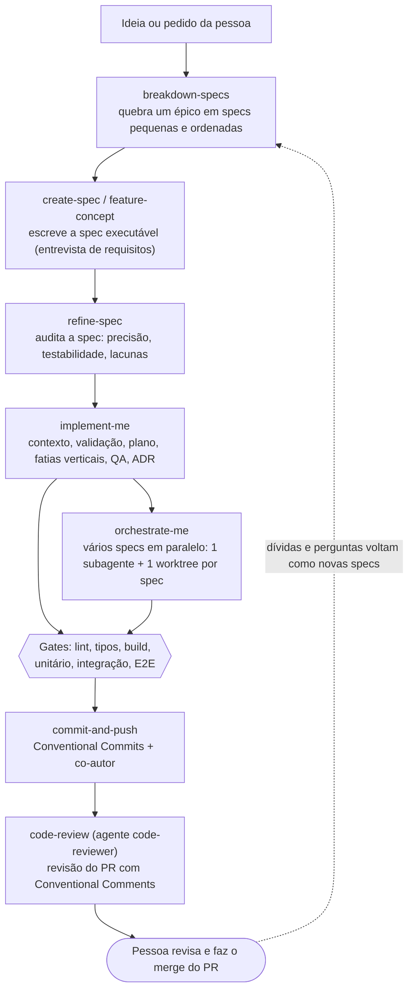
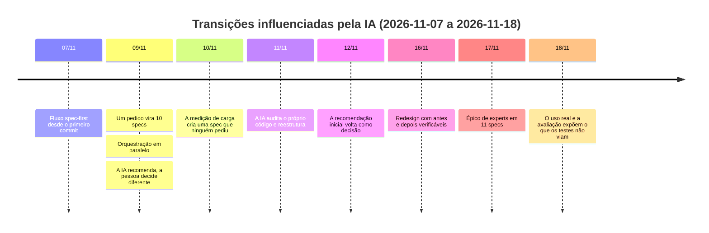

# AI_PROCESS.md — Como a IA foi usada para construir o Rondo

> **Público:** quem avalia o processo e a engenharia assistida por IA, e quem vai continuar o projeto.
> **Fonte dos números:** repositório git, `.specs/`, `.plans/`, `.adrs/` e os registros das duas execuções orquestradas, consultados em 2026-11-18 (antes dos commits desta entrega de documentação). Onde um dado vem de um registro local não versionado, isso está dito.
> **Leitura relacionada:** `EXPERTS.md` (a IA **dentro** do produto), `QUALITY.md` (como a IA é testada), `RULES.md` (regras de trabalho dos agentes).

Este documento trata de **dois papéis diferentes da IA** no projeto e mantém os dois separados:

1. **IA no produto:** os sete experts que respondem ao usuário. Está em `EXPERTS.md`.
2. **IA como ferramenta de engenharia:** agentes de código (Claude Code) que escreveram specs, código, testes, ADRs e documentação. É o assunto daqui.

## 1. Resumo

O projeto foi feito com **desenvolvimento orientado a especificação, assistido por agentes de código**. O princípio é: **a pessoa decide o quê e por quê; a IA executa o como, dentro de contratos que podem ser verificados** (spec, plano, gates, ADR). Nada vira "feito" sem comando executado e saída vista.

| Evidência no repositório                                   | Valor (2026-11-18)                                                            |
| ---------------------------------------------------------- | ----------------------------------------------------------------------------- |
| Período do histórico                                       | 2026-11-07 a 2026-11-18                                                       |
| Commits                                                    | 109, dos quais **97 com `Co-Authored-By: Claude`**                            |
| Pull requests integrados                                   | 13                                                                            |
| Specs executáveis em `.specs/`                             | 30 (0000 a 0029)                                                              |
| Planos em `.plans/`                                        | 31 (um por spec, mais o do `refactor-slices`)                                 |
| ADRs em `.adrs/` (decisões com alternativas)               | 30                                                                            |
| Skills do projeto em `.claude/skills/`                     | 19 (**9 autorais** do fluxo; 10 de terceiros, travadas em `skills-lock.json`) |
| Agente especializado em `.claude/agents/`                  | 1 (`code-reviewer`)                                                           |
| Specs implementadas por subagentes em execução orquestrada | 20 (9 na primeira execução, 11 na segunda)                                    |

## 2. O fluxo de trabalho



A pessoa entra em **três pontos**: define a ideia e responde as perguntas que a IA levanta (decisões de produto e de risco), revisa e integra cada PR, e executa o que só ela pode executar (chaves de API, aprovação visual, parecer jurídico).

### 2.1 As ferramentas (skills autorais)

| Skill             | Para que serve                                                                                                                                        | O que produz                                 | Criada em  |
| ----------------- | ----------------------------------------------------------------------------------------------------------------------------------------------------- | -------------------------------------------- | ---------- |
| `breakdown-specs` | Quebra um épico em specs pequenas, ordenadas e independentes, com mapa de dependências                                                                | `.plans/*-breakdown.md` + N specs            | 2026-11-09 |
| `create-spec`     | Transforma um pedido em spec executável: escopo, requisitos com critério de aceite, riscos, perguntas                                                 | `.specs/NNNN-*.md`                           | 2026-11-07 |
| `refine-spec`     | Audita e reescreve uma spec existente sem mudar a intenção                                                                                            | Spec refinada                                | 2026-11-07 |
| `feature-concept` | Entrevista aprofundada quando a ideia ainda é vaga                                                                                                    | Spec e plano                                 | 2026-11-07 |
| `implement-me`    | Executa uma spec de ponta a ponta: lê o contexto, valida lacunas, planeja, implementa em fatias verticais, roda o QA, escreve o ADR e relata          | Código, testes, plano, ADR, relatório        | 2026-11-07 |
| `orchestrate-me`  | Executa um intervalo de specs em paralelo: grafo de dependências, um subagente por spec em worktree próprio, lock de infraestrutura, merge sequencial | Branch de integração + relatório consolidado | 2026-11-09 |
| `commit-and-push` | Analisa tudo que mudou, escreve o commit em Conventional Commits com a IA como co-autora e publica                                                    | Commit rastreável                            | 2026-11-07 |
| `code-review`     | Revisa um PR do GitHub com o agente `code-reviewer` e publica a revisão (blocking ou issue pedem mudanças; nunca revisão neutra)                      | Comentários inline + resumo                  | 2026-11-11 |
| `refactor-slices` | Audita e refatora vertical slices para a arquitetura em camadas (um use case e um handler por endpoint)                                               | Refatoração + PR (ADR `0014`)                | 2026-11-11 |

As skills de terceiros (`frontend-design`, `shadcn`, `playwright`, `tdd`, `web-design-guidelines` e outras) estão fixadas por hash em `skills-lock.json` para que o comportamento do agente seja reproduzível.

## 3. Contratos que mantêm a IA verificável

O risco de trabalhar com agentes é a **afirmação sem prova** ("está pronto", "os testes passam"). O projeto responde com regras escritas, que os agentes carregam a cada tarefa (`AGENTS.md`, `.docs/AGENTS.md`, `.docs/RULES.md`):

| Regra                                                                                   | Como aparece na prática                                                                                       |
| --------------------------------------------------------------------------------------- | ------------------------------------------------------------------------------------------------------------- |
| **Não invente comandos, scripts, dependências ou skills**; confira `package.json` antes | Cada relatório lista os comandos realmente executados                                                         |
| **Não afirme que executou** lint, testes ou build sem ter visto o resultado             | Os relatórios distinguem `pass`, `baseline` e **"não executado"**, com o motivo (ex.: "sem `OPENAI_API_KEY`") |
| Toda decisão de arquitetura vira **ADR com alternativas consideradas**                  | 30 ADRs, cada um com tabela de alternativas e "por que não"                                                   |
| Toda spec tem **escopo, não-objetivos, critérios de aceite e perguntas abertas**        | Lacuna reversível vira premissa registrada; lacuna irreversível (dados, segurança) para a execução            |
| **Dado sensível e LGPD** têm regra própria                                              | Telemetria sem conteúdo, isolamento por usuário, exclusão completa, aviso de privacidade (`BUSINESS.md` §10)  |
| **Escopo estrito** por spec; arquivos compartilhados só com mudança aditiva e mínima    | Reduz conflito de merge entre agentes em paralelo                                                             |

Os subagentes da execução orquestrada recebem um _briefing_ padronizado (`.claude/skills/orchestrate-me/references/subagent-brief.md`): não conversam com a pessoa, só mexem no próprio worktree, devolvem `blocked` em vez de improvisar quando a base está errada, só rodam testes que usam o Postgres sob um **lock de infraestrutura** e terminam com `commit-and-push`.

## 4. A orquestração em números

As duas execuções com `orchestrate-me` implementaram 20 specs por subagentes. Os dados abaixo vêm dos arquivos de status gravados por cada subagente (`.claude/orchestrate/<execução>/`, **não versionados**: são registro local de trabalho); o commit de cada spec é público no histórico.

**Primeira execução, 2026-11-09 (specs 0002 a 0010, autenticação):** 9 specs, todas integradas em `orchestrate/0002-0010` e no PR #4. Gates por spec: lint, tipos, build, unitário e integração `pass`; E2E `pass` onde aplicável.

**Segunda execução, 2026-11-17 e 2026-11-18 (specs 0019 a 0029, experts):** 11 specs, integradas em `orchestrate/0019-0029` e no PR #13.

| Spec   | Capacidade                   | Commit do subagente | Lint / tipos / build | Integração | E2E  |
| ------ | ---------------------------- | ------------------- | -------------------- | ---------- | ---- |
| `0019` | Chat com experts             | `def8105`           | pass                 | pass       | pass |
| `0020` | Histórico persistente        | `65805da`           | pass                 | pass       | pass |
| `0021` | Avatares pixel art           | `368a045`           | pass                 | n/a        | n/a  |
| `0022` | Weaviate e embeddings        | `532289e`           | pass                 | pass       | n/a  |
| `0023` | Conexão de arquivos          | `99af97f`           | pass                 | pass       | pass |
| `0024` | Respostas com fontes         | `855c441`           | pass                 | pass       | pass |
| `0025` | Gerenciar e excluir conexões | `18ce9dd`           | pass                 | pass       | pass |
| `0026` | Imagens                      | `9d89784`           | pass                 | pass       | pass |
| `0027` | Links (SSRF)                 | `a39edbc`           | pass                 | pass       | pass |
| `0028` | Áudio e vídeo                | `380dd74`           | pass                 | pass       | pass |
| `0029` | Observabilidade dos agentes  | `0b0d9fd`           | pass                 | pass       | pass |

(Na época, o teste unitário da API tinha 3 falhas conhecidas e declaradas como `baseline` em todas as specs; foram **corrigidas** nesta entrega, ver `QUALITY.md` §6.)

## 5. Linha do tempo: onde a IA mudou o rumo do projeto

Os 12 dias de histórico (2026-11-07 a 2026-11-18) têm **transições** em que a participação da IA mudou o que foi construído, a ordem ou a forma. Cada linha abaixo aponta o commit, o ADR ou a spec que prova, e diz quem decidiu.



| #   | Data       | Transição                                          | O que a IA fez                                                                                                                                                                                                                                                                                                    | Como o rumo mudou                                                                                                                                                                      | Quem decidiu                                                                          | Evidência                                               |
| --- | ---------- | -------------------------------------------------- | ----------------------------------------------------------------------------------------------------------------------------------------------------------------------------------------------------------------------------------------------------------------------------------------------------------------- | -------------------------------------------------------------------------------------------------------------------------------------------------------------------------------------- | ------------------------------------------------------------------------------------- | ------------------------------------------------------- |
| 1   | 2026-11-07 | **O fluxo nasce com a IA**                         | As skills `create-spec`, `refine-spec`, `feature-concept`, `implement-me` e `commit-and-push` já estão no **primeiro commit**, junto com a fundação do monorepo (spec `0000`)                                                                                                                                     | Nenhuma funcionalidade entra sem spec, plano e relatório: o processo é orientado a especificação desde o dia 1, não foi adaptado depois                                                | A pessoa definiu o fluxo                                                              | `227e0ad`, `.specs/0000-fundation.md`                   |
| 2   | 2026-11-09 | **De uma spec por vez para o paralelo**            | Um pedido ("fluxo de autenticação completo") foi quebrado por `breakdown-specs` em 10 specs com mapa de dependências; **no mesmo dia** nasceu a skill `orchestrate-me` para executá-las em paralelo, um subagente e um worktree por spec                                                                          | 9 specs de autenticação foram implementadas e integradas num único dia, em vez de em sequência. A integração achou o que cada spec isolada não via (`10c6fbf`: rota pública duplicada) | A pessoa pediu o fluxo; o processo de execução foi proposto pela IA e aceito no PR #4 | `d7f3ee3`, `1c67cb7`, `.plans/auth-breakdown.md`, PR #4 |
| 3   | 2026-11-09 | **A IA recomenda; a pessoa decide diferente**      | Recomendou conexão direta ao Postgres (`pg`). A pessoa escolheu `supabase-js` com funções SQL. A IA **não impôs**: registrou a decisão, a alternativa recusada e o motivo                                                                                                                                         | O acesso a dados seguiu a decisão da pessoa; a recomendação ficou documentada como alternativa, o que permitiu revisitar a escolha com fatos três dias depois (linha 6)                | **A pessoa** ("o solicitante decidiu")                                                | ADR `0008`, spec `0004` §11                             |
| 4   | 2026-11-10 | **A medição cria uma spec que ninguém pediu**      | Instrumentou a API (métricas, traces, logs) e criou testes de carga com k6. O teste mostrou que o argon2id saturava o pool de threads: teto de ~33 hashes/s; `jwtVerify` foi de 0,3 ms a 1.252 ms; p95 de `session` chegou a 12,8 s                                                                               | Nasceu a spec `0015` (limitador de hashes e limite de sign-in por IP). Depois dela, 61 sign-ins de um IP: 60 passam e os 7.454 seguintes recebem `429`                                 | A pessoa aprovou no PR #7                                                             | ADR `0013`, spec `0015`, `a101eef`, `c4e5caf`           |
| 5   | 2026-11-11 | **A IA audita o próprio código**                   | Criou a skill `refactor-slices` e a aplicou ao código escrito dias antes: achou um controller com 8 rotas e 7 casos de uso, um controller falando direto com a infraestrutura e um guard decidindo regra na borda HTTP                                                                                            | Reestruturação para um _request handler_ por endpoint e um caso de uso por fluxo; hoje um teste de fronteira impede a regressão                                                        | A pessoa aprovou no PR #8                                                             | ADR `0014`, `2441f3a`, `d735afa`                        |
| 6   | 2026-11-12 | **A recomendação inicial volta como decisão**      | A spec `0016` substitui o Supabase por Postgres nativo com `pg`: o ambiente pedia ~10 contêineres, chaves e JWT de plataforma que o produto não usava e uma superfície HTTP (PostgREST) que só existia para justificar a RLS                                                                                      | O que era recomendação teórica no dia 9 virou custo concreto no dia 12, e a decisão foi revertida com o registro das duas fases                                                        | **A pessoa** (a spec tem o "Solicitante" como dono)                                   | ADR `0015`, spec `0016`, `027320c`                      |
| 7   | 2026-11-16 | **O redesign vira comparação verificável**         | Usou o Playwright para capturar **54 imagens** de "antes" e "depois" de todas as telas (inclusive mobile e escuro) e as skills `frontend-design`, `web-design-guidelines` e `shadcn`; os achados das revisões foram corrigidos                                                                                    | Uma decisão de gosto ("retro 8-bit, futebol, Brasil") passou a ser revisável tela a tela, e o tema escuro entrou no escopo                                                             | **A pessoa** definiu a direção visual (dona: Produto/Design); a IA executou           | spec `0018`, `.screenshots/`, PR #12                    |
| 8   | 2026-11-17 | **Um épico em 11 specs, com decisões estruturais** | `breakdown-specs` quebrou "experts com conhecimento próprio" em 11 specs com dependências e regra de paralelismo; cada decisão estrutural saiu num ADR com alternativas (LangGraph como biblioteca, tenant por usuário, citações do servidor)                                                                     | A home deixou de ser decorativa (`HOME.md`); o isolamento de dado sensível virou **estrutural** em vez de um filtro que um erro poderia esquecer                                       | A pessoa aprovou no PR #13 e escolheu o paralelo (ver §6)                             | ADRs `0020` a `0030`, `b70071e`                         |
| 9   | 2026-11-17 | **A integração descobre o que cada spec não via**  | Os gates rodados na **integração** acharam um teste de fronteira que impedia o LangGraph (`d50023d`) e uma corrida entre duas specs (`5b667ee`); num merge com conflito semântico a IA **abortou** e devolveu ao subagente dono, e a spec seguinte foi resolvida contra a base já atualizada, em vez de adivinhar | "Gate também na integração" e "conflito semântico volta ao dono" viraram prática da orquestração                                                                                       | A IA, dentro das regras da skill                                                      | `d50023d`, `5b667ee`, `380dd74`, `a39edbc`              |
| 10  | 2026-11-18 | **O uso real vence o teste**                       | A **pessoa** rodou a API e achou o erro de `WEAVIATE_URL`; a IA achou a causa raiz (o `ConfigModule` só expõe o objeto do validador) e que os testes injetavam as variáveis num atalho. Na mesma data, tratou os 3 testes de sessão "em baseline" como defeito real e corrigiu a causa                            | Mudou a postura: **testar o caminho real de configuração** e **não aceitar "baseline" como estado normal**                                                                             | A pessoa percebeu o sintoma; a IA corrigiu a causa                                    | `dd73b82`, `b25aab3`, `TESTING.md` §7                   |
| 11  | 2026-11-18 | **A avaliação faz a evidência virar entregável**   | A avaliação do projeto pediu documentação e evidências; a IA produziu os documentos e **capturas reproduzíveis do produto real**, e nelas descobriu o defeito de layout (botões cobrindo a conversa), que os testes não pegavam                                                                                   | Evidência passou a ser uma saída do processo, não um texto escrito no fim                                                                                                              | A pessoa pediu; a IA executou e corrigiu                                              | PR #14, `669d036`                                       |

### 5.1 Quatro padrões de influência da IA

Olhando as 11 transições, a IA influenciou o projeto de quatro formas, e **nenhuma delas é "a IA decide"**:

1. **Escalar o processo.** Skills e orquestração mudaram o ritmo (linhas 1, 2 e 8): uma spec por vez virou um grafo de specs em paralelo.
2. **Medir e propor.** Instrumentação e testes de carga produziram evidência que gerou trabalho novo (linha 4) e que justificou uma reversão (linha 6).
3. **Auditar o próprio trabalho.** A IA revisou o que ela mesma escreveu e o reestruturou (linha 5) ou o corrigiu depois de uso real (linhas 9 e 10).
4. **Registrar a divergência.** Quando a pessoa decidiu diferente da recomendação (linha 3), a IA documentou as duas posições. Foi esse registro que tornou possível, três dias depois, decidir com dados (linha 6).

Em todas, **a decisão final foi humana**: aprovação no PR, resposta a uma pergunta da spec ou escolha explícita.

## 6. Como a IA influenciou as decisões, e quem decidiu

A IA **propôs e documentou alternativas**; a pessoa **aprovou ao integrar o PR** ou **decidiu explicitamente** quando a escolha era dela. Os casos abaixo mostram as duas coisas.

| Decisão                                                                                                                           | O que a IA levantou                                                                                                                                                                          | Quem decidiu e como                                                                                                                        | Registro                                   |
| --------------------------------------------------------------------------------------------------------------------------------- | -------------------------------------------------------------------------------------------------------------------------------------------------------------------------------------------- | ------------------------------------------------------------------------------------------------------------------------------------------ | ------------------------------------------ |
| LangGraph.js como **biblioteca** na API (sem Platform e sem LangSmith)                                                            | Comparou 5 alternativas (SDK direto, LangChain sem grafo, LangGraph Platform, `streamMode: "messages"`, `EventSource`) com prós, contras e razão da recusa                                   | A pessoa aprovou ao integrar o PR #13; dado do usuário não sai para serviço externo de observabilidade                                     | ADR `0021`                                 |
| **Isolamento por tenant** no Weaviate, não por filtro                                                                             | Comparou `pgvector`, coleção por usuário, coleção única com filtro e vetorizador do servidor; apontou que um erro de filtro vazaria dado de saúde                                            | A pessoa aprovou no PR #13 (dado sensível e LGPD estavam no escopo da spec)                                                                | ADR `0020`                                 |
| **Histórico no servidor**, removendo o `history` enviado pelo cliente                                                             | A spec `0019` recebia o histórico do cliente; a `0020` persistiu a conversa no banco e removeu o `history` do corpo (hoje é `400`), de modo que o cliente não reescreve o contexto do modelo | Decisão da spec `0020`, aprovada no PR #13                                                                                                 | ADR `0023`, `ARCHITECTURE.md` §4.8         |
| **Citações montadas pelo servidor**, não escritas pelo modelo                                                                     | Propôs que o modelo nunca escreva fonte nem página, para que as fontes sejam verificáveis                                                                                                    | Aprovada no PR #13                                                                                                                         | ADR `0025`                                 |
| **Política de saída de rede** para links (SSRF)                                                                                   | Listou 7 alternativas; recusou validar só o texto da URL e rejeitou lista de exceção interna "em qualquer ambiente"; recomendou revisão de segurança antes do release                        | Aprovada no PR #13; **revisão de segurança humana segue pendente**                                                                         | ADR `0030`                                 |
| Executar as specs `0026` a `0029` **em paralelo**                                                                                 | O mapa do épico recomendava uma por vez, porque as quatro mexem nos mesmos arquivos; a IA expôs o custo (conflitos semânticos) e perguntou                                                   | **A pessoa escolheu paralelo.** Consequência real: 0028 e 0027 tiveram conflitos semânticos, devolvidos aos subagentes donos para resolver | Mapa em `.plans/experts-breakdown.md`      |
| Premissas de **Produto e Jurídico** (sem expiração automática; excluir fonte mantém o histórico; voz e imagem podem ir ao Gemini) | A IA registrou cada uma como "premissa" e como pergunta aberta, sem decidir                                                                                                                  | **A pessoa confirmou** em 2026-11-18 ("da forma sugerida"). Não é parecer formal do Jurídico, e está escrito assim nas specs               | Changelog das specs `0020`, `0025`, `0028` |
| **Avatares dos experts**                                                                                                          | A IA construiu a ferramenta e **não gerou imagem sem chave**, deixando a geração como pendência explícita                                                                                    | **A pessoa gerou** os 7 avatares com a própria chave e os **aprovou** antes de entrarem no repositório                                     | ADR `0022`, spec `0021`                    |

## 7. Quando a IA errou, e como o processo pegou

Evidenciar o uso da IA inclui mostrar onde ela falhou. Os casos abaixo são reais e têm commit.

| O que deu errado                                                                                             | Quem ou o que percebeu                                                                                  | O que aconteceu depois                                                                                      | Referência                   |
| ------------------------------------------------------------------------------------------------------------ | ------------------------------------------------------------------------------------------------------- | ----------------------------------------------------------------------------------------------------------- | ---------------------------- |
| Os worktrees dos subagentes foram criados de uma base sem as specs                                           | O próprio subagente, na verificação de base do briefing                                                 | Ele devolveu `blocked` em vez de "consertar" a base; a execução foi relançada com a base certa              | Briefing, "Antes de começar" |
| O teste de fronteira da `0022` proibia `@langchain/*` fora do módulo `knowledge`, mas a `0019` usa LangGraph | Gate de unitário **na integração** (cada spec passava sozinha)                                          | Teste ajustado: Weaviate segue restrito; LangChain liberado só onde o grafo vive                            | `d50023d`                    |
| Os testes de anexos da `0023` interagiam antes de o compositor da `0020` habilitar                           | 12 testes falharam **após o merge** das duas specs                                                      | Helper de teste passou a aguardar o compositor habilitar                                                    | `5b667ee`                    |
| Conflitos **semânticos** (19 arquivos) entre `0028` e `0026`, e depois com a `0027`                          | Merge na integração                                                                                     | O orquestrador **abortou** o merge e devolveu a cada subagente dono, que tinha o contexto das duas mudanças | `380dd74`, `a39edbc`         |
| A API não subia com `WEAVIATE_URL` no `.env`                                                                 | **A pessoa**, ao rodar `bun run dev`. Os testes injetavam as variáveis direto no ambiente e não pegavam | Causa raiz corrigida (`loadEnvironment`) com teste de regressão                                             | `dd73b82`                    |
| Botões flutuantes cobrindo a conversa em 375 px                                                              | **Inspeção das capturas de tela** produzidas para a documentação                                        | Botões movidos para o fluxo do compositor                                                                   | `HOME.md` §7                 |
| Documentação desatualizada: README dizia "features de produto ainda não existem"; `AGENTS.md` idem           | **A avaliação do projeto**                                                                              | README, `AGENTS.md`, `ARCHITECTURE.md` e `QA.md` reescritos; quatro documentos novos                        | Esta entrega                 |
| Interrupções: 1 travamento de subagentes e 2 pausas por limite de uso                                        | A pessoa (travamento) e a notificação dos subagentes (limite)                                           | Trabalho parcial preservado nos worktrees; subagentes retomados sem refazer                                 | —                            |

O padrão que se repete: **a IA acerta mais quando existe um gate objetivo** (teste, `axe`, merge limpo) e **erra mais onde só um humano ou um uso real percebe** (o `.env` do desenvolvedor, a aparência de uma tela). Por isso o projeto separa o que se prova por teste do que depende de pessoa (`QUALITY.md` §3.2).

## 8. Como auditar este processo você mesmo

```powershell
git log --format=%B | Select-String -Pattern "co-authored-by: claude" | Measure-Object   # commits com a IA como co-autora
git log --oneline --merges                                                                 # os PRs integrados
Get-ChildItem .adrs                                                                        # decisões com alternativas
Get-Content .specs\0024-experts-grounded-answers.md                                        # uma spec: escopo, requisitos, premissas, changelog
Get-Content .claude\skills\orchestrate-me\SKILL.md                                         # o contrato da orquestração
```

Cada spec termina com um **histórico de alterações** (data, o que mudou, por quê) e cada verificação por spec está em `QA.md` §1, com data, comandos e resultado real.

## 9. Limites do que este documento prova

- Os arquivos de status e relatórios das execuções orquestradas ficam em `.claude/orchestrate/` (não versionado). O que está versionado e auditável é o histórico git, as specs (com changelog), os planos, os ADRs e `QA.md`.
- "A pessoa aprovou ao integrar o PR" é a evidência de decisão **onde não há um registro mais explícito**; as decisões marcadas como explícitas estão nos changelogs das specs.
- A quantidade de commits com co-autoria da IA mede **autoria assistida**, não "percentual de código escrito por IA".
