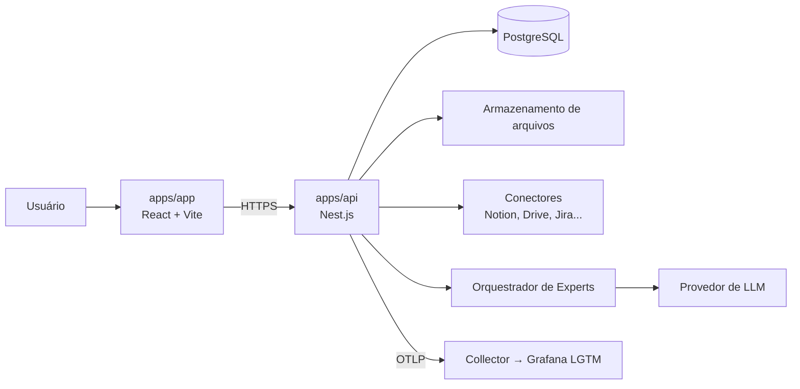

# Arquitetura

> **Público:** agentes de código e pessoas que precisam alterar estrutura, stack ou integrações.
> **Verificado contra o código em:** 2026-11-09.
> Leia `BUSINESS.md` para o contexto de produto e `DEVELOPMENT.md` para as regras de código.

## 1. Visão em uma frase

Monorepo que entrega uma SPA (`apps/app`) para operar experts de futebol, apoiada por uma API Nest.js (`apps/api`), Postgres local (Docker) e observabilidade Grafana LGTM. A fundação técnica (spec `0000-foundation`), a autenticação completa (specs `0002` a `0010`), a identidade visual retro 8-bit (spec `0018`) e o chat com sete experts de IA, com conhecimento conectado pela pessoa (arquivos, imagens, links, áudio e vídeo), respostas com fontes e observabilidade dos agentes (specs `0019` a `0029`) estão implementados. Para entender os agentes, leia `EXPERTS.md`.

## 2. Estado atual (implementado)

| Caminho                        | O que é                                                                                     | Estado                                                                                                                                                                                                                                                                                                                                                                                                                                                                                                                                                             |
| ------------------------------ | ------------------------------------------------------------------------------------------- | ------------------------------------------------------------------------------------------------------------------------------------------------------------------------------------------------------------------------------------------------------------------------------------------------------------------------------------------------------------------------------------------------------------------------------------------------------------------------------------------------------------------------------------------------------------------ |
| `apps/app`                     | Cliente de produto em React + Vite (porta 5173)                                             | TanStack Router: `/` → `/app` (home de chat com experts, `features/experts/`), grupos `/auth/*` e `/app/*`, 404; `QueryClientProvider`; páginas `/auth/sign-in`, `/auth/sign-up`, `/auth/forgot-password`, `/auth/confirm-account`, `/auth/resend-confirmation` e `/auth/reset-password` (`features/auth/`) e `lib/api-client.ts`; `/app/*` exige sessão (guard) e a home é o chat com os experts (spec `0019`; cabeçalho com tema e sign-out), com `lib/stream-client.ts` (POST + SSE)                                                                            |
| `apps/api`                     | API Nest.js (porta 3002)                                                                    | Prefixo `/api/v1`, `GET /api/v1/health`, envelope de erro, CORS (`APP_URL`); env validada; OTel; logs JSON; `POST /api/v1/auth/sign-up`, `POST /api/v1/auth/sign-in`, `POST /api/v1/auth/forgot-password`, `POST /api/v1/auth/confirm-account`, `POST /api/v1/auth/resend-confirmation` e `POST /api/v1/auth/reset-password` (`modules/auth`); **fechada por padrão**: `AuthGuard` global, `@Public()`, `GET /api/v1/auth/session`, `POST /api/v1/auth/sign-out`; `GET /api/v1/experts` e `POST /api/v1/experts/:expertId/messages` (SSE; `modules/experts`, §4.8) |
| `apps/docs`                    | Site de documentação em Next.js (porta 3001)                                                | Página inicial com a identidade do `@repo/ui` (Tailwind v4 por `@tailwindcss/postcss`, tokens e tema compartilhados)                                                                                                                                                                                                                                                                                                                                                                                                                                               |
| `packages/ui`                  | `@repo/ui`: Tailwind v4 + shadcn, tokens de `DESIGN.md`                                     | `Button`, `Input`, `Label`, `PasswordInput`, `Card`, `Alert`, `Field`, `Spinner`, `ThemeToggle`, ícones, campo em pixel e logos; tokens em dois temas e fontes auto-hospedadas; exports em `packages/ui/package.json`                                                                                                                                                                                                                                                                                                                                              |
| `packages/experts-avatars`     | `@repo/experts-avatars`: ferramenta manual dos avatares pixel art dos experts (spec `0021`) | `characters.ts` (fichas e prompts), cliente da Image API (`gpt-image-2`, `fetch`), normalização (`pngjs` + PNG indexado), geração em lote e CLI; entrada em `scripts/experts-avatars.ts` (`bun run experts:avatars`); só na máquina de quem desenvolve; ADR `0022`                                                                                                                                                                                                                                                                                                 |
| `packages/typescript-config`   | tsconfig base (`strict`, `noUncheckedIndexedAccess`)                                        | `base`, `nestjs`, `nextjs`, `vite`, `react-library`                                                                                                                                                                                                                                                                                                                                                                                                                                                                                                                |
| `db/`                          | Postgres local: `migrations/` (SQL aplicado por `scripts/db-migrate.ts`) e `init/` (roles)  | Migrations `users`/`auth_tokens` (funções `auth_sign_up`, `auth_request_password_reset` e `auth_reset_password`), `sessions` (função `auth_issue_session`) e `expert_conversations`/`expert_messages` (função `expert_append_message`, spec `0020`); roles `rondo_migrator` (DDL) e `rondo_app` (DML e `execute`)                                                                                                                                                                                                                                                  |
| `docker-compose.yml`, `infra/` | Postgres, Weaviate, Grafana, Loki, Tempo, Mimir e OTel Collector                            | Datasources (com link log → trace e trace → logs) e dashboard "Rondo — Observabilidade da API" provisionado                                                                                                                                                                                                                                                                                                                                                                                                                                                        |
| `scripts/`                     | `infra:up`, `infra:down`, `db:migrate` (Bun)                                                | Funcionais                                                                                                                                                                                                                                                                                                                                                                                                                                                                                                                                                         |
| `e2e/`, `playwright.config.ts` | Testes E2E                                                                                  | Rotas `/`, 404, `/auth/sign-in`, `/auth/sign-up`, `/auth/forgot-password`, `/auth/confirm-account`, `/auth/resend-confirmation` e `/auth/reset-password` (app e API reais, e-mail em `capture`)                                                                                                                                                                                                                                                                                                                                                                    |

```text
apps/
  app/    src/ (App.tsx, main.tsx, router.tsx, routes/, features/auth/, lib/api-client.ts, test/)
  api/    src/ (main.ts, bootstrap.ts, app.module.ts, common/, config/, health/, modules/{auth,email,rate-limit}/, observability/) + test/
  docs/   app/ (rotas, layout, CSS Modules)
packages/
  ui/                 src/{button,input,label}.tsx, src/styles.css, src/lib/utils.ts, components.json
  experts-avatars/    src/{characters,image-client,normalize,png,generate,cli}.ts (ferramenta de dev; sem build)
  typescript-config/  base.json, nestjs.json, nextjs.json, vite.json, react-library.json
```

**Não existem hoje:** modelo de domínio além de `users`, `auth_tokens` e `sessions`, refresh token e bloqueio de conta por falhas, storage do arquivo original (só vetores e metadados são guardados), CD e deploy. Há um CI mínimo (`.github/workflows/ci.yml`: lint, tipos, build e testes unitários com piso de cobertura); integração e E2E rodam localmente porque exigem Docker. Os experts respondem por um grafo LangGraph.js de dois nós (`retrieve` e `respond`), com recuperação de fontes e citações montadas pelo servidor; a conversa de cada par (usuário, expert) é persistida.

### 2.1 Portas

| Serviço                | Porta                                    |
| ---------------------- | ---------------------------------------- |
| `apps/app` (Vite)      | 5173                                     |
| `apps/docs` (Next.js)  | 3001                                     |
| `apps/api` (Nest.js)   | 3002                                     |
| Grafana                | 3000                                     |
| Loki / Tempo / Mimir   | 3100 / 3200 / 9009                       |
| OTel Collector (OTLP)  | 4317 (gRPC), 4318 (HTTP), 13133 (health) |
| Postgres               | 5432                                     |
| Weaviate (HTTP / gRPC) | 8080 / 50051, só em `127.0.0.1`          |

## 3. Stack

### 3.1 Instalada e utilizável

| Camada                          | Tecnologia                                                                                                                            | Versão (lockfile)               | Observação                                                                                                                                                                                                                                                                           |
| ------------------------------- | ------------------------------------------------------------------------------------------------------------------------------------- | ------------------------------- | ------------------------------------------------------------------------------------------------------------------------------------------------------------------------------------------------------------------------------------------------------------------------------------ |
| Runtime                         | Node.js                                                                                                                               | >= 24                           | `engines` da raiz                                                                                                                                                                                                                                                                    |
| Package manager                 | Bun                                                                                                                                   | 1.4.4                           | `devEngines` da raiz                                                                                                                                                                                                                                                                 |
| Monorepo                        | Turborepo                                                                                                                             | 2.11.10                         | `turbo.json`                                                                                                                                                                                                                                                                         |
| Cliente                         | React + Vite                                                                                                                          | 19.3.1 / 8.3.6                  | `apps/app`; ADR 0001                                                                                                                                                                                                                                                                 |
| Docs                            | Next.js                                                                                                                               | 16.4.5                          | `apps/docs`, App Router                                                                                                                                                                                                                                                              |
| API                             | Nest.js                                                                                                                               | 12.4.0                          | `apps/api`; `class-validator` para DTOs                                                                                                                                                                                                                                              |
| Linguagem                       | TypeScript                                                                                                                            | 6.0.3                           | Config base estrita                                                                                                                                                                                                                                                                  |
| Estilo                          | TailwindCSS (CSS-first) + shadcn/ui                                                                                                   | 4.3.5                           | Tokens em `packages/ui/src/tokens.css` (CSS puro) e `styles.css`; dark mode por `data-theme` (ADR 0018); fontes Press Start 2P, Geist e Geist Mono auto-hospedadas (ADR 0019)                                                                                                        |
| Dados no cliente                | TanStack Query                                                                                                                        | 5.107.1                         | Provider e hooks de dados (Table, Charts e `date-fns` saíram em 2026-11-18, sem uso)                                                                                                                                                                                                 |
| Roteamento                      | TanStack Router                                                                                                                       | 1.170.46                        | `apps/app`; rotas em código (`router.tsx`); ADR 0003                                                                                                                                                                                                                                 |
| JWT                             | jose                                                                                                                                  | 6.2.17                          | `apps/api`, HS256; ver §4.7 e ADR da spec `0005`                                                                                                                                                                                                                                     |
| Banco de dados                  | PostgreSQL 17 (Docker) + `pg` (node-postgres)                                                                                         | 17 / 8.23.1                     | `apps/api`: Pool, SQL parametrizado e migrations próprias (§4.6, ADR 0015); o SPA não acessa o banco                                                                                                                                                                                 |
| LLM e agentes                   | `@langchain/core` 1.4.1, `@langchain/openai` 1.8.4, `@langchain/langgraph` 1.7.5                                                      | 1.4.1 / 1.8.4 / 1.7.5           | `apps/api`, módulo `experts` (§4.8); `gpt-4o-mini`; LangGraph como biblioteca, sem Platform (ADR da spec `0019`); `langchain` (guarda-chuva) não instalado                                                                                                                           |
| Testes                          | Vitest 5.1.0, Supertest 7.3.1, Playwright 1.65.0                                                                                      | —                               | Ver `QA.md`                                                                                                                                                                                                                                                                          |
| Lint / format                   | OXLint 1.92.0, OXFmt 0.77.0                                                                                                           | —                               | ADR 0002                                                                                                                                                                                                                                                                             |
| Hooks                           | lefthook 2.2.2 + lint-staged 17.6.0                                                                                                   | —                               | Instalar com `bun run hooks:install`; validados no commit raiz                                                                                                                                                                                                                       |
| Observabilidade                 | OpenTelemetry SDK 0.301.0, pino 10.4.0                                                                                                | —                               | Traces, métricas e logs via OTLP HTTP                                                                                                                                                                                                                                                |
| Infra local                     | Docker Compose                                                                                                                        | —                               | Postgres 17, Weaviate, Grafana LGTM e OTel Collector; `scripts/` (`infra:up`, `db:migrate`)                                                                                                                                                                                          |
| Banco vetorial                  | Weaviate (Docker) + `weaviate-client` / `@langchain/weaviate`                                                                         | 1.40.5 / 3.15.3 / 1.1.0         | `apps/api/src/modules/knowledge`; um tenant por usuário; versão do servidor fixada (§4.8, ADR da spec `0022`)                                                                                                                                                                        |
| Ingestão de arquivos            | `@langchain/classic` (`DirectoryLoader`, `TextLoader`), `@langchain/community` (`PDFLoader`), `@langchain/textsplitters`, `pdf-parse` | 1.0.61 / 1.1.29 / 1.0.2 / 2.4.5 | `apps/api/src/modules/connections/infrastructure`; versões exatas (§4.10, ADR da spec `0023`)                                                                                                                                                                                        |
| Entendimento de mídia           | `@google/genai` (Gemini: Files API e `generateContent`)                                                                               | 3.4.0                           | `apps/api/src/modules/connections/infrastructure/gemini-client.ts` (o único arquivo que importa o SDK); só com `GEMINI_API_KEY`; modelo em `GEMINI_UNDERSTANDING_MODEL` (padrão `gemini-3.6-flash`); versão exata (§4.14, ADR `0029-gemini-para-entendimento-de-midia`, spec `0028`) |
| Ingestão de links (spec `0027`) | `html-to-text` (por baixo do `HtmlToTextTransformer` do `@langchain/community`), `node:http`/`node:https`/`node:dns`                  | 9.0.5                           | `apps/api/src/modules/connections/infrastructure`; versão exata; o HTML já baixado vira texto sem rede (§4.15, ADR da spec `0027`)                                                                                                                                                   |
| Embeddings                      | `@langchain/openai` (`text-embedding-3-small`)                                                                                        | 1.8.4 (`@langchain/core` 1.4.1) | `apps/api`; 1.536 dimensões, calculados pela aplicação; só com `OPENAI_API_KEY` (§4.8)                                                                                                                                                                                               |

### 3.2 Alvo (planejada, ainda não instalada)

| Camada | Tecnologia | Uso pretendido                |
| ------ | ---------- | ----------------------------- |
| Deploy | Vercel     | Apps e API (fora da fundação) |
| CI     | —          | Gates de `QA.md` em pipeline  |

**Regra:** só descreva como disponível o que estiver em `package.json` e puder ser executado. Ao instalar algo novo, atualize esta tabela e `QA.md`.

## 4. Arquitetura-alvo



`apps/app`, `apps/api`, o Postgres local e o pipeline de observabilidade existem como fundação. Conectores, orquestrador e LLM são **alvo**. Não crie imports, variáveis de ambiente ou chamadas para serviços que ainda não existem.

### 4.1 Limites entre partes

| Parte         | Pode importar                                 | Não pode importar                           |
| ------------- | --------------------------------------------- | ------------------------------------------- |
| `apps/app`    | `@repo/ui`, seus próprios `features/`, `lib/` | `apps/docs`, `apps/api`, código de servidor |
| `apps/docs`   | `@repo/ui`, seus próprios arquivos            | `apps/app`, `apps/api`                      |
| `apps/api`    | seus módulos, `src/modules/shared`            | `apps/app`, `apps/docs`                     |
| `packages/ui` | React e utilitários de apresentação           | apps, regras de negócio, clients de API     |
| `packages/*`  | outros pacotes compartilhados                 | apps                                        |
| `domain`      | apenas TypeScript                             | framework, banco, HTTP, SDKs                |

### 4.2 Backend: camadas + vertical slices

Cada domínio é uma fatia vertical em `apps/api/src/modules/<dominio>/`, com as quatro camadas dentro dela:

| Camada           | Responsabilidade                                     | Exemplos                                                     |
| ---------------- | ---------------------------------------------------- | ------------------------------------------------------------ |
| `domain`         | Entidades, value objects, regras, ports (interfaces) | `Expert`, `Connector`, `Demand`                              |
| `application`    | Casos de uso e orquestração                          | `CreateExpert`, `AskExpert`                                  |
| `infrastructure` | Implementações concretas dos ports                   | Repositórios Postgres, clients de conectores, LLM, filas     |
| `interface`      | Entrada/saída HTTP                                   | Request handlers (um por endpoint), DTOs, presenters, guards |

**Request handler por endpoint (ADR `0014`):** cada endpoint tem uma classe em `interface/request-handlers/<fluxo>.request-handler.ts` que injeta exatamente um caso de uso de `application/use-cases/<fluxo>.use-case.ts` (uma classe, um `execute`); o handler declara rota e decorators de borda, valida o DTO, traduz erros de domínio em `ApiException` e apresenta a resposta com um presenter. Serviços de capacidade reutilizável (`SessionService`, `EmailService`) ficam em `application/services/` e nunca representam um fluxo. Exemplo: `SignInRequestHandler` injeta `SignIn`, chama `execute({ email, password })`, mapeia `InvalidCredentialsError` em `401 INVALID_CREDENTIALS` e responde com `presentSession`.

Hoje `apps/api/src` tem só `bootstrap.ts`, `common/` (envelope de erro, filtro e validação), `config/`, `health/`, `modules/email/` (spec `0002`), `modules/rate-limit/` (spec `0003`), `modules/auth/` (spec `0004`) e `observability/`. Código compartilhado entre fatias vive em `apps/api/src/modules/shared` **somente** quando for estável e usado por dois ou mais módulos. Não crie `shared` preventivamente.

### 4.3 Frontend: composição

```text
apps/app/
  src/
    features/<dominio>/   # componentes, hooks e chamadas da fatia (a criar)
    lib/                  # clients, configuração e utilitários
    router.tsx, routes/   # árvore de rotas (grupos /auth e /app), layouts e páginas de composição
    main.tsx, App.tsx
```

- `App.tsx` compõe; não concentra regra de negócio.
- `features/<dominio>/` é a fatia vertical do frontend, criada junto com a primeira feature.
- Primitivos visuais vivem em `packages/ui`; composições específicas ficam na feature.
- O cliente é uma SPA: o browser fala com a API (`VITE_API_URL`); segredos nunca entram no bundle. Só variáveis `VITE_*` são públicas.

### 4.4 Observabilidade

A API carrega `observability/telemetry.ts` antes do Nest (`import` na primeira linha de `main.ts`) e exporta traces, métricas e logs por OTLP HTTP ao Collector (`OTEL_EXPORTER_OTLP_ENDPOINT`), que encaminha para Tempo, Mimir e Loki. Exportação é em lote com timeout (`OTEL_EXPORTER_OTLP_TIMEOUT`); se o Collector cair, a API continua respondendo.

Regras já aplicadas e que devem ser mantidas:

- Log por request via `pino-http` com `requestId` (aceita `x-request-id` ou gera UUID e devolve no header).
- O log de request registra **apenas** `id`, método, path (sem query string) e status. Não registre headers, IP, query ou corpo.
- O SDK não usa detectores de host/processo (`resourceDetectors: []`), para não exportar nome da máquina nem caminhos locais.
- O Postgres local roda no mesmo Compose (`postgres:17-alpine`, volume `postgres-data`) e o Collector só sobe depois dele (`depends_on`). Logs da API vão para o LGTM.

**Catálogo de sinais (spec `0011`, ADR `0010`).** As métricas ficam em **push OTLP**: não existe `GET /metrics` nem raspagem. Os nomes e labels abaixo são contrato dos dashboards em `infra/grafana/dashboards/` (`api-observability.json`); mudar um deles exige mudar o dashboard e o teste `grafana-assets.spec.ts`.

| Sinal   | Nome (no backend)                                                                                                                                                                                                                                                                                                                              | Dimensões / campos                                                                                                                                           | Onde nasce                                                                                                                    |
| ------- | ---------------------------------------------------------------------------------------------------------------------------------------------------------------------------------------------------------------------------------------------------------------------------------------------------------------------------------------------- | ------------------------------------------------------------------------------------------------------------------------------------------------------------ | ----------------------------------------------------------------------------------------------------------------------------- |
| Métrica | `http_server_request_duration_seconds_*` (automática)                                                                                                                                                                                                                                                                                          | `http_route` (template da rota ou `unmatched`), `http_request_method`, status                                                                                | `observability/http-route.ts`, primeiro middleware de `configureApp` (antes do CORS, para cobrir o preflight)                 |
| Métrica | `auth_operations_total` (contador `auth.operations`)                                                                                                                                                                                                                                                                                           | `operation`, `outcome` (`success`/`failure`), `reason`                                                                                                       | `modules/auth/interface/auth-telemetry.middleware.ts`: uma contagem por tentativa, quando a resposta termina                  |
| Métrica | `auth_operation_duration_seconds_*` (histograma `auth.operation.duration`)                                                                                                                                                                                                                                                                     | `operation`, `outcome`                                                                                                                                       | o mesmo middleware                                                                                                            |
| Métrica | `auth_hash_active` e `auth_hash_queued` (gauges), `auth_hash_queue_wait_seconds_*` (histograma), `auth_hash_rejected_total` (contador)                                                                                                                                                                                                         | sem labels                                                                                                                                                   | `modules/auth/infrastructure/hash-limiter.ts` (`HashLimiter`)                                                                 |
| Span    | `auth.<operation>`, filho do span HTTP                                                                                                                                                                                                                                                                                                         | `auth.operation`, `auth.outcome`, `auth.error_code` (só na falha); status `ERROR` na falha                                                                   | `traceAuthOperation` (`observability/auth-telemetry.ts`), chamado pelo request handler do fluxo em volta do caso de uso       |
| Log     | `event: "auth_operation"` (nível `info` no sucesso, `warn` na falha)                                                                                                                                                                                                                                                                           | `operation`, `outcome`, `reason`, `requestId`, mais `trace_id` e `span_id` do pino                                                                           | o mesmo middleware                                                                                                            |
| Métrica | `db_client_operation_duration_seconds_*` (histograma `db.client.operation.duration`)                                                                                                                                                                                                                                                           | `db_operation_name`, `db_collection_name` (tabela) ou `db_stored_procedure_name` (função SQL), `error_type` (só em falha)                                    | `observability/db-telemetry.ts`: wrapper `DatabaseClient` do Pool `pg`, criado no `auth.module`                               |
| Span    | `<operação> <tabela ou função>` (CLIENT), filho do span ativo (`auth.*`)                                                                                                                                                                                                                                                                       | `db.system.name`, `db.operation.name`, `db.collection.name` ou `db.stored_procedure.name`, `db.response.status_code`, `error.type`; `ERROR` só em 5xx e rede | o mesmo `fetch`                                                                                                               |
| Span    | `expert.message` (spec `0019`), filho do span HTTP; atributos `expert.id`, `expert.outcome`, `expert.reason` e `expert.tokens.input`/`output`; sem conteúdo de mensagem                                                                                                                                                                        |
| Log     | `event: "expert_message"` (`info`; `warn` na falha): `expertId`, `outcome` (`success`, `failure`, `aborted`), `reason`, `durationMs`, `inputTokens`, `outputTokens`, `requestId`; nunca mensagem, `history`, prompt ou chave                                                                                                                   |
| Log     | `event: "db_operation_failed"` (`warn`)                                                                                                                                                                                                                                                                                                        | `operation`, `collection` ou `procedure`, `errorType`, mais `trace_id` e `span_id`                                                                           | o mesmo `fetch`, só em 5xx e falha de rede                                                                                    |
| Métrica | `postgresql_*` (`job="rondo-postgres"`): `postgresql_backends`, `postgresql_connection_max`, `postgresql_commits_total`, `postgresql_rollbacks_total`, `postgresql_deadlocks_total`, `postgresql_blocks_read_total`, `postgresql_db_size_bytes`, `postgresql_rows`, `postgresql_table_size_bytes`, `postgresql_database_locks`                 | `database`, `table` (`schema.tabela`), `state`, `source`, `operation`, `mode`                                                                                | OTel Collector, receiver `postgresql` (`infra/otel/otel-collector-config.yaml`)                                               |
| Métrica | `knowledge_index_operation_duration_seconds_*` (histograma `knowledge.index.operation.duration`)                                                                                                                                                                                                                                               | `operation` (`upsert`, `search`, `delete_by_connection`, `delete_all_for_user`), `outcome`                                                                   | `modules/knowledge/infrastructure/instrumented.ts` (`InstrumentedKnowledgeIndex`), por `observability/knowledge-telemetry.ts` |
| Métrica | `knowledge_embeddings_duration_seconds_*` (histograma `knowledge.embeddings.duration`) e `knowledge_embeddings_texts_total` (contador `knowledge.embeddings.texts`)                                                                                                                                                                            | `outcome`; o contador soma a quantidade de textos                                                                                                            | `InstrumentedEmbeddingsGenerator`                                                                                             |
| Span    | `knowledge.index.<operation>`, filho do span ativo                                                                                                                                                                                                                                                                                             | `knowledge.operation`, `knowledge.outcome`, `knowledge.error_reason` (só na falha, conjunto fechado); `ERROR` na falha, sem mensagem nem evento              | `traceKnowledge`                                                                                                              |
| Log     | `event: "knowledge_index_operation"` e `"knowledge_embeddings_request"` (`info` no sucesso, `warn` na falha)                                                                                                                                                                                                                                   | `operation`, `outcome`, `reason`, `durationMs` (e `texts` nos embeddings), mais `trace_id` e `span_id`                                                       | `recordKnowledgeIndexCall`, `recordEmbeddingsCall`                                                                            |
| Métrica | `connection_ingestions_total` (contador `connection.ingestions`) e `connection_ingestion_duration_seconds_*` (histograma `connection.ingestion.duration`) (spec `0023`)                                                                                                                                                                        | `outcome` (`success`, `failure`), `kind` (`pdf`, `txt`, `md`, `image`, `audio`, `video`), `deduplicated`                                                     | `observability/connection-telemetry.ts`                                                                                       |
| Métrica | `connection_vision_duration_seconds_*` (histograma `connection.vision.duration`) (spec `0026`)                                                                                                                                                                                                                                                 | `outcome` (`success`, `refused`, `unavailable`)                                                                                                              | `modules/connections/infrastructure/instrumented-image-describer.ts`, por `recordVisionCall`                                  |
| Métrica | `connection_media_minutes_total` (contador `connection.media.minutes`, minutos de áudio e vídeo enviados ao processamento), `connection_media_processing_per_media_minute_seconds_*` (histograma: segundos de processamento por minuto de mídia) e `connection_media_cleanups_total` (contador: exclusão do arquivo no provedor) (spec `0028`) | `kind` (`audio`, `video`) e `outcome` (`success`, `failure`); nos cleanups, `outcome` (`deleted`, `pending`, `retried`)                                      | `observability/connection-telemetry.ts`                                                                                       |
| Span    | `connection.ingest` (processamento de uma conexão), filho do span ativo                                                                                                                                                                                                                                                                        | `connection.kind`, `connection.outcome`, `connection.reason` (conjunto fechado), `connection.chunk_count`; `ERROR` na falha                                  | `traceConnectionIngestion`                                                                                                    |
| Métrica | `expert_retrievals_total` (contador `expert.retrievals`), `expert_retrieval_duration_seconds_*` e `expert_retrieval_chunks_*` (histogramas) (spec `0024`)                                                                                                                                                                                      | `outcome` (`found`, `gap`, `failure`), `scope` (`all`, `connections`)                                                                                        | `observability/expert-telemetry.ts` (`recordExpertRetrieval`)                                                                 |
| Span    | `expert.retrieval`, filho do span `expert.message`                                                                                                                                                                                                                                                                                             | `expert.retrieval.scope`, `.outcome`, `.chunks` e `.reason` (só na falha); `ERROR` na falha                                                                  | `traceExpertRetrieval`                                                                                                        |
| Log     | `event: "expert_retrieval"` (`info`; `warn` na falha)                                                                                                                                                                                                                                                                                          | `outcome`, `scope`, `reason`, `chunks`, `durationMs`; nunca pergunta, trecho, nome de fonte, `userId` ou `connectionId`                                      | `recordExpertRetrieval`                                                                                                       |
| Log     | `event: "connection_ingested"` (`info` no sucesso, `warn` na falha)                                                                                                                                                                                                                                                                            | `kind`, `outcome`, `reason`, `deduplicated`, `chunkCount`, `durationMs`; nunca nome de arquivo, conteúdo, hash, `userId` ou `connectionId`                   | `recordConnectionIngestion`                                                                                                   |

- **`operation`:** `sign_up`, `confirm_account`, `sign_in`, `sign_out`, `forgot_password`, `reset_password`, `resend_confirmation`.
- **`reason`:** `none` no sucesso; na falha, o `code` do envelope de erro em minúsculas, num conjunto **fechado**: `validation_failed`, `rate_limited`, `unauthenticated`, `email_already_registered`, `invalid_credentials`, `email_not_confirmed`, `token_invalid_or_expired`, `internal_error`, `service_busy`; qualquer outro vira `request_failed`. A lista vive em `AUTH_FAILURE_REASONS`.
- **Contagem única:** validação (400), limite (429) e sessão (401) respondem antes do controller, então a contagem fica no middleware de app, que lê o status e o `code` que o `AllExceptionsFilter` guarda em `response.locals`. Essas recusas contam, mas não têm span `auth.*` (o span HTTP já carrega o status).
- **Anti-enumeração:** `forgot_password` e `resend_confirmation` respondem 202 com ou sem conta e registram o mesmo resultado; nenhum sinal revela se um e-mail existe.
- **Sem PII:** nenhum e-mail, nome, senha, token, link, IP, `userId` ou `sid` em label, atributo de span ou campo de log; o span de falha leva só o código de erro, nunca a mensagem da exceção. `test/auth-observability.int-spec.ts` falha se um valor sentinela vazar.
- **Rota nas métricas:** o `instrumentation-http` lê `route` do metadado RPC ao fechar a resposta, mas a instrumentação do Express 5 não o preenche; por isso o middleware grava `req.baseUrl + req.route.path` (ou `unmatched`, inclusive para a rota _catch-all_ do Nest) no `finish`. Sem o SDK ele não faz nada.
- **Grafana:** o datasource Loki tem um _derived field_ sobre `trace_id` (abre o trace no Tempo) e o Tempo tem _trace to logs_ para o Loki; ambos provisionados em `infra/grafana/provisioning/datasources/datasources.yaml`. O Loki local guarda 24 h.
- **Banco (spec `0013`, ADR `0016`):** toda query da API passa por `DatabaseClient` (wrapper do Pool `pg`) e o repositório declara a `operation` e o alvo (tabela ou função SQL); nada é inferido do SQL. Nome fora de `[a-z_][a-z0-9_]{0,62}` vira `unknown`. **Nunca** o texto do SQL, os parâmetros (e-mail, hashes, `sid`) ou o resultado. `error_type` é o SQLSTATE ou `connection`; violação de unicidade ou de check (`23*`, `22*`) é fluxo normal: conta em `error_type`, mas não marca o span nem gera log. Só falha de infraestrutura (conexão e classes `08`, `53`, `57`, `58`) marca o span `ERROR` e gera `db_operation_failed`. A duração inclui a espera por uma conexão do Pool.
- **Servidor Postgres:** o Collector lê o serviço `postgres` do Compose (`postgres:5432`, banco `rondo`, usuário `rondo_app` com `pg_monitor`) a cada 15 s; `infra:up` deriva endpoint, usuário e senha de `DATABASE_URL` (host local vira `postgres`). Em outro banco use um usuário com o papel `pg_monitor`. Se a API apontar para um banco fora do Compose, as operações dele aparecem, mas as métricas do servidor continuam sendo as do banco local.
- **Spans sem query string e sem IP:** `observability/span-redaction.ts` sobrescreve `url.full` (sem query) e `url.query` (vazio) nas chamadas de saída (`startSpanHook` do undici) e esvazia `url.query` e `client.address` nos spans de entrada (`requestHook` do HTTP). Os limites dos histogramas de duração (`DURATION_BUCKETS_SECONDS`) são em **segundos**; o padrão do OpenTelemetry é em ms.
- **`instance` por processo:** o resource da API leva `service.instance.id` (um UUID aleatório por processo, sem dado pessoal), que o Mimir expõe como o label `instance`. Sem ele, dois processos da API (dev e teste de carga, ou duas réplicas) escrevem nas **mesmas séries** e os contadores se sobrescrevem, o que distorce `rate()` e as médias de gauge. Cada reinício gera um `instance` novo; consulte sempre com `sum`, `max` ou `avg` por cima.
- **Contador OTLP e `increase()`:** o contador só nasce no primeiro incremento, então `increase()` e `rate()` perdem o primeiro evento de uma série nova. Para eventos raros (5xx, falha de banco, falha de e-mail, 429, falhas de auth) o dashboard e os alertas contam **logs do Loki**; séries contínuas (latência, vazão) usam métricas.
- **Hash de senha com orçamento (spec `0015`, ADR `0013`):** o argon2id (64 MiB, 3 passes, 4 lanes) é limitado por memória (~33 hashes por segundo na máquina de desenvolvimento, não importa a concorrência) e roda no pool de threads do libuv, que a verificação do JWT, o `randomBytes` e o `fetch` ao PostgREST também usam: sem controle, a fila dos hashes atrasa todos eles (medido: `jwtVerify` de 0,3 ms para 1.252 ms). O `HashLimiter` mantém **no máximo `AUTH_HASH_CONCURRENCY` hashes em voo** (padrão: `UV_THREADPOOL_SIZE` menos 1, mínimo 1; o pool padrão tem 4), enfileira o excedente em ordem de chegada até **`AUTH_HASH_QUEUE_LIMIT`** (padrão 64) e, com a fila cheia, **recusa na hora com `503 SERVICE_BUSY`** e `Retry-After`, sem executar o hash. Toda chamada ao argon2 passa por ele (hash no sign-up e no reset; verificação no sign-in, inclusive a do e-mail inexistente). O 503 é uma recusa deliberada: o filtro de exceções não o registra como `unhandled_exception`.
- **Sign-in por IP:** a política `sign-in-ip` (60 por 10 min por IP, sem e-mail) é avaliada antes da por IP e e-mail, porque esta nunca barra um IP que troca de e-mail a cada tentativa e cada tentativa custa um hash. `@RateLimit` aceita várias políticas e a primeira que estoura responde 429.
- **Alertas (spec `0012`):** 22 regras em `infra/grafana/provisioning/alerting/rondo-alerts.yaml` (grupos `rondo-api` com 6, `rondo-auth` com 5, `rondo-postgres` com 6 e `rondo-experts` com 5, esta da spec `0029`), na pasta "Rondo". Sem dados é normal (`noDataState: OK`); API e Postgres parados são detectados por `absent_over_time`. Não há contact point: o estado só aparece na interface. Alteração feita pela interface ou pela API do Grafana se perde com o volume; edite o YAML e rode `docker compose restart grafana`.

**Observabilidade dos agentes (spec `0029`, ADR "Observabilidade dos agentes por OpenTelemetry, sem LangSmith").** Os experts (LangGraph.js) são observados pelo mesmo pipeline OTLP (API → Collector → Tempo, Mimir e Loki), sem serviço novo. Tudo abaixo vale para os sinais já listados acima (`expert.message`, `expert.retrieval`, `expert_message`, `expert_retrieval`, `knowledge.*`, `connection.*`) e os completa. **Nenhum sinal carrega conteúdo:** pergunta, resposta, prompt, trecho, nome de fonte ou de arquivo, URL, chave, `userId`, `connectionId`, nome de tenant nem a mensagem de exceção do provedor; só ids de um conjunto fechado, números e códigos tipados.

| Sinal   | Nome (no backend)                                                                                                               | Dimensões / campos                                                                                                                                                                                                | Onde nasce                                                                                                         |
| ------- | ------------------------------------------------------------------------------------------------------------------------------- | ----------------------------------------------------------------------------------------------------------------------------------------------------------------------------------------------------------------- | ------------------------------------------------------------------------------------------------------------------ |
| Métrica | `expert_message_duration_seconds_*` (histograma `expert.message.duration`; buckets em segundos até 120 s)                       | `expert` (os 7 ids do catálogo; qualquer outro vira `unknown`), `outcome` (`success`, `failure`, `aborted`)                                                                                                       | `recordExpertMessage` (`observability/expert-telemetry.ts`), chamado por `traceExpertMessage` e pelo handler (503) |
| Métrica | `expert_first_token_seconds_*` (histograma `expert.first_token`)                                                                | `expert`; mede do recebimento da requisição ao primeiro token escrito ao cliente, **uma vez por mensagem**                                                                                                        | `ExpertMessageProbe.firstToken()`, chamado por `writeAnswerStream`                                                 |
| Métrica | `expert_llm_tokens_total` (contador `expert.llm.tokens`)                                                                        | `expert`, `direction` (`input`, `output`); só soma o que o provedor informou, nunca estima (sem uso, log `expert_usage_unavailable`)                                                                              | `recordExpertMessage`                                                                                              |
| Métrica | `expert_retrieval_hits_*` (histograma `expert.retrieval.hits`)                                                                  | `scope` (`all`, `attached`); só buscas que terminaram (`expert_retrieval_chunks_*` da `0024` segue, com `scope=connections`)                                                                                      | `recordExpertRetrieval`                                                                                            |
| Métrica | `expert_grounded_total` (contador `expert.grounded`)                                                                            | `grounded` (`yes`: com fonte; `gap`: nenhuma fonte cobre; `skipped`: sem busca, o usuário não tem conexão pronta)                                                                                                 | nó `retrieve` do grafo                                                                                             |
| Métrica | `expert_dependency_calls_total` (contador `expert.dependency.calls`)                                                            | `dependency` (`openai`, `weaviate`, `gemini`), `outcome` (`success`, `failure`); inclui as chamadas da ingestão (embeddings, visão e mídia); `gemini` são as tentativas de ler áudio e vídeo (spec `0028`, §4.14) | `recordDependencyCall` (`observability/agent-telemetry.ts`): chat, embeddings e índice                             |
| Span    | `expert.retrieve` e `expert.generate`, filhos de `expert.message` (um por nó do grafo)                                          | `expert.error_code` (só na falha, conjunto fechado); `ERROR` só em falha real; `Stop` marca `expert.outcome=aborted` sem `ERROR`                                                                                  | `traceExpertNode`, nos nós de `langgraph-expert-orchestrator.ts`                                                   |
| Span    | `gen_ai.chat` (CLIENT), filho de `expert.generate`                                                                              | `gen_ai.operation.name`, `gen_ai.provider.name`, `gen_ai.usage.input_tokens` e `.output_tokens` (quando informados), `expert.error_code` (`rate_limited`, `server_error`, `timeout`...)                           | `traceModelCall`                                                                                                   |
| Span    | `gen_ai.embeddings` (CLIENT) e `knowledge.index.<operação>` (agora CLIENT, com `db.system.name=weaviate` e `db.operation.name`) | os da `0022`; filhos de `expert.retrieval` (ou de `connection.ingest`)                                                                                                                                            | `InstrumentedEmbeddingsGenerator` e `InstrumentedKnowledgeIndex`                                                   |
| Span    | `expert.message` ganha `expert.error_code` (igual a `expert.reason`) só na falha                                                | `expert.id` agora também sai do conjunto fechado                                                                                                                                                                  | `traceExpertMessage`                                                                                               |
| Log     | `event: "expert_dependency_failed"` (`warn`)                                                                                    | `dependency`, `reason` (conjunto fechado dos motivos do `knowledge`), `durationMs`, `trace_id`, `span_id`; só na falha                                                                                            | `recordDependencyCall`                                                                                             |
| Log     | `event: "expert_usage_unavailable"` (`warn`)                                                                                    | `expertId`, `trace_id`, `span_id`                                                                                                                                                                                 | `recordExpertMessage`, numa resposta com sucesso sem uso informado                                                 |
| Log     | `expert_message` e `expert_retrieval` ganham `trace_id` e `span_id` (do span ativo, mesmo com o SDK desligado nos testes)       | o derived field do Loki abre o trace no Tempo; o Tempo abre os logs                                                                                                                                               | `activeTraceFields()`                                                                                              |
| Log     | `event: "langsmith_tracing_disabled"` (`warn`, uma vez por processo)                                                            | `variables`: nomes das variáveis que estavam ligadas; nunca valor nem chave                                                                                                                                       | `disableLangSmithTracing` (`observability/langsmith-guard.ts`)                                                     |

- **LangSmith fora:** o LangChain.js liga o tracing para o LangSmith sozinho quando `LANGSMITH_TRACING`, `LANGCHAIN_TRACING_V2` (ou as variantes `LANGSMITH_TRACING_V2` e `LANGCHAIN_TRACING`) estão ligadas, e os runs levam prompts e trechos de documentos. `disableLangSmithTracing()` roda em `createNestApp` e em `createExpertOrchestrator` (antes de qualquer modelo ou grafo): põe as quatro chaves em `false` (também as ausentes, porque o `.env` carregado depois não sobrescreve variável já definida), apaga chaves e endpoints do LangSmith do `process.env` e registra o evento. `test/experts-observability.int-spec.ts` mostra que, com o tracing ligado e um endpoint falso, o grafo sem a trava fala com o LangSmith (controle) e a API com a trava manda **zero** requisições.
- **Eventos raros por log:** falha de resposta, de dependência e de ingestão são contadas pelos logs do Loki (o contador OTLP perde o primeiro incremento); as taxas contínuas (latência, vazão, primeiro token, tokens) usam as métricas.
- **Grafana:** dashboard "Rondo — Experts" (`infra/grafana/dashboards/experts-observability.json`, uid `rondo-experts-observability`) e o grupo `rondo-experts` em `rondo-alerts.yaml` (5 regras: `rondo-experts-falha-respostas`, `-primeiro-token-lento`, `-falhas-weaviate`, `-falhas-openai`, `-falhas-ingestao`; `noDataState: OK`, sem contact point, com amostra mínima nas taxas). O teste `grafana-assets.spec.ts` lê as declarações dos instrumentos e falha se um painel consulta uma série que a API não emite.
- **Coletor parado:** a exportação é em lote com timeout; `test/experts-telemetry-resilience.int-spec.ts` liga o SDK real contra uma porta recusada e exige respostas `200` e no máximo 50 ms a mais no p95.
- **Cobertura dos tipos novos de conexão:** os sinais de conexões (`connection_*`, `expert_dependency_calls_total`) agrupam por `kind` e por `dependency`, então imagens, URLs e áudio/vídeo (specs `0026` a `0028`) entram sem mudar o dashboard; a revisão de cobertura (motivos novos de falha, `gemini`) acontece na integração dessas specs.

### 4.5 E-mail transacional (`apps/api/src/modules/email`)

Único ponto de saída de e-mail da API. Casos de uso importam **apenas** o barrel `modules/email/index.ts` (`EmailService`, `renderEmailLayout`, `html`, `EmailDeliveryError`) e nunca código de provedor; `email-boundaries.spec.ts` verifica isso. Os helpers de captura para testes (`getCapturedEmails`, `clearCapturedEmails`, `EMAIL_PROVIDER`) saem de `modules/email/testing/index.ts`, não do barrel público.

| Camada           | Conteúdo                                                                                                                                                                                                                                                       |
| ---------------- | -------------------------------------------------------------------------------------------------------------------------------------------------------------------------------------------------------------------------------------------------------------- |
| `domain`         | `EmailMessage`, `EmailDeliveryError` (códigos tipados, `retryable`), porta `EmailProvider`, `EmailConfig`/`parseEmailConfig`, read model `CapturedEmail` e port `CapturedEmailRepository`, `SafeHtml`/`html`/`escapeHtml`                                      |
| `application`    | `EmailService` (`send` com timeout de 5 s por tentativa, até 3 tentativas com espera de 250 ms e 500 ms e prazo de 15 s; `dispatch` que nunca rejeita; `drain`), `renderEmailLayout`; casos de uso `ListCapturedEmails` e `ClearCapturedEmails` (`use-cases/`) |
| `infrastructure` | Provedores `mailtrap` (Email Sandbox, fora de produção), `resend` (produção) e `capture` (testes), ambos por API HTTP com `fetch`; `CapturedEmailStore` (implementa `CapturedEmailRepository`); logger                                                         |
| `interface`      | `ListCapturedEmailsRequestHandler` (`GET /api/v1/test-support/emails`) e `ClearCapturedEmailsRequestHandler` (`DELETE`), com `CaptureOnlyGuard` (404 fora do `capture`)                                                                                        |

- **O provedor sai de `NODE_ENV`** (spec `0017`, ADR `0017`; não existe `EMAIL_PROVIDER`): `production` → `resend`; `test` → `capture`; qualquer outro valor → `mailtrap`. `NODE_ENV` é opcional e, ausente ou vazia, vale `dev` (normalizada com trim e minúsculas; `Environment.nodeEnv` guarda o valor efetivo). `EMAIL_FROM` e a credencial do provedor derivado (`RESEND_API_KEY`; `MAILTRAP_API_TOKEN` e `MAILTRAP_INBOX_ID`; nenhuma no `capture`) são validadas no boot (`validateEnvironment`). Produção nunca usa `capture` nem Mailtrap, e uma `EMAIL_PROVIDER` herdada de um `.env` antigo é ignorada.
- **Produção exige `NODE_ENV=production`:** sem ele a API sobe como `dev` e envia ao Mailtrap, sem erro. O boot registra `email_provider_selected` com o provedor e o `NODE_ENV` efetivo (sem credencial) para tornar isso visível.
- Logs: apenas `event` (`email_sent` ou `email_delivery_failed`), provedor, `purpose`, duração, tentativas e código de erro; nunca destinatário, assunto, corpo, token, link ou chave.
- Sem fila nem outbox: e-mail em andamento se perde se o processo cair (reenvio nas specs 0006 e 0009). `drain()` roda no desligamento gracioso.
- Decisão registrada no ADR `0006-email-transacional-via-api-http`.

### 4.6 Autenticação e acesso a dados (`apps/api/src/modules/auth`, spec `0004`)

Primeira fatia de produto e referência das próximas specs de auth (`0005` a `0010`). Identidade própria da API, sem provedor de identidade externo (ADR 0007); acesso ao banco por `pg` (Pool, SQL parametrizado) com o role `rondo_app` e funções SQL chamadas por `select` (ADR 0015).

| Camada           | Conteúdo                                                                                                                                                                                                                                                                    |
| ---------------- | --------------------------------------------------------------------------------------------------------------------------------------------------------------------------------------------------------------------------------------------------------------------------- |
| `domain`         | `auth-rules` (limites, `normalizeEmail`, `normalizeName`, TTL de 24 h), `EmailAlreadyRegisteredError`, ports (`UserRepository`, `PasswordHasher`, `TokenGenerator`, `TokenHasher`, `ConfirmationMailer`), `HashCapacityExceededError`                                       |
| `application`    | `use-cases/sign-up.use-case.ts` (`SignUp`): hash Argon2id, token, `createWithConfirmationToken`, depois o e-mail (`dispatch`, depois do commit)                                                                                                                             |
| `infrastructure` | `PostgresUserRepository` (`select auth_sign_up`), `Argon2PasswordHasher`, `CryptoTokenGenerator` (256 bits, SHA-256 em hex), `CryptoTokenHasher`, `HashLimiter` (lança `HashCapacityExceededError`, sem conhecer HTTP), `EmailServiceConfirmationMailer`, `DataAccessError` |
| `interface`      | `SignUpRequestHandler` (`POST /api/v1/auth/sign-up`, `@RateLimit('sign-up')`), `SignUpDto` (`class-validator`; `@SameAs`), mapeamento do erro de domínio para `409 EMAIL_ALREADY_REGISTERED` e de `HashCapacityExceededError` para `503 SERVICE_BUSY`                       |

**Banco** (migration `db/migrations/20261109200000_create_users_and_auth_tokens.sql`):

- `users` (`id`, `first_name`, `last_name`, `email` único e já normalizado, `password_hash`, `email_confirmed_at` nulo = não confirmada, `created_at`, `updated_at` com gatilho) e `auth_tokens` (`id`, `user_id` com `on delete cascade`, `type` `email_confirmation` | `password_reset`, `token_hash` único, `expires_at`, `used_at`, `created_at`). Índices: `users_email_key`, `auth_tokens_token_hash_key`, `auth_tokens_user_id_type_idx`.
- Sem RLS: a API é o único cliente e acessa como `rondo_app`, com DML nas tabelas e sem DDL (`CREATE`/`ALTER`/`DROP` falham com SQLSTATE `42501`). O dono do schema é o `rondo_migrator`, usado só pelo runner de migrations.
- `auth_sign_up(...)` cria usuário e token numa transação com `on conflict (email) do nothing`: devolve o `uuid` ou `null` (e-mail repetido); cadastros simultâneos do mesmo e-mail resolvem no índice único, sem 500. `execute` revogado de `public` e concedido só ao `rondo_app`. Funções novas seguem a mesma regra.
- Rollback: SQL no comentário da migration (apaga todas as contas).
- `auth_request_password_reset(p_email, p_token_hash, p_token_expires_at)` (migration `20261109220000_add_auth_request_password_reset.sql`, spec `0009`): para conta **confirmada**, trava a linha do usuário (`for update`), marca como usadas todas as `password_reset` ainda não usadas e insere a nova; devolve o primeiro nome, ou `null` quando não há ação (e-mail inexistente ou conta não confirmada). A trava serializa pedidos simultâneos: o usuário nunca tem dois tokens de reset válidos. Mesma regra de `execute` (só `rondo_app`).
- `auth_confirm_account(p_token_hash)` e `auth_resend_confirmation(p_email, p_token_hash, p_token_expires_at)` (migration `20261109230000_add_auth_confirm_account.sql`, spec `0006`): a primeira consome o token `email_confirmation` com um único `update ... where used_at is null and expires_at > now()` (sob concorrência o segundo `update` não acha linha: uma resposta 200 e uma 400) e preenche `users.email_confirmed_at` (sem sobrescrever); devolve o id do usuário ou `null` para token desconhecido, expirado, usado ou de outro tipo. A segunda, para conta **não confirmada**, trava o usuário (`for update`), invalida as `email_confirmation` ainda não usadas e insere a nova; devolve o primeiro nome ou `null`. Mesma regra de `execute` (só `rondo_app`).

**Esqueci a senha (spec `0009`):** `RequestPasswordReset` (`application`) usa as ports `PasswordResetRepository` e `PasswordResetMailer` (`domain/password-reset-ports.ts`), `PostgresPasswordResetRepository` e `EmailServicePasswordResetMailer` (`dispatch`, em segundo plano, depois do commit; TTL de 1 h em `PASSWORD_RESET_TOKEN_TTL_MS`). `POST /api/v1/auth/forgot-password` (`@RateLimit('forgot-password')`) responde sempre `202 {}`: o caso de uso não devolve nada, então o request handler não consegue distinguir conta confirmada, não confirmada e inexistente. A falha do provedor de e-mail só aparece no log e não muda a resposta nem o tempo.

**Confirmação de conta (spec `0006`):** `ConfirmAccount` (`application`) faz o hash do token, chama `ConfirmationRepository.confirmByTokenHash` (`select auth_confirm_account`) e, só se o token foi consumido, `SessionService.issue` (a sessão anterior é revogada); token ruim vira `InvalidConfirmationTokenError`, que o request handler traduz em `400 TOKEN_INVALID_OR_EXPIRED` sem distinguir o motivo. `POST /api/v1/auth/confirm-account` (`@Public()`, `@RateLimit('confirm-account')`) responde `200` com a resposta de sessão (`presentSession`) e nunca por `GET`. `ResendConfirmation` usa `renewForUnconfirmedUser` (`select auth_resend_confirmation`) e o `ConfirmationMailer` do cadastro (mesmo template, em segundo plano); `POST /api/v1/auth/resend-confirmation` (`@RateLimit('resend-confirmation')`) responde sempre `202 {}`, com conta não confirmada, confirmada ou inexistente. No SPA, `ConfirmAccountPage` chama a API uma única vez por visita (um `useRef`, que sobrevive ao StrictMode), grava o token no `onSuccess` do `useConfirmAccount` e vai para `/app`.

- `auth_reset_password(p_token_hash, p_password_hash)` (migration `20261109250000_add_auth_reset_password.sql`, spec `0010`): numa transação, consome o token `password_reset` (`update ... where used_at is null and expires_at > now() returning`, o que garante uso único sob concorrência), grava o novo hash em `users`, marca como usados os demais tokens `password_reset` do usuário e **revoga todas as sessões ativas** do usuário. Devolve `user_id`, `first_name` e `email`, ou nenhuma linha quando o token é desconhecido, expirado, usado ou de outro tipo. Mesma regra de `execute` (só `rondo_app`).

**Redefinir a senha (spec `0010`):** `ResetPassword` (`application`) calcula o hash Argon2id (antes de tocar no token) e chama `PasswordResetRepository.resetByTokenHash` (RPC `auth_reset_password`); só depois do commit despacha o e-mail "Your Rondo password was changed" por `PasswordChangedMailer` (`dispatch`, em segundo plano; falha só no log). `POST /api/v1/auth/reset-password` (`@Public()`, `@RateLimit('reset-password')`) responde `204`, ou `400 VALIDATION_FAILED` (antes de usar o token) e `400 TOKEN_INVALID_OR_EXPIRED` (um só código para token desconhecido, expirado, usado ou de outro tipo); não abre sessão. A revogação das sessões fica na própria função SQL, e não numa chamada posterior ao `SessionService`, para que uma falha entre a troca da senha e a revogação nunca deixe uma sessão antiga viva. No SPA, `/auth/reset-password` lê o token da URL, guarda só em memória e o remove do endereço (`replace`) ao carregar; recarregar mostra o link inválido. `index.html` tem `<meta name="referrer" content="no-referrer">`.

**Sign-in (spec `0007`):** `SignIn` (`application`) usa as ports `CredentialsRepository` (`PostgresCredentialsRepository`: uma leitura de `users`, sem função SQL, pois não há atomicidade a garantir), `PasswordVerifier` (`Argon2PasswordVerifier`) e `NewSessionMailer` (`EmailServiceNewSessionMailer`, `dispatch` em segundo plano, depois da sessão aberta), mais o `SessionService.issue` (a sessão anterior é revogada). A senha é sempre verificada, inclusive quando o e-mail não tem conta (o verificador usa um hash Argon2id "fantasma" criado uma vez), e só depois a conta não confirmada é revelada: e-mail inexistente e senha errada viram `InvalidCredentialsError` (`401 INVALID_CREDENTIALS`, resposta idêntica), senha certa com conta não confirmada vira `EmailNotConfirmedError` (`403 EMAIL_NOT_CONFIRMED`). `POST /api/v1/auth/sign-in` (`@Public()`, `@RateLimit('sign-in')`) responde `200` com a resposta de sessão (`presentSession`). O DTO só exige senha de texto, não vazia e com até 128 caracteres: senha curta é senha errada (401), não erro de validação. O e-mail "New sign-in to Rondo" traz só primeiro nome, data e hora em UTC, o aviso de que a sessão anterior foi encerrada e o link `${APP_URL}/auth/forgot-password` (sem IP, dispositivo, token ou senha). No SPA, `SignInPage` guarda o token e põe o usuário no cache de `useSession` no `onSuccess` do `useSignIn` e vai para `/app`; em erro limpa a senha.
**Regras que as specs seguintes mantêm:** senha só como hash Argon2id; tokens de link só como hash SHA-256; `DataAccessError` tem mensagem fixa (mensagens do Postgres podem repetir o e-mail); nada de senha, token, link, e-mail ou IP em log; o request handler não acessa o banco; cada endpoint tem o seu handler e o seu caso de uso (ADR `0014`); `MIN_JWT_SECRET_LENGTH` fica em `apps/api/src/config/auth-secret.ts`.

**SPA:** `lib/api-client.ts` (base `${VITE_API_URL}/api/v1`, JSON, erro tipado `ApiError { status, code, message, details }`, `status` 0 e `NETWORK_ERROR` quando a rede falha) e `features/auth/` (página, validação por função pura, `useMutation` do TanStack Query).

### 4.7 Sessão e proteção de rotas (spec `0005`)

Bearer JWT cujo `sid` é conferido no banco a cada request; **sessão única por usuário**; **API fechada por padrão** (ADR `0009-modelo-de-sessao-jwt-com-sid-no-banco`). Mesmo módulo `modules/auth`.

| Camada           | Conteúdo                                                                                                                                                                                                                                                                                                                                                                |
| ---------------- | ----------------------------------------------------------------------------------------------------------------------------------------------------------------------------------------------------------------------------------------------------------------------------------------------------------------------------------------------------------------------- |
| `domain`         | `session-rules` (7 dias, `isUuid`), `session-ports` (`SessionRepository`, `AccessTokenSigner`, `SessionUser`, `IssuedSession`, `ActiveSession`), `SessionUserNotFoundError`                                                                                                                                                                                             |
| `application`    | `services/session.service.ts` (`SessionService`, capacidade usada pelos casos de uso e pelo `AuthGuard`): `issue(userId)` (devolve `{accessToken, expiresAt, user}`), `validate(sid)`, `authenticate(token)` (assinatura, depois sessão no banco e `sub` igual ao dono), `revoke(sid)`                                                                                  |
| `infrastructure` | `JoseAccessTokenSigner` (HS256, `sub` e `sid` precisam ser UUID), `PostgresSessionRepository` (`select auth_issue_session`; leitura de `sessions` com o usuário; revogação)                                                                                                                                                                                             |
| `interface`      | `AuthGuard` (global, `APP_GUARD`, em `guards/`), `@CurrentSession()`, `presentSession`/`presentUser`, `GetSessionRequestHandler` (`GET /api/v1/auth/session`, caso de uso `GetSession`), `SignOutRequestHandler` (`POST /api/v1/auth/sign-out`, 204; caso de uso `SignOut` revoga o `sid` de `@CurrentSession()`); `@Public()` vive em `src/common/public.decorator.ts` |

- **Banco** (`db/migrations/20261109210000_create_sessions.sql`): `sessions` (`id` = `sid`, `user_id` com `on delete cascade`, `created_at`, `expires_at`, `revoked_at`), índice único parcial `sessions_user_id_active_key` (uma ativa por usuário), `auth_issue_session(p_user_id, p_expires_at)` trava a linha do usuário, revoga a ativa e insere a nova na mesma transação; devolve a sessão e os campos públicos do usuário (ou nenhuma linha se o usuário não existe). `execute` só para `rondo_app`. Rollback no comentário da migration.
- **Contrato:** token `{sub, sid, iat, exp}` (sem PII); resposta de sessão `{accessToken, expiresAt, user:{id, firstName, lastName, email}}` (use `presentSession` nos endpoints de 0006 e 0007); `401 UNAUTHENTICATED` ("Authentication required.") para qualquer problema com o token, sem dizer qual. `AUTH_JWT_SECRET` (>= 32 caracteres) é obrigatória: a API não sobe sem ela.
- **Ordem dos guards:** `RateLimitModule` antes de `AuthModule` em `AppModule`: o limite roda antes da autenticação.
- **SPA:** `lib/access-token.ts` (`access_token` no `localStorage`, `try/catch`, cópia em memória), `api-client` (`get`, `Authorization: Bearer`, 401 `UNAUTHENTICATED` limpa o token), `lib/query-client.ts` (um 401 em qualquer query ou mutation leva a `/auth/sign-in` fora das páginas de auth), `features/auth/use-session.ts` (`GET /auth/session`; o token faz parte da chave), `auth-redirect.ts` (função pura de `/auth/*`), `session-states.tsx` (`role="status"` e "We couldn't verify your session."/`Try again`), `use-sign-out.ts` e `sign-out-button.tsx` (botão `Sign out` na home; em `onSettled`, qualquer resultado limpa o token e o cache e vai a `/auth/sign-in`). Guard de `/app`: `beforeLoad` (sem token: `/auth/sign-in` sem chamar a API) mais `AppLayout`. `AuthLayout` manda quem tem sessão para `/app`, exceto `confirm-account` e `reset-password`.
- **Para 0006, 0007 e 0008:** emita com `SessionService.issue(userId)` e responda `presentSession(...)`; no SPA, grave com `setAccessToken` e navegue para `/app` (a chave da query muda com o token, então nada de cache antigo é reaproveitado); sign-out: `SessionService.revoke(sid)` no servidor (o `sid` vem de `@CurrentSession()`) e `clearAccessToken()` no cliente.

### 4.8 Experts e chat (spec `0019`, módulo `apps/api/src/modules/experts`)

Home de chat do `/app`: catálogo fixo de 7 experts em código, resposta em streaming por um grafo LangGraph.js. A conversa de cada par (usuário, expert) é persistida no Postgres (spec `0020`, abaixo). Decisão e alternativas: ADR da spec `0019` (LangGraph.js como biblioteca, sem LangGraph Platform) e ADR da spec `0020` (conversa persistida).

| Camada           | Conteúdo                                                                                                                                                                                                                                                                                                                                                                     |
| ---------------- | ---------------------------------------------------------------------------------------------------------------------------------------------------------------------------------------------------------------------------------------------------------------------------------------------------------------------------------------------------------------------------- |
| `domain`         | Catálogo (`expert-catalog`: `id`, nome, função, personagem fictício, descrição, persona, sugestões, aviso), prompt de sistema, regras de conversa (4.000 caracteres, 20 mensagens de contexto, 200 por conversa, página de 50), portas (`ExpertOrchestrator`, `ConversationRepository`, `ConversationLock`), cursor opaco, erros e `ExpertChatConfig`. Não importa LangChain |
| `application`    | `ListExperts`, `SendExpertMessage`, `GetConversation` e `ClearConversation` (um caso de uso por endpoint, ADR `0014`; o envio lê o histórico, grava pergunta e resposta e segura a trava): política de 30 s sem primeiro token, 120 s no total, uma nova tentativa antes do primeiro token, abort propagado ao modelo                                                        |
| `infrastructure` | `LangGraphExpertOrchestrator` (grafo `retrieve` e `respond`, `streamMode: "custom"`; recuperação e citações em §4.11), `ChatOpenAI` (`maxRetries: 0`), `ScriptedChatModel` (`NODE_ENV=test`, sem rede) `UnavailableExpertOrchestrator` (sem chave), `PostgresConversationRepository` e `InMemoryConversationLock`                                                            |
| `interface`      | `ListExpertsRequestHandler`, `SendExpertMessageRequestHandler` (SSE), `GetConversationRequestHandler`, `ClearConversationRequestHandler`, DTO com `class-validator`, presenter (sem prompt nem avatar) e tradução de erros em eventos                                                                                                                                        |

- **Contrato:** `GET /api/v1/experts` → `{ experts: [{ id, name, role, characterName, description, suggestedQuestions, notice }] }`. `POST /api/v1/experts/:expertId/messages` com `{ content }` (o `history` da `0019` foi removido: o corpo com `history` é `400`) responde `text/event-stream` com `delta` (`{ text }`), `done` (`{}`) e `error` (`{ code: "EXPERT_ANSWER_FAILED", message }`). Antes do primeiro byte: envelope de erro (`400 VALIDATION_FAILED`, `401`, `404 EXPERT_NOT_FOUND`, `409 CONVERSATION_BUSY`, `429`, `503 EXPERT_UNAVAILABLE`).
- **Variáveis:** `OPENAI_API_KEY` (opcional no boot; sem ela só o envio responde 503) e `OPENAI_CHAT_MODEL` (padrão `gpt-4o-mini`), só no servidor. Com `NODE_ENV=test` a API usa o modelo falso (como o e-mail `capture`, ADR `0017`); `production` nunca o usa.
- **Limite:** política `expert-message` (20 por minuto **por IP**: o limitador roda antes da autenticação e não enxerga o usuário; por usuário exigiria `keyBy: "user"` e outra ordem de guards, ADR `0005`).
- **Segurança e privacidade:** o histórico vem do banco (nunca do cliente) e entra no modelo só como `user` e `assistant`, nunca como instrução de sistema; o prompt de sistema não sai da API; conteúdo, histórico, prompt e chave não aparecem em log, span ou métrica (`test/experts-chat.int-spec.ts` falha se um valor sentinela aparecer).
- **SPA:** `features/experts/` (catálogo por `useExperts`, dropdown nativo estilizado `@repo/ui/select`, estado vazio, balões em `role="log"`, `Stop` e `Try again`); `lib/stream-client.ts` e `lib/sse.ts` consomem o SSE com `fetch` e `ReadableStream`, reaproveitando o token e o 401 do `api-client`. O avatar é escolhido no app pelo `id` (fallback pixel `@repo/ui/pixel-avatar` até a spec `0021`).
- **Conversa persistida (spec `0020`):** migration `20261117180000_create_expert_conversations.sql`: `expert_conversations` (única por `(user_id, expert_id)`, `on delete cascade` do usuário) e `expert_messages` (`role` `user`/`assistant`, `status` `complete`/`incomplete`, índice `(conversation_id, created_at, id)`); `rondo_app` só com DML (DDL falha com `42501`). A gravação é a função `expert_append_message`, que cria a conversa, insere e remove as mensagens além da 200ª **na mesma transação**. Rotas: `GET /api/v1/experts/:expertId/conversation?limit=&before=` (até 50 por página, cronológica, `nextCursor` opaco; `limit` fora de 1 a 50 ou não inteiro e cursor inválido são `400 VALIDATION_FAILED`; sem conversa, `messages: []`) e `DELETE /api/v1/experts/:expertId/conversation` (`204`, idempotente). No envio, o servidor lê as 20 últimas mensagens, grava a pergunta, envia persona + 20 + nova ao modelo e grava a resposta **antes** do último evento do stream (completa, ou `incomplete` com o texto recebido em `Stop`, queda ou falha após o primeiro token; sem texto, a pergunta é retirada). Uma resposta por vez por `(usuário, expert)`: `ConversationLock` em memória, `409 CONVERSATION_BUSY`, liberada no fim do stream e no `finally` do handler (instância única, dívida em §6). O `ExpertsModule` tem seu próprio `Pool` e lê o usuário da sessão por `CurrentSession` (exportado por `modules/auth`). SPA: `useConversation` (nunca em cache: `gcTime: 0`; a leitura é cancelada ao trocar de expert), esqueleto, "We couldn't load the conversation." com `Try again`, rolagem até a última mensagem, "Incomplete answer" nas respostas incompletas e `Clear conversation` com `alertdialog` de confirmação. A interface mostra só a página mais recente (50); carregar as anteriores pelo cursor é backlog. Retenção: até o usuário limpar (limite de 200), sem expiração automática (pergunta aberta com Produto/Jurídico, `BUSINESS.md` §9 item 6).
- **Testes:** unitários (catálogo, caso de uso, grafo com modelo falso, SSE, cliente de stream, estado do chat, repositório com cliente falso, trava, cursor), integração com orquestrador falso por porta e com o modelo falso do grafo, E2E `e2e/experts-chat.spec.ts`. Nenhum teste chama a OpenAI; a avaliação com o modelo real é manual (`QA.md` §1.17).

### 4.9 Conhecimento: índice vetorial e embeddings (`apps/api/src/modules/knowledge`, spec `0022`)

Fundação do RAG dos experts: guarda os trechos (chunks) dos documentos conectados e os devolve por similaridade. Só infraestrutura e contrato; upload e chunking são da 0023, a busca no chat da 0024 e a exclusão pela interface da 0025. O `KnowledgeModule` existe, mas **ainda não é importado pelo `AppModule`** (sem consumidor); a spec que o usar o registra. Decisão no ADR `0020-weaviate-com-multi-tenancy-por-usuario`.

| Camada           | Conteúdo                                                                                                                                                                                                                                                                                                                                                            |
| ---------------- | ------------------------------------------------------------------------------------------------------------------------------------------------------------------------------------------------------------------------------------------------------------------------------------------------------------------------------------------------------------------- |
| `domain`         | Portas `KnowledgeIndex` (`upsert`, `search`, `deleteByConnection`, `deleteAllForUser`) e `EmbeddingsGenerator`; `KnowledgeChunk`, `KnowledgeSearchHit`; erros tipados (`KnowledgeIndexUnavailableError`, `EmbeddingsUnavailableError`, `KnowledgeInputError`); regras (`tenantNameOf`, 1.536 dimensões, lote de 96); `parseKnowledgeConfig`; validações de contrato |
| `infrastructure` | `WeaviateKnowledgeIndex` (client oficial e `WeaviateStore` do LangChain), `OpenAiEmbeddingsGenerator`, decoradores de telemetria (`InstrumentedKnowledgeIndex`, `InstrumentedEmbeddingsGenerator`), `InMemoryKnowledgeIndex` e `FakeEmbeddingsGenerator` (também em `testing/`), retry e timeout (`retry.ts`)                                                       |
| `interface`      | Nenhuma (não há endpoint)                                                                                                                                                                                                                                                                                                                                           |

- **Isolamento:** coleção `KnowledgeChunk` com multi-tenancy e **um tenant por usuário** (`u_<uuid sem hífens>`, derivado do `userId` da sessão, nunca guardado nem logado). O tenant nasce no primeiro `upsert`; `search` e `delete*` de um usuário sem tenant não fazem nada e não criam tenant; `deleteAllForUser` remove o tenant inteiro. A busca nunca atravessa tenants.
- **Coleção:** vetor fornecido pela aplicação (sem vetorizador), HNSW cosseno, `description` com modelo e dimensão. Propriedades: `connectionId`, `sourceName`, `position`, `page`, `text`. O id do objeto é um UUID v5 de `connectionId:position`: regravar um chunk o substitui (upsert idempotente).
- **Servidor:** `cr.weaviate.io/semitechnologies/weaviate:1.40.5`, volume `weaviate-data`, API key (`AUTHENTICATION_APIKEY_*`, acesso anônimo desligado), portas 8080 e 50051 só em `127.0.0.1`, **sem módulos** (`API_BASED_MODULES_DISABLED=true`; sem isso a imagem liga 45 módulos de provedores), healthcheck em `/v1/.well-known/ready` (o único endpoint que responde sem chave). `infra:up` espera o Weaviate; `infra:down` o derruba preservando o volume; `infra:reset` apaga `weaviate-data`.
- **Variáveis (só servidor, nunca `VITE_*`):** `WEAVIATE_URL`, `WEAVIATE_API_KEY` (obrigatórias quando o módulo é carregado), `WEAVIATE_GRPC_PORT` (padrão 50051), `WEAVIATE_COLLECTION` (padrão `KnowledgeChunk`; os testes usam `KnowledgeChunkTest`), `OPENAI_API_KEY` (opcional: sem ela gerar embeddings falha com `EmbeddingsUnavailableError` `NOT_CONFIGURED`, sem rede). Com `NODE_ENV=test` o módulo usa o `FakeEmbeddingsGenerator` (sem rede nem chave), como o provedor `capture` do e-mail. A conexão com o Weaviate abre no primeiro uso: a API sobe mesmo com o Weaviate ainda iniciando.
- **Falhas (§7):** índice com timeout de 10 s por tentativa e até 3 tentativas (250 ms e 500 ms) para conexão, timeout e 5xx; chave errada e requisição recusada não são repetidas. Embeddings: 96 textos por chamada, 20 s, 3 tentativas (500 ms e 1 s) em 429, 5xx e timeout. Os erros têm mensagem fixa e **nunca** carregam o texto do erro do client (que pode repetir texto de chunk, vetor ou tenant); o consumidor decide a resposta HTTP.
- **Sem PII e sem conteúdo:** nenhum texto de chunk, vetor, `userId`, `connectionId`, nome de arquivo ou tenant em log, span ou métrica (`knowledge-weaviate.int-spec.ts` e `instrumented.spec.ts` falham se um sentinela vazar). O `addVectors` do `WeaviateStore` imprime payloads no console, por isso as escritas usam o client oficial.
- **Fronteira:** `domain` não importa `weaviate-client`, `@langchain/*`, `openai`, Nest nem `node:*`; os SDKs só existem em `infrastructure/`; fora do módulo só o barrel (`index.ts`) e `testing/` (`knowledge-boundaries.spec.ts`).
- **Testes:** o contrato do índice (`test/support/knowledge-index-contract.ts`) roda contra o fake em memória (unitário) e contra o Weaviate local (`test/knowledge-weaviate.int-spec.ts`). O `globalSetup` continua só com o Postgres: o Weaviate só é exigido no `beforeAll` dos testes do módulo `knowledge`.

### 4.10 Conexões de arquivos de texto (`apps/api/src/modules/connections`, spec `0023`)

Leva um PDF, TXT ou Markdown do usuário até o índice vetorial, sem indexar duas vezes o mesmo conteúdo. Decisão no ADR `0024`.

- **Endpoints:** `POST /api/v1/connections` (`multipart/form-data`, campo `file`; política `connection-upload`, 20 por 10 min por IP) e `GET /api/v1/connections/:id`. `202` com a conexão `processing` enquanto processa; `200` com `deduplicated: true` quando o conteúdo já existe. Resposta `{ id, name, kind, sizeBytes, status, chunkCount, errorCode, createdAt }` (e `deduplicated` no `POST`); `404 CONNECTION_NOT_FOUND` para conexão de outro usuário, inexistente ou id que não é UUID. Códigos de erro: `400 UNSUPPORTED_FILE`, `400 EMPTY_FILE`, `413 FILE_TOO_LARGE`, `409 CONNECTION_LIMIT_REACHED`.
- **Camadas:** `domain` (tipos, regras e limites em `connection-rules.ts`, validação de assinatura em `upload-validation.ts`, erros e portas `ConnectionRepository`, `DocumentExtractor`, `TextChunker`, `ContentHasher`, `ConnectionTelemetry`); `application` (casos de uso `UploadConnection` e `GetConnection`; serviço `ConnectionProcessor`, que extrai, divide, gera embeddings e grava no índice pelas portas do `knowledge`); `infrastructure` (`PostgresConnectionRepository`, `LangChainDocumentExtractor`, `RecursiveTextChunker`, `NodeContentHasher`, `OtelConnectionTelemetry`); `interface` (um handler por endpoint, `UploadExceptionFilter`, presenter). O módulo tem o próprio pool do Postgres e importa `KnowledgeModule`.
- **Identidade e deduplicação:** SHA-256 dos bytes, por usuário; `unique (user_id, content_hash)` em `connections`. `ready` ou `processing` com o mesmo conteúdo voltam como estão (sem arquivo temporário, extração, embeddings nem escrita no índice); `failed` é reivindicado por um `update ... where status = 'failed'` e reprocessado (limpando antes os vetores da conexão); o limite de 50 conexões só vale para conexão nova.
- **Validação:** o `multer` (em memória, 20 MB, um arquivo, nenhum outro campo) recusa antes de ler o corpo a extensão (`.pdf`, `.txt`, `.md`) ou o `Content-Type` fora da lista; depois a assinatura dos bytes decide (`%PDF-` nos primeiros 1.024 bytes; UTF-8 válido sem byte nulo para TXT e MD). O nome mostrado é só o nome-base, sem caminho nem caracteres de controle.
- **Processamento:** fora do request, numa fila em memória (concorrência 2, até 20 esperando; além disso a conexão falha com `PROCESSING_UNAVAILABLE`). O extrator grava o arquivo num diretório temporário exclusivo (`mkdtemp`, arquivo nomeado pelo tipo, nunca pelo nome do usuário) lido pelo `DirectoryLoader` e removido em `finally`; extração limitada a 60 s; chunks de ~1.000 caracteres com 150 de sobreposição, por página; no máximo 2.000 chunks. Códigos de falha: `NO_EXTRACTABLE_TEXT`, `PDF_PROTECTED`, `TOO_MANY_CHUNKS`, `PROCESSING_UNAVAILABLE`. Em qualquer falha os vetores já gravados da conexão são removidos. Uma `processing` há mais de 15 minutos vira `failed` ao ser consultada ou reenviada.
- **Dados:** tabela `connections` (migration `20261117230000_create_connections.sql`, `grant` DML ao `rondo_app`, sem RLS: toda query leva o `user_id` da sessão). O arquivo original não é guardado. Nome, hash e conteúdo nunca vão a log, span ou métrica (`test/connections.int-spec.ts` falha se um sentinela vazar).
- **Limites (constantes em `connection-rules.ts`, não variáveis de ambiente):** 20 MB por arquivo, 50 conexões por usuário, 2.000 chunks por arquivo, 15 minutos para uma `processing` esquecida, 60 s de extração.
- **Fronteira:** `domain` não importa Nest, LangChain, `pg` nem `node:*`; `application` só usa `domain` e o barrel do `knowledge`; os loaders do LangChain e o `pdf-parse` só existem em `infrastructure/`; o teste de fronteira do `knowledge` permite `@langchain/*` (nunca os pacotes do Weaviate) em `connections/infrastructure`, como já faz para `experts/infrastructure`.
- **Interface (`apps/app/src/features/connections`):** botão flutuante "Add connection" acima do composer, chips de anexo (`role="status"` enquanto processa), aviso de privacidade antes do primeiro envio (aceite no `localStorage`, chave `rondo.connections.privacy-accepted`), consulta do status com espera de 1 s até 5 s (a query para quando a página sai) e `Send` desabilitado enquanto houver anexo em upload ou processamento. Remover o chip não exclui a conexão (a exclusão é do painel "Your connections", §4.12). Os chips ficam até o servidor aceitar a mensagem (aí são limpos) e o anexo `ready` vai como `connectionIds` (§4.11, spec `0024`).

### 4.11 Respostas ancoradas nas fontes (spec `0024`, módulo `apps/api/src/modules/experts`)

Liga o índice (0022) e as conexões (0023) ao chat: a cada mensagem o grafo busca os trechos relevantes do usuário, passa-os ao modelo como **dado**, devolve **citações montadas pelo servidor** e declara a lacuna quando nenhuma fonte cobre a pergunta (`BUSINESS.md` §10). Decisão no ADR `0025-recuperacao-e-citacoes-do-servidor`.

- **Grafo:** `START → retrieve → respond → END` (`LangGraphExpertOrchestrator`, `Annotation.Root` com `messages`, `retrieval` e `grounding`). `retrieve` usa a porta `KnowledgeRetriever` (adaptador `KnowledgeIndexRetriever`: embeda a pergunta com o `EmbeddingsGenerator`, busca no tenant do usuário com `KnowledgeIndex.search` e descarta o que está abaixo do limiar) e escreve o evento interno `citations` assim que termina. `respond` acrescenta ao prompt de sistema as regras e o bloco de contexto (`applyGrounding`) e faz o streaming. Sem conexão `ready` do usuário o caso de uso nem pede a recuperação: não há chamada de embeddings nem do Weaviate.
- **Escopo:** o corpo de `POST /api/v1/experts/:expertId/messages` aceita `connectionIds` (até 10 UUIDs distintos; vazio ou ausente = toda a base do usuário). Antes do stream e antes da trava, `ConnectionSources` (adaptador sobre o `ConnectionRepository` do módulo `connections`, pelo barrel) confere cada id contra o dono: id de outro usuário ou inexistente é `404 CONNECTION_NOT_FOUND`; conexão que não está `ready` é `409 CONNECTION_NOT_READY`. O corpo continua sem `userId`: o dono vem da sessão. Uma conexão reaproveitada por dedup se anexa como qualquer outra (nenhum embedding do arquivo).
- **Prompt (R6, R7):** com trechos, o bloco `<retrieved_context>` leva cada trecho em `<chunk number page>` com `&`, `<` e `>` escapados (o texto do documento não consegue fechar o bloco nem abrir outro); as regras dizem que o bloco é dado, nunca instrução, que persona, limites e regras de citação continuam valendo e que o modelo não escreve fontes nem páginas. Sem trechos acima do limiar, a instrução começa por "No connected source covers the user's question." e manda declarar a lacuna no idioma do usuário (citando o arquivo anexado quando a busca foi restrita), sem afirmar dado específico do clube, e permite orientação geral marcada como "no source".
- **Citações (R4, R5):** `{ connectionId, sourceName, page | null, position }`, uma por fonte e página (a `position` é a do trecho de maior similaridade), vindas do que foi recuperado e usado, nunca do texto do modelo. SSE: evento `citations` (`{ citations }`) uma vez, logo antes de `done`, só quando a recuperação rodou (lista vazia = lacuna); em resposta interrompida o evento não sai, mas as citações dos trechos já recuperados são gravadas com o texto parcial. Migration `20261118010000_add_expert_message_citations.sql`: coluna `expert_messages.citations jsonb` com `check` de lista; `null` = nenhuma recuperação rodou, `[]` = lacuna; `expert_append_message` ganha `p_citations jsonb default null` (a função de 6 argumentos foi substituída e a chamada antiga continua válida). **Nunca** se grava o texto do trecho: `GET .../conversation` devolve `citations` em cada mensagem (`null` ou lista) lidas com validação estrita dos quatro campos.
- **Falha (R8):** erro de embeddings ou do índice vira `ExpertKnowledgeUnavailableError` e o stream termina com `error` `{ code: "KNOWLEDGE_UNAVAILABLE", message }`, sem nova tentativa (os adaptadores da 0022 já fazem retry) e sem chamar o modelo. A pergunta do usuário continua gravada; reenviar o mesmo texto (`Try again`) reaproveita essa pergunta em vez de repeti-la. Usuário sem conexões continua respondendo com o Weaviate parado.
- **Configuração (só servidor):** `EXPERT_RETRIEVAL_MAX_CHUNKS` (padrão 6, de 1 a 12) e `EXPERT_RETRIEVAL_MIN_SCORE` (padrão 0,30, de 0 a 1; similaridade de cosseno). O valor inicial do limiar ainda precisa de calibração com o modelo de embeddings real (`QA.md` §1.21).
- **Telemetria (sem conteúdo):** métricas `expert.retrievals` (contador), `expert.retrieval.duration` e `expert.retrieval.chunks` (histogramas) com `outcome` (`found`, `gap`, `failure`) e `scope` (`all`, `connections`); span `expert.retrieval` (`expert.retrieval.scope`, `.outcome`, `.chunks`, `.reason` na falha) e log `event: "expert_retrieval"` (`outcome`, `scope`, `reason`, `chunks`, `durationMs`). A razão `knowledge_unavailable` entra em `expert.reason` e no log `expert_message`. Nunca pergunta, resposta, trecho, nome de fonte, `userId` ou `connectionId` (`test/experts-grounded-answers.int-spec.ts` falha se um sentinela vazar).
- **Fronteira:** `domain` e `application` do `experts` não importam `@langchain/*`, Nest nem `observability`; o `experts` só chega ao conhecimento pelo barrel do `knowledge` e às conexões pelo barrel do `connections` (`CONNECTION_REPOSITORY`); `weaviate-client` continua só no `knowledge` (`knowledge-boundaries.spec.ts`).
- **SPA (`features/experts`):** `AnswerSources` mostra "Sources" (nome e página) abaixo da resposta ou, para lacuna (`citations: []`), o aviso "No connected source covers this." sem lista; o histórico mostra o que foi guardado. O anexo `ready` segue como `connectionIds` (cada conexão uma vez, mesmo com o arquivo anexado duas vezes) e os chips só saem quando o servidor aceita a mensagem; `404` e `409` desfazem o envio, devolvem o texto ao campo, marcam o chip com o problema e seguram o `Send` até o `Remove`. `KNOWLEDGE_UNAVAILABLE` mostra "We couldn't search your sources right now." com `Try again` (que reenvia os mesmos arquivos).
- **Testes:** unitários (citações, prompt e escape, configuração, adaptadores, grafo com modelo falso que registra o prompt, caso de uso, SSE, DTO, repositório, estado do chat e componentes), integração com o Weaviate local (`test/experts-grounded-answers.int-spec.ts`: escopo, dedup, citações persistidas, lacuna, injeção, falha do índice e dos embeddings, isolamento, sentinela) e E2E `e2e/experts-grounded-answers.spec.ts` (axe nos dois temas). Nenhum teste chama a OpenAI.

### 4.12 Gerenciar e excluir conexões (spec `0025`, módulos `connections` e `experts`)

Fecha o ciclo de vida das conexões: listar, excluir uma e excluir todas, com a exclusão completa e verificável (LGPD). Decisão no ADR `0026-exclusao-de-conexoes`.

- **Endpoints (sessão obrigatória; `userId` só da sessão):** `GET /api/v1/connections` (`{ connections: [...] }`, da mais recente para a mais antiga, só as do usuário; sem nenhuma, lista vazia), `DELETE /api/v1/connections/:id` e `DELETE /api/v1/connections` (ambos `204`). Erros da exclusão: `400 VALIDATION_FAILED` (id que não é UUID), `404 CONNECTION_NOT_FOUND` (inexistente ou de outro usuário), `409 CONNECTION_PROCESSING` (alguma está `processing` há menos de 15 minutos; na exclusão total nada é apagado) e `503 KNOWLEDGE_UNAVAILABLE` (o índice falhou; nada mais é tocado).
- **Ordem e idempotência:** vetores primeiro (`KnowledgeIndex.deleteByConnection` ou `deleteAllForUser`), linha depois (`ConnectionRepository.deleteSettled` e `deleteAllSettled`, `delete ... where not (status = 'processing' and updated_at >= corte)`). A linha leva a identidade de deduplicação, então reenviar o mesmo arquivo cria uma conexão nova e reprocessa. Repetir depois de um `503` conclui o trabalho; repetir depois do sucesso é `404` (individual) ou `204` (total). `failed`, `ready` e `processing` há mais de 15 minutos podem ser excluídas.
- **Camadas:** `application` (`ListConnections`, `DeleteConnection`, `DeleteAllConnections`: só o domínio e o barrel do `knowledge`; o `KnowledgeIndexUnavailableError` vira `ConnectionIndexUnavailableError`); `infrastructure` (novas operações no `PostgresConnectionRepository`); `interface` (um handler por endpoint e `deletion-errors.ts`, que mapeia os erros). Sem migration: `rondo_app` já tinha `delete` em `connections`.
- **Citações removidas:** `GET /api/v1/experts/:expertId/conversation` resolve cada citação por usuário (`CitationSources.existingConnectionIds`, adaptador `RepositoryCitationSources` sobre o `ConnectionRepository`): a que existe vem com `removed: false`; a de uma conexão excluída vem como `{ connectionId, removed: true }`, **sem o nome** (o nome fica gravado na mensagem, mas não sai do servidor). A resposta do expert permanece.
- **Telemetria (sem conteúdo):** contador `connection.deletions` (`scope` `single` ou `all`; `outcome` `success`, `not_found`, `processing`, `index_unavailable`, `error`) e log `event: "connection_deleted"` (`scope`, `outcome`, `durationMs`). Nunca nome de arquivo, `connectionId` ou `userId` (`test/connections-manage.int-spec.ts` falha se um sentinela vazar).
- **Interface (`apps/app/src/features/connections`):** o botão flutuante "Your connections" (ao lado de "Add connection") abre o painel "Connections", um diálogo modal com as seções "Add" (escolher um arquivo, que fecha o painel e vira chip) e "Your connections" (nome, tipo, tamanho, status e data; carregando, vazio com "Add a file", erro com `Try again`; atualiza a cada 3 s enquanto houver `processing`). `Delete` e `Delete all` abrem um `alertdialog` que nomeia o item (ou a quantidade), avisa que não há como desfazer e que as respostas já dadas ficam nas conversas, com foco em `Cancel`, Escape cancela e `Try again` após falha (`503`: "We couldn't delete this connection. Try again."; `409`: "Wait for it to finish."; `404`: recarrega a lista). Os botões ficam desabilitados durante a operação. Depois do `204` os chips das conexões excluídas saem e as fontes em tela viram "Source removed" na hora; na leitura seguinte vem do servidor.
- **Retenção:** a conexão fica até o usuário excluir (sem expiração, lixeira nem desfazer); o original nunca foi guardado. A exclusão de conta é backlog (dívida 17).

### 4.13 Conexões de imagem (spec `0026`, módulo `apps/api/src/modules/connections`)

Aceita JPG, JPEG e PNG no mesmo `POST /api/v1/connections`: um modelo de visão converte a imagem em texto e o restante do pipeline da `0023` (chunking, embeddings, índice, dedup, listagem, exclusão e citação) não muda. Decisão no ADR `0027-imagens-como-texto-por-visao` (número provisório até a integração).

- **Validação pelos bytes (`domain/image-format.ts`, `upload-validation.ts`):** assinatura JPEG (`FF D8 FF`) ou PNG (`89 50 4E 47`) e tamanho em pixels lido do cabeçalho (IHDR; marcador SOF), sem biblioteca. Até 10 MB e 8.000 px por lado; cabeçalho ilegível ou outro formato (GIF renomeado) é `400 UNSUPPORTED_FILE`; `400 IMAGE_TOO_LARGE` acima de 8.000 px; `413 FILE_TOO_LARGE` acima de 10 MB (o multipart continua em 20 MB para os documentos). O `Content-Type` de uma imagem deve ser `image/jpeg`, `image/png` ou genérico.
- **Extração (`infrastructure/image-document-extractor.ts`):** mais uma implementação de `DocumentExtractor`, sobre a porta `ImageDescriber` (`domain/connection-ports.ts`). Envia a imagem e a instrução fixa (`domain/vision-instruction.ts`: descrição objetiva, transcrição fiel, **proibido identificar pessoas pelo rosto**, texto da imagem tratado como dado) e recebe o texto; corta em 4.000 caracteres; 30 s por tentativa e 2 tentativas (só para indisponibilidade). Falhas: vazio ou marcador `NO_RELEVANT_CONTENT` é `NO_EXTRACTABLE_TEXT`; recusa do provedor é `CONTENT_NOT_PROCESSABLE` (código novo, sem nova tentativa); timeout, 429, 5xx e rede são `PROCESSING_UNAVAILABLE`. O timeout do processador para imagem é 70 s. A compensação da `0023` vale.
- **Adaptadores (`create-image-describer.ts`, escolha por `parseVisionConfig`):** `LangChainImageDescriber` sobre `ChatOpenAI` (`@langchain/openai`, `gpt-4o-mini`, `temperature: 0`, `maxRetries: 0`; imagem como data URL em memória, `detail: "auto"`); `ScriptedImageDescriber` com `NODE_ENV=test` (sem rede; lê marcadores como `[vision-blank]` dos bytes da imagem de teste); `UnavailableImageDescriber` sem `OPENAI_API_KEY` (falha na hora com `PROCESSING_UNAVAILABLE`). Todos passam por `InstrumentedImageDescriber`. Variáveis (só servidor): `OPENAI_API_KEY` (a mesma) e `OPENAI_VISION_MODEL` (opcional, padrão `gpt-4o-mini`).
- **Dados:** migration `20261118020000_add_connection_image_kind.sql` só amplia o `check` de `connections.kind` com `image`. O original e miniaturas nunca são guardados; a imagem não vai a disco (só ao provedor de IA, em memória).
- **Uso:** a conexão aparece na listagem com `kind: "image"`, anexa-se por `connectionIds` e é citada pelo nome com `page: null`; o texto transcrito vai ao modelo no bloco delimitado e escapado da `0024` (instruções escritas na imagem são dado). A exclusão da `0025` a remove por completo.
- **Telemetria (sem conteúdo):** `connection.ingestions` e `connection_ingested` ganham `kind=image` e a razão `content_not_processable`; histograma `connection.vision.duration` com `outcome` (`success`, `refused`, `unavailable`). Nunca nome, hash, bytes, texto transcrito, `userId` ou `connectionId` (`test/connections-images.int-spec.ts` falha se um sentinela vazar).
- **Interface:** o seletor aceita `.jpg,.jpeg,.png`; imagens acima de 10 MB são recusadas no navegador; mensagens próprias para imagem sem conteúdo (`NO_EXTRACTABLE_TEXT`), recusa (`CONTENT_NOT_PROCESSABLE`), `IMAGE_TOO_LARGE` e indisponibilidade; o aviso de privacidade diz que imagens também vão ao provedor de IA; o painel mostra o tipo "Image".
- **Fronteira:** o `knowledge-boundaries.spec.ts` continua permitindo `@langchain/*` (nunca Weaviate) em `connections/infrastructure`; o `connections-boundaries.spec.ts` garante que o modelo de visão falso só é escolhido por `NODE_ENV=test` e que o extrator e o wrapper não usam logger nem `console`.

### 4.14 Conexões de áudio e vídeo (spec `0028`, módulo `connections`)

`.mp3` e `.mp4` entram pelo mesmo `POST /api/v1/connections` e pelo mesmo pipeline da §4.10; o que muda é o **extrator**, o tempo e o custo. Decisão no ADR `0029-gemini-para-entendimento-de-midia`.

- **Validação (antes de qualquer processamento):** extensão e tipo, depois os **bytes**: MP3 começa com `ID3` ou um quadro MPEG (`FF Fx`); MP4 tem a caixa `ftyp` nos bytes 4 a 8. Tamanho: MP3 até 50 MB, MP4 até 200 MB (documentos seguem em 20 MB; o limite do multipart é o maior, 200 MB). **Duração lida dos metadados, sem decodificar** (`domain/media-metadata.ts`): cabeçalho Xing, Info ou VBRI do MP3 (ou bitrate constante medido pelo tamanho; MP3 de bitrate variável sem cabeçalho não tem duração confiável) e `moov/mvhd` do MP4. MP3 até 60 min, MP4 até 20 min. Erros: `400 UNSUPPORTED_FILE`, `413 FILE_TOO_LARGE`, `400 MEDIA_TOO_LONG`, `400 MEDIA_UNREADABLE`.
- **Porta e adaptador:** `domain/media-understanding.ts` define `MediaUnderstanding` (`understand` devolve o texto com marcas de tempo; falhas num conjunto fechado: `NO_CONTENT`, `UNREADABLE`, `REFUSED`, `UNAVAILABLE`). `infrastructure/gemini-media-understanding.ts` envia os bytes **da memória** (um `Blob`, nunca disco) à Files API, espera `ACTIVE`, pede a transcrição (temperatura 0, instrução fixa de `domain/timed-transcript.ts`: linhas `[MM:SS] texto`, `SCENE:` no vídeo, proibido identificar pessoa pelo rosto ou pela voz, a mídia é dado) e **apaga o arquivo no provedor em `finally`** (sucesso, falha ou timeout). Cada tentativa tem 10 min; até 2 tentativas em 429, 5xx, timeout ou falha de rede (o arquivo enviado é reaproveitado); 400 vira `UNREADABLE`; chave recusada, `UNAVAILABLE` sem repetir. Exclusão que falha fica numa lista em memória e é repetida antes da próxima chamada e por um timer (60 s); o provedor também expira arquivos sozinho. `infrastructure/fake-media-understanding.ts` (selecionado por `NODE_ENV=test`, como os embeddings falsos) não usa rede e lê o roteiro dentro dos próprios bytes do arquivo de teste (`testing/media-fixtures.ts`).
- **Extração e divisão:** `MediaDocumentExtractor` implementa `DocumentExtractor` (um por tipo), mapeia as falhas para `NO_EXTRACTABLE_TEXT`, `MEDIA_UNREADABLE`, `CONTENT_NOT_PROCESSABLE` e `PROCESSING_UNAVAILABLE`, e devolve seções com `startSeconds`. `TimedTextChunker` junta segmentos consecutivos até ~1.000 caracteres e cada chunk guarda o início do primeiro; a marca de tempo não entra no texto do chunk.
- **Processamento longo:** o `POST` só valida e delega (`202`, `processing`); a fila do `ConnectionProcessor` ganhou uma **pista de mídia** (concorrência 3, fila de espera 3, extração com teto de 22 min) separada da de documentos, para uma mídia longa não segurar PDFs e para limitar a memória (até 200 MB por mídia). Uma mídia `processing` há mais de **30 min** é `failed` (`PROCESSING_UNAVAILABLE`), contra 15 min dos documentos; a exclusão e a listagem seguem a mesma regra por tipo. A interface acompanha com espera de 2 s a 15 s.
- **Limites por usuário:** no máximo 2 mídias em processamento (`409 TOO_MANY_PROCESSING`) e 100 minutos de mídia por 24 h móveis (`429 MEDIA_DAILY_LIMIT`), cobrados no aceite, antes de enviar ao Gemini, num livro-razão que sobrevive à exclusão da conexão. Só valem quando o envio criaria ou reprocessaria uma conexão: dedup de mídia `ready` não chama o Gemini, não gasta minuto nem vaga. Sem `GEMINI_API_KEY`: `503 MEDIA_UNAVAILABLE` no `POST`, nada gravado; o chat e os demais tipos seguem.
- **Dados:** migration `20261118130000_add_connection_media.sql` (`kind` aceita `audio` e `video`; `duration_seconds`; tabela `connection_media_usage`, com `grant` DML ao `rondo_app`, `on delete cascade` do usuário). A resposta da conexão ganha `durationSeconds`. O índice (Weaviate) ganha a propriedade opcional `startSeconds` (int), acrescentada à coleção existente na primeira chamada; chunks antigos continuam válidos. A citação ganha `startSeconds` só para mídia (JSON da mensagem; os outros tipos não mudam).
- **Citação com tempo:** `buildCitations` mantém **uma citação por trecho de mídia** (fonte + segundo de início), para a pessoa conferir cada instante; a interface mostra `nome · mm:ss` (`1:02:03` a partir de uma hora).
- **Privacidade e telemetria:** voz e imagem saem para o Gemini; o aviso da interface (chave própria `rondo.connections.privacy-media-accepted`, pedido de novo mesmo para quem já aceitou o aviso de documentos) diz isso. Nome, conteúdo, transcrição, hash, `connectionId`, `userId` e o identificador do arquivo no provedor nunca vão a log, span ou métrica (`test/connections-media.int-spec.ts` falha se um sentinela vazar). `connection.ingestions` ganha `kind` `audio` e `video`; o log `connection_ingested` ganha `mediaSeconds`; evento `media_cleanup_pending` (aviso) quando a exclusão no provedor falha.
- **Fronteira:** `@google/genai` só em `connections/infrastructure/gemini-client.ts` (`connections-boundaries.spec.ts`); `domain` e `application` continuam sem SDK.

### 4.15 Conexões de link (spec `0027`, módulo `connections`)

Uma conexão pode ser um **link externo público**. É o único tipo em que o servidor faz requisições a um endereço escolhido pela pessoa, por isso a proteção contra **SSRF** é o centro do desenho. Decisão no ADR `0030-politica-de-saida-de-rede-da-api`.

- **Endpoint (sessão obrigatória; `userId` só da sessão):** `POST /api/v1/connections/url` com `{ "url": "..." }` (política `connection-url`, 10 por 10 min por IP). `202` com a conexão `processing`; `200` com `deduplicated: true` quando o link ou o texto já existe. A resposta é a mesma das conexões (`kind: "url"`, `name` = título da página ou `host/caminho`) e **nunca devolve a URL**. Erros: `400 VALIDATION_FAILED` (corpo, mais de 2.048 caracteres), `400 INVALID_URL` (não é http(s), usuário e senha, porta fora de 80 e 443), `400 URL_NOT_ALLOWED` (destino não público, também depois de um redirecionamento), `409 CONNECTION_LIMIT_REACHED`, `422` com `FETCH_FAILED`, `FETCH_TIMEOUT`, `RESPONSE_TOO_LARGE`, `UNSUPPORTED_CONTENT_TYPE`, `TOO_MANY_REDIRECTS`, `NO_EXTRACTABLE_TEXT` ou `PDF_PROTECTED`, e `503 PROCESSING_UNAVAILABLE`.
- **Política de saída de rede (`ProtectedUrlFetcher`, única saída para o link):** a cada salto resolve o host **uma vez** e confere **todos** os IPs (IPv4: `0/8`, `10/8`, `100.64/10`, `127/8`, `169.254/16` com os metadados de nuvem, `172.16/12`, `192.0.0/24`, `192.0.2/24`, `192.88.99/24`, `192.168/16`, `198.18/15`, documentação, multicast e reservado; IPv6: só _global unicast_ `2000::/3` fora de `2001::/23`, `2001:db8::/32` e `3fff::/20`; `::ffff:a.b.c.d`, NAT64 e 6to4 valem pelo IPv4 embutido); um IP proibido e nada é requisitado. O transporte recebe o IP validado e abre o socket nele (`lookup` fixado, sem segunda consulta, contra _DNS rebinding_), mantendo o nome no `Host` e no TLS; sem pool de conexões. Cada redirecionamento (até 3; `http` e `https`) passa pelas mesmas regras. `localhost`, `*.localhost`, `*.local`, `*.internal` e formas obscuras de IP (`0x7f.1`, decimal, octal) são recusados.
- **Limites:** 15 s por tentativa (DNS incluído), corpo até 5 MB **contado depois de descomprimir** (gzip, deflate, Brotli em _stream_; a leitura para ao exceder; `Content-Length` é só dica), tipos `text/html`, `text/plain`, `text/markdown` e `application/pdf`, 2 tentativas em falha de rede ou 5xx (nunca em 4xx nem em timeout), `User-Agent` `Rondo-Link-Fetcher/1.0`, sem `robots.txt` (pergunta aberta). A busca roda no próprio request (no máximo 4 ao mesmo tempo; além disso `503`).
- **Extração:** `LangChainUrlContentExtractor`: o HTML já baixado passa pelo `HtmlToTextTransformer` (sem `script`, `style`, `nav`, `footer`, `aside`, `form`; endereços de links descartados); PDF, texto e Markdown usam os mesmos extratores da 0023. O processor recebe os trechos prontos (`ProcessRequest.sections`) e segue com chunking, embeddings e índice. Página sem texto: `422 NO_EXTRACTABLE_TEXT`.
- **Identidade e dedup (duas camadas):** (1) SHA-256 da **URL canônica** (esquema e host em minúsculas, sem fragmento, sem porta padrão, sem `/` final, sem `utm_*`, demais parâmetros ordenados), `unique (user_id, url_hash)` onde não nulo, procurado antes de qualquer requisição; (2) SHA-256 do **texto extraído** (`content_hash`), `unique (user_id, content_hash)`: outro link com o mesmo texto devolve a conexão existente e não grava vetores. Falha da busca ou da extração **não cria linha**; uma `failed` do mesmo link (ou `processing` esquecida) é removida (vetores primeiro) e o link refeito.
- **Segredos:** a URL completa, a query e o fragmento nunca são guardados, logados, medidos nem devolvidos; o banco guarda `url_hash` e o nome de exibição (migration `20261118140000_add_connections_url.sql`, que libera `kind = 'url'` reconstruindo o _check_ a partir dos tipos já permitidos). As requisições de saída são marcadas (`EGRESS_REQUEST`) e ignoradas pela instrumentação HTTP (`ignoreOutgoingRequestHook`): sem span nem métrica `http.client.*` com host ou caminho.
- **Telemetria (sem URL, host nem conteúdo):** `connection.ingestions` com `kind=url`, contador `url_fetch.blocked` (`url_fetch_blocked_total`; `reason`: `scheme`, `port`, `credentials`, `address`, `redirect`), histograma `url_fetch.duration` (`outcome`: `success`, `failure`, `blocked`) e log `event: "url_fetch"` (`outcome`, `reason`, `durationMs`, `sizeBytes`).
- **Testes:** com `NODE_ENV=test` o `ProtectedUrlFetcher` é o real, mas o resolvedor e o transporte são os da web roteirizada em memória (`createScriptedWeb`, `infrastructure/fake-web.ts`): nenhuma requisição sai da máquina e **não existe lista de exceção para destinos internos em nenhum ambiente**.
- **Interface (`apps/app/src/features/connections`):** o botão "Add link" (ao lado de "Add connection") abre um diálogo com o campo "Link" (botão desabilitado vazio; validação ao enviar junto do campo, sem perder o texto); o link vira chip nomeado por `host/caminho` (nunca a query), com as mensagens por código; um destino bloqueado mostra só "This link can't be used.". O aviso de privacidade cobre links.

## 5. Decisões já tomadas

| Decisão                                                                                                      | Motivo                                                                                                     | Consequência                                                                                                       |
| ------------------------------------------------------------------------------------------------------------ | ---------------------------------------------------------------------------------------------------------- | ------------------------------------------------------------------------------------------------------------------ |
| Monorepo com Turborepo e workspaces                                                                          | Compartilhar UI e tsconfig entre apps                                                                      | Mudanças em pacotes exigem atenção a consumidores                                                                  |
| Cliente em Vite; `apps/docs` em Next.js                                                                      | Produto sem SSR e com API própria — ADR 0001                                                               | `apps/web` removido; sem Server Components no produto                                                              |
| OXLint + OXFmt no lugar de ESLint + Prettier                                                                 | Baseline quebrado e stack-alvo — ADR 0002                                                                  | Sem plugins ESLint; `tsc` é o gate de tipos                                                                        |
| Pacote `@repo/ui` compartilhado                                                                              | Evitar duplicação de primitivos                                                                            | Contrato de exports (`@repo/ui/*`) precisa ser estável                                                             |
| TypeScript estrito                                                                                           | Segurança de tipos em domínio rico                                                                         | `any` e asserções não justificadas são proibidos                                                                   |
| Backend separado do cliente                                                                                  | API, conectores e jobs sem acoplar ao frontend                                                             | O cliente nunca acessa o banco com segredo                                                                         |
| Postgres no mesmo Compose da observabilidade                                                                 | Um comando sobe o banco e o LGTM, sem CLI extra — ADR 0015                                                 | `infra:up` sobe e espera os dois; `infra:reset` apaga o volume                                                     |
| API em `/api/v1`, rotas `/auth` e `/app`, en-US                                                              | Espaço de URLs e idioma estáveis antes da autenticação — ADR 0004                                          | Ver `DEVELOPMENT.md` §13; `APP_URL` é obrigatória na API                                                           |
| TanStack Router, rotas em código                                                                             | Combina com o stack TanStack — ADR 0003                                                                    | Sem plugin de geração de rotas                                                                                     |
| Limite de requisições próprio, em memória                                                                    | Chave por rota + IP + e-mail e envelope próprio — ADR 0005                                                 | Sem `@nestjs/throttler`; instância única; ver §6 item 10                                                           |
| Auth própria na API (Nest + Postgres), Argon2id                                                              | Sessão única, e-mails próprios e identidade no domínio — ADR 0007                                          | Sem provedor de identidade externo; segurança de credenciais é nossa (§4.6)                                        |
| `pg` + funções SQL por `select`, dois roles                                                                  | Transação no banco, sem CLI nem PostgREST — ADR 0015                                                       | `rondo_app` sem DDL; segurança por `grant`, sem RLS                                                                |
| Sessão: bearer JWT com `sid` conferido no banco                                                              | Sessão única e revogação imediata — ADR 0009                                                               | API fechada por padrão; uma leitura por request; token em `localStorage` (§4.7)                                    |
| LangGraph.js como biblioteca na API, `gpt-4o-mini`                                                           | Grafo de execução que cresce com histórico, conhecimento e citações, sem serviço novo — ADR da spec `0019` | Sem LangGraph Platform nem LangSmith; sem `langchain` guarda-chuva; SSE por `fetch`; limite de envio por IP (§4.8) |
| Conexão identificada pelo SHA-256 dos bytes, por usuário; original não retido; processamento fora do request | Sem reembeddings repetidos nem cópia de dados de saúde e contratos — ADR `0024`                            | Duas versões de um documento são conexões diferentes; a fila em memória se perde se a API cair (§6 item 14)        |
| Weaviate com um tenant por usuário; vetores calculados pela aplicação                                        | Isolamento estrutural de dados sensíveis e nenhuma chamada de provedor pelo servidor — ADR `0020`          | Imagem fixada em 1.40.5, sem módulos, só `127.0.0.1` e API key; o domínio só vê portas (§4.9)                      |

ADRs vivem em `./.adrs/` (`0001` a `0016`). Crie `./.adrs/NNNN-titulo.md` ao tomar decisões estruturais (template em `RULES.md`).

## 6. Dívidas e lacunas conhecidas

1. **Modelo de dados mínimo:** só `users` e `auth_tokens` (spec `0004`); sem tabelas de clube, expert ou conector. Não há rollback automático: o SQL fica no comentário da migration.
2. **Autenticação:** existem o cadastro (spec `0004`), a sessão com a proteção de rotas (spec `0005`: API e `/app/*` fechadas), a confirmação de conta (spec `0006`), que já abre a sessão, e o sign-out (spec `0008`: `POST /api/v1/auth/sign-out` e o botão na home) o sign-in (spec `0007`: `POST /api/v1/auth/sign-in`, a página `/auth/sign-in` e o e-mail de nova sessão) e a redefinição de senha (specs `0009` e `0010`: `POST /api/v1/auth/forgot-password`, `POST /api/v1/auth/reset-password`, as duas páginas e o e-mail de senha alterada; o reset revoga as sessões e não abre uma nova). Se a chamada de sign-out falhar (rede, 5xx), a sessão local termina mas a do servidor vale até expirar (7 dias, aceito). O token no `localStorage` é legível por XSS (risco aceito, ADR 0009); sessões expiradas ou revogadas não são apagadas (backlog) (`.plans/auth-breakdown.md`).

3. **CI parcial:** `.github/workflows/ci.yml` roda lint, tipos, build e os testes unitários com piso de cobertura (workflow criado em 2026-11-18; executou com sucesso no PR #14). Integração e E2E exigem Postgres e Weaviate em Docker e ainda não rodam no CI.
4. **Poucas páginas de produto:** além de `/auth/*`, só existe a home de chat com experts (spec `0019`, com histórico persistente desde a `0020` e respostas com fontes desde a `0024`) e a 404.
5. **Hooks e push sem automação em CI:** o repositório existe desde 2026-11-07 (`main`, `origin` = `https://github.com/brunolucildo/rondo.git`, commit raiz `227e0ad`). Os hooks do `lefthook` só rodam depois de `bun run hooks:install` em cada clone e não há pipeline que repita os gates. O push exige login do Git Credential Manager na conta `brunolucildo`.
6. **`bun run lint` cobre só os workspaces:** `scripts/` e `e2e/` na raiz não são linted por esse comando.
7. **Imagens LGTM em `:latest`** e Grafana com `admin/admin`: aceitável só para uso local; fixe versões e troque credenciais antes de qualquer ambiente compartilhado.
8. **Postgres local sem backup:** o volume `postgres-data` é descartável (`infra:reset`). Backup/PITR, PgBouncer e TLS (`sslmode=require`/`verify-full` na `DATABASE_URL`) em Postgres gerenciado ficam para quando houver deploy (ADR 0015).
9. **(Resolvida em 2026-11-18)** TanStack Table/Charts e `date-fns` estavam instalados sem uso e foram removidos de `apps/app`; reinstale quando a primeira tela com dados precisar deles.
10. **Limite de requisições em memória (spec `0003`):** os contadores são de instância única e zeram ao reiniciar a API; com mais de uma instância o limite não é compartilhado. A interface `RateLimitStore` permite trocar por Redis (backlog). `TRUST_PROXY` precisa ser definido antes do deploy atrás de proxy (ver `DEVELOPMENT.md` §13.4).
11. **`argon2` é um módulo nativo** (prebuilds do `node-gyp-build`; o script de instalação fica bloqueado pelo Bun sem `trustedDependencies`, mas os prebuilds carregam). Uma plataforma sem prebuild exige toolchain de compilação.
12. **`test:integration` e `test:e2e` exigem o Postgres local** (`infra:up` e `db:migrate`); os dados de teste ficam no banco local compartilhado e são removidos pelos próprios testes (`example.test`).
13. **Weaviate local sem backup e com chave pública de desenvolvimento (spec `0022`):** o volume `weaviate-data` é descartável (`infra:reset`), como o do Postgres; a chave padrão `rondo-dev-weaviate-key` só vale em `127.0.0.1`. Troque a chave, planeje backup e revise o limite prático de tenants por nó antes de um deploy compartilhado. As imagens LGTM em `:latest` (item 7) continuam abertas: só o Weaviate está fixado.
14. **Trava de conversa em memória (spec `0020`):** "uma resposta por vez por (usuário, expert)" só vale para uma instância da API, no mesmo espírito do limite de requisições (item 10); com mais de uma instância a porta `ConversationLock` passa para um armazenamento compartilhado. Conversas com dados de saúde ficam sem expiração automática até a decisão de Produto/Jurídico, e a exclusão em cascata da conta depende do `on delete cascade` (não existe exclusão de conta hoje).
15. **Ingestão de conexões em memória (spec `0023`):** o arquivo (até 20 MB) fica na memória da API durante a validação, o hash e o processamento, e a fila de processamento é de instância única: se a API cair, a conexão fica `processing` até os 15 minutos (depois `failed`) e o reenvio a reinicia. O limite de 50 conexões é checado antes do insert e pode ser passado em 1 ou 2 por envios simultâneos de arquivos diferentes. PDFs escaneados não têm OCR. Fila externa, OCR e limite por usuário (o limitador vê só o IP) são backlog.
16. **Recuperação sem calibração e sem reranking (spec `0024`):** o limiar de similaridade (0,30) e os 6 trechos são um primeiro valor, medido só com embeddings falsos; com o modelo real pode haver lacuna demais ou fonte falsa. Há uma busca vetorial simples por pergunta (sem busca híbrida, reescrita, reranking nem avaliação offline). A citação guarda só `connectionId`, nome, página e posição; depois de excluir a fonte (spec `0025`, §4.12) a leitura da conversa a devolve como `removed`, sem o nome, e a interface mostra "Source removed". O `expert-message` continua limitado por IP.
17. **Exclusão de conexões sem backup nem cascata de conta (spec `0025`):** a exclusão remove vetores e registro, mas não há exclusão de conta (a cascata de conversas, sessões e conexões é backlog) e não existe backup do Postgres nem do Weaviate (itens 8 e 13), então não há exclusão física em backups. A resposta do expert que citou uma fonte excluída permanece no histórico (decisão de Produto e Jurídico em aberto). Uma `processing` esquecida e excluída depois de 15 minutos pode, se o trabalhador voltar, gravar vetores de uma conexão sem linha.
18. **Mídia no Gemini sem validação com chave real (spec `0028`):** toda a verificação automatizada usa o Gemini falso; o ID do modelo (`gemini-3.6-flash`, lido da documentação em 2026-11-17), a qualidade da transcrição e da descrição de cenas, o custo por minuto e o comportamento real da Files API (expiração, tamanhos, recusa de conteúdo) ainda não foram medidos. A mídia fica inteira na memória da API (até 200 MB; o `Blob` do upload a duplica por instantes) e a fila é de instância única, como a de documentos (item 15). O limite de 100 minutos por dia é uma premissa de Produto. Se a API cair no meio, a conexão fica `processing` até os 30 minutos e o arquivo no Gemini expira sozinho (até 48 h). Voz e imagem de pessoas saem para um segundo terceiro: o texto do aviso depende do Jurídico.
19. **Busca de links (spec `0027`):** o servidor busca páginas de terceiros; a proteção SSRF depende da lista de faixas e do IP fixado (revisão de segurança recomendada antes do release). Uma página que exige login, JavaScript ou captcha não é suportada; não há `robots.txt`, rastreamento nem atualização periódica (a conexão é um retrato); a busca e a extração (HTML de até 5 MB, processamento síncrono) rodam no request, até 4 ao mesmo tempo. Direitos autorais do conteúdo copiado seguem como pergunta do Jurídico.

## 7. Regras ao evoluir a arquitetura

- Adicione dependência na raiz somente se for ferramenta de todo o monorepo; caso contrário, instale no app/pacote consumidor.
- O browser fala com a API; segredos (`DATABASE_URL`, `DATABASE_MIGRATOR_URL`) ficam no servidor e nunca no bundle de `apps/app`.
- Conectores devem implementar uma interface comum (port) e ficar em `infrastructure`; nenhuma regra de domínio pode depender de Notion, Jira ou Google.
- O orquestrador de experts não deve conhecer detalhes de UI. Ele recebe uma demanda e devolve uma entrega rastreável às fontes.
- Toda integração externa precisa de timeout, retry com limite, tratamento de erro e logs sem PII.
- Antes de alterar `turbo.json`, leia `node_modules/turbo/docs/README.md` da versão instalada.
