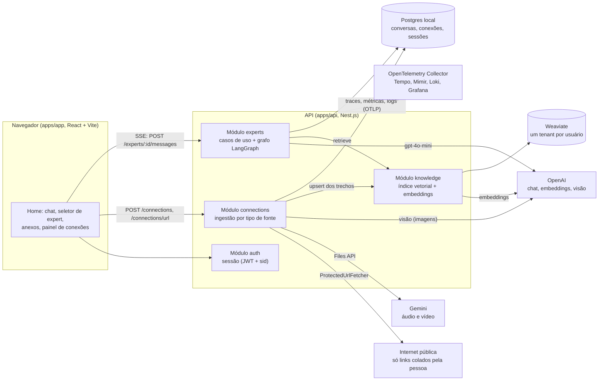
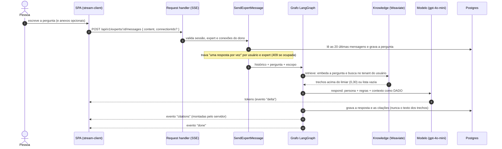

# EXPERTS.md — Os agentes especialistas e como se ligam ao produto

> **Público:** quem avalia, mantém ou estende o produto.
> **Verificado contra o código em:** 2026-11-18 (branch `main` após o PR #13).
> **Leitura relacionada:** `ARCHITECTURE.md` §4.8 a §4.15 (contratos e detalhes de cada módulo), `BUSINESS.md` (regras de produto), `QUALITY.md` (testes e observabilidade), `HOME.md` (a tela onde tudo isso aparece).

Este documento responde a três perguntas: **o que é um "agente especialista" no Rondo**, **como ele funciona por dentro** e **como cada funcionalidade do produto alimenta ou usa esse agente**. Os detalhes de contrato (rotas, colunas, variáveis) ficam em `ARCHITECTURE.md`; aqui está o mapa para entendê-los.

## 1. O que é um agente especialista

No Rondo, um _expert_ é um agente de IA com função de comissão técnica de um clube de futebol. Ele é composto por **quatro partes**, cada uma num lugar diferente do código:

| Parte                 | O que define                                                                                            | Onde vive                                                                        |
| --------------------- | ------------------------------------------------------------------------------------------------------- | -------------------------------------------------------------------------------- |
| **Persona**           | Função, tom, escopo, limites do que não responde, estilo; personagem fictício (nenhuma pessoa real)     | `apps/api/src/modules/experts/domain/expert-catalog.ts`                          |
| **Grafo de execução** | Os passos que o agente executa a cada pergunta: recuperar fontes e responder (LangGraph.js)             | `.../experts/infrastructure/langgraph-expert-orchestrator.ts`                    |
| **Conhecimento**      | Os documentos, imagens, links, áudios e vídeos que **a própria pessoa conectou**, indexados por usuário | `apps/api/src/modules/connections` (entrada) e `.../knowledge` (índice vetorial) |
| **Memória**           | A conversa de cada par (usuário, expert), guardada no Postgres                                          | `.../experts/infrastructure/postgres-conversation.repository.ts`                 |

O agente **não "sabe" nada do clube por conta própria**: o que ele afirma sobre dados específicos tem de vir de uma fonte que a pessoa conectou, e a resposta traz a lista de fontes usadas (citações montadas pelo servidor). Quando nenhuma fonte cobre a pergunta, ele declara a lacuna em vez de inventar (`BUSINESS.md` §10).

### 1.1 O catálogo: sete especialistas

O catálogo é fixo e vive em código (não há CRUD de experts nesta fase). Cada expert tem `id`, nome, função, personagem fictício, descrição, persona, perguntas sugeridas e, quando for da área de saúde ou jurídica, um aviso de que o conteúdo não substitui um profissional habilitado.

| `id`                  | Expert              | Função                                       | Personagem (fictício)      | Aviso profissional |
| --------------------- | ------------------- | -------------------------------------------- | -------------------------- | ------------------ |
| `head-coach`          | Head Coach          | Treino, escalação e estratégia               | Arnaldo Pinheiro Lessa     | não                |
| `performance-analyst` | Performance Analyst | Métricas de desempenho individuais e do time | Lívia Taborda Reis         | não                |
| `sports-lawyer`       | Sports Lawyer       | Contratos, regulamentos e transferências     | Heitor Camargo Valente     | sim                |
| `physiologist`        | Physiologist        | Carga de treino, recuperação e prevenção     | Marta Quintela Ribas       | sim                |
| `sports-physician`    | Sports Physician    | Saúde do atleta                              | Caio Menezes Aranha        | sim                |
| `physiotherapist`     | Physiotherapist     | Reabilitação e retorno ao jogo               | Tainá Seabra Moura         | sim                |
| `football-manager`    | Football Manager    | Gestão do departamento de futebol            | Rogério Albuquerque Dantas | não                |

Cada persona também declara **limites**: por exemplo, o Head Coach não decide contratos nem laudos e indica o especialista certo; o Performance Analyst não inventa números e, quando falta dado, diz o que falta. O avatar (pixel art, 8-bit) de cada um foi gerado uma vez com um script manual e é um asset do app (`apps/app/src/assets/experts/`, ADR `0022`).

## 2. Visão geral da arquitetura

**Regra de dependência (camadas):** `domain` não importa framework nem SDK; `application` orquestra casos de uso (um por endpoint); `infrastructure` contém os adaptadores (LangGraph, OpenAI, Weaviate, Gemini, Postgres); `interface` contém os _request handlers_ e DTOs. Testes de fronteira (`experts-boundaries.spec.ts`, `knowledge-boundaries.spec.ts`) falham se alguém violar isso; a decisão está no ADR `0014` (um _request handler_ por endpoint).

## 3. O que acontece quando a pessoa pergunta algo

Pontos que explicam o comportamento do produto:

1. **A pessoa nunca informa quem ela é no corpo da requisição.** O dono vem da sessão; o corpo só leva `content` e, se quiser restringir a busca, `connectionIds`. Uma conexão de outro usuário ou inexistente é `404`; uma conexão que ainda processa é `409`.
2. **O histórico vem do banco, não do cliente.** Ele entra no modelo só como mensagens `user` e `assistant`, nunca como instrução de sistema, então o cliente não consegue "reescrever" a persona.
3. **A busca é opcional e barata:** sem nenhuma conexão pronta, o servidor nem chama embeddings nem o Weaviate (evento `expert.grounded` com `skipped`).
4. **A busca é sempre dentro do tenant do usuário.** O isolamento é estrutural (um tenant do Weaviate por usuário, ADR `0020`), não um filtro de consulta que um erro poderia esquecer.
5. **Streaming por SSE** (`delta`, `citations`, `done`, `error`) com `fetch`. `Stop` aborta a geração e o abort chega ao modelo; uma resposta interrompida é gravada como `incomplete`, com as citações dos trechos já recuperados.
6. **Falha tipada, nunca silenciosa:** sem chave de LLM a API sobe, mas só o envio responde `503`; índice ou embeddings fora do ar viram `KNOWLEDGE_UNAVAILABLE` e o modelo nem é chamado; o usuário vê "We couldn't search your sources right now." com `Try again`.

### 3.1 Respostas ancoradas, citações e lacuna

| Situação                               | O que o grafo faz                                                                                                                                 | O que a pessoa vê                                               |
| -------------------------------------- | ------------------------------------------------------------------------------------------------------------------------------------------------- | --------------------------------------------------------------- |
| Há trechos acima do limiar             | Monta o bloco `<retrieved_context>` (texto escapado) e manda tratar como dado; o servidor monta as citações a partir do que foi recuperado        | Resposta + bloco **Sources** (nome do arquivo e página)         |
| Há conexões, mas nada cobre a pergunta | Instrui o modelo a declarar a lacuna no idioma do usuário e a não afirmar dado específico do clube; orientação geral vem marcada como "sem fonte" | Resposta + aviso "No connected source covers this." (sem lista) |
| Não há nenhuma conexão pronta          | Não busca; responde pela persona                                                                                                                  | Resposta sem bloco de fontes                                    |
| A fonte foi excluída depois            | A citação guardada vira `{ removed: true }`, sem nome                                                                                             | "Source removed" no histórico                                   |

**Defesa contra instruções escondidas em documentos (prompt injection):** o texto do documento é escapado (`&`, `<`, `>`), o bloco é declarado como dado e **nunca** como instrução, e persona, limites e regras de citação continuam valendo. O modelo não escreve nomes de arquivo nem páginas: isso é montado pelo servidor. O teste `test/experts-grounded-answers.int-spec.ts` cobre um documento hostil.

## 4. De onde vem o conhecimento: as conexões

A pessoa alimenta os experts pelos botões **Add connection**, **Add link** e **Your connections** da home. Todos os tipos passam pelo mesmo pipeline (porta de extrator por tipo → _chunks_ → embeddings → índice) e pelas mesmas regras de ciclo de vida.

| Tipo de fonte            | Spec   | Como o texto é obtido                                                                       | Limites principais                                        | Defesa específica                                                            |
| ------------------------ | ------ | ------------------------------------------------------------------------------------------- | --------------------------------------------------------- | ---------------------------------------------------------------------------- |
| PDF, TXT, Markdown       | `0023` | _Document Loaders_ do LangChain.js e divisão em trechos                                     | 20 MB; PDF protegido e sem texto são recusados com código | Assinatura do PDF conferida pelos bytes, não pela extensão                   |
| Imagem (JPG, PNG)        | `0026` | Modelo de visão (`gpt-4o-mini`) descreve e transcreve a imagem; o texto entra no pipeline   | 10 MB, 8.000 px                                           | O texto lido na imagem é dado, nunca instrução                               |
| Link (URL)               | `0027` | `ProtectedUrlFetcher` baixa a página e `HtmlToTextTransformer` extrai o texto               | 5 MB depois de descomprimir, 15 s, 3 redirecionamentos    | Proteção contra SSRF (ADR `0030`): IP validado e fixado, sem exceção interna |
| Áudio (MP3), vídeo (MP4) | `0028` | Gemini (Files API) transcreve e descreve com tempos; o arquivo é apagado do provedor ao fim | 2 em processamento por vez, 100 min por 24 h              | Citação com instante `mm:ss`; limpeza no provedor em todo desfecho           |

Regras comuns a todos os tipos:

- **Deduplicação por conteúdo, por usuário** (SHA-256 dos bytes; para links, da URL canônica e depois do texto): reenviar o mesmo conteúdo não gera novos embeddings.
- **Processamento fora do request**, com estados `processing`, `ready` e `failed`; o `Send` fica retido enquanto um anexo processa.
- **O original nunca é guardado**: só os vetores (no Weaviate) e uma linha de metadados (no Postgres). Nem o texto do trecho vai para o banco relacional.
- **Exclusão completa e verificável** (spec `0025`): excluir uma conexão apaga os vetores primeiro e a linha depois; é idempotente; se o índice estiver fora, responde `503` sem perder a linha para poder tentar de novo. "Delete all" remove tudo da pessoa.
- **Aviso de privacidade** antes do primeiro envio, porque os conteúdos podem trazer dados de saúde de atletas e saem da máquina rumo ao provedor do modelo (`BUSINESS.md` §10).

## 5. Como cada funcionalidade do produto se liga ao agente

| Funcionalidade (o que a pessoa vê)                    | Spec                   | Que parte do agente ela alimenta                               | Onde está o código                                                  |
| ----------------------------------------------------- | ---------------------- | -------------------------------------------------------------- | ------------------------------------------------------------------- |
| Cadastro, confirmação de conta, login, reset de senha | `0002` a `0010`        | **Identidade:** a sessão define o dono do tenant e da conversa | `modules/auth`, `modules/email`, `modules/rate-limit`               |
| Home como chat, seletor de expert, streaming          | `0019`                 | **Persona + grafo** (catálogo, prompt, SSE)                    | `modules/experts`, `apps/app/src/features/experts`                  |
| Histórico persistente e "Clear conversation"          | `0020`                 | **Memória** (20 mensagens de contexto, 200 por conversa)       | `postgres-conversation.repository.ts`, `expert_append_message`      |
| Avatares 8-bit dos experts                            | `0021`                 | **Identidade visual** de cada persona                          | `packages/experts-avatars`, `apps/app/src/assets/experts`           |
| Índice vetorial por usuário                           | `0022`                 | **Conhecimento** (armazenamento e busca isolados)              | `modules/knowledge`, Weaviate no Compose                            |
| Add connection (arquivos), chips, dedup               | `0023`                 | **Conhecimento** (entrada de PDF, TXT e MD)                    | `modules/connections`, `features/connections`                       |
| Respostas com fontes e declaração de lacuna           | `0024`                 | **Grafo** (nó `retrieve`) + citações do servidor               | `modules/experts` (`grounding.ts`, `knowledge-index-retriever.ts`)  |
| Your connections: listar e excluir                    | `0025`                 | **Conhecimento** (ciclo de vida e LGPD)                        | `modules/connections`, `features/connections/connections-panel.tsx` |
| Imagens, links, áudio e vídeo                         | `0026`, `0027`, `0028` | **Conhecimento** (novos extratores no mesmo pipeline)          | `modules/connections/infrastructure`                                |
| Dashboard e alertas dos agentes                       | `0029`                 | **Operação** (como saber que o agente está saudável)           | `observability/expert-telemetry.ts`, `infra/grafana`                |

## 6. Decisões que moldam o agente (ADRs)

| ADR    | Decisão                                                                            | Por que importa para o agente                                                                                      |
| ------ | ---------------------------------------------------------------------------------- | ------------------------------------------------------------------------------------------------------------------ |
| `0021` | LangGraph.js como biblioteca dentro da API, sem LangGraph Platform e sem LangSmith | O grafo é o que as specs seguintes estendem; nenhum dado do usuário sai para um serviço de observabilidade externo |
| `0020` | Weaviate com multi-tenancy por usuário; vetores calculados pela aplicação          | O isolamento de dado sensível é estrutural; o servidor do índice não consegue chamar a OpenAI por conta própria    |
| `0023` | Conversa persistida: uma por (usuário, expert), 200 mensagens, trava em memória    | Define a memória do agente e a regra "uma resposta por vez"                                                        |
| `0024` | Ingestão por conteúdo (hash), processamento em segundo plano                       | Evita reprocessar e custo duplicado de embeddings                                                                  |
| `0025` | Recuperação e citações montadas pelo servidor                                      | O modelo não escreve as fontes: elas são verificáveis                                                              |
| `0026` | Exclusão de conexões com vetores primeiro, linha depois                            | Nenhum vetor órfão; direito de exclusão atendido                                                                   |
| `0027` | Imagens viram texto por visão                                                      | O resto do pipeline não muda                                                                                       |
| `0028` | Observabilidade dos agentes por OpenTelemetry, sem LangSmith                       | Sinais do agente no mesmo Grafana da API, sem conteúdo                                                             |
| `0029` | Gemini para entendimento de áudio e vídeo                                          | Segundo provedor de IA, com limpeza do arquivo no provedor                                                         |
| `0030` | Política de saída de rede da API (busca de links)                                  | A API não vira ponte para a rede interna                                                                           |

## 7. Limitações conhecidas (honestas)

- **Nenhuma avaliação com modelo real foi registrada.** Os testes usam modelos e embeddings falsos e roteirizados (de propósito: determinismo e zero custo); o limiar de similaridade 0,30 só foi exercitado com embeddings falsos. O roteiro de avaliação manual está em `QA.md` §1.17 e §1.21.
- **O Gemini nunca foi chamado de verdade** (sem chave na execução); o ID de modelo padrão não foi validado.
- **O limite de mensagens é por IP**, não por usuário, porque o limitador roda antes da autenticação (ADR `0005`).
- **A trava de "uma resposta por vez" e a fila de ingestão vivem na memória de uma instância** da API; para mais de uma réplica, precisam ir para um recurso compartilhado.
- **Decisões de Produto e Jurídico** foram confirmadas pela pessoa responsável no chat de execução (sem expiração automática de conversas; excluir uma fonte mantém as respostas do histórico; voz e imagem podem ir ao Gemini com o aviso atual). Não são parecer formal do Jurídico.
