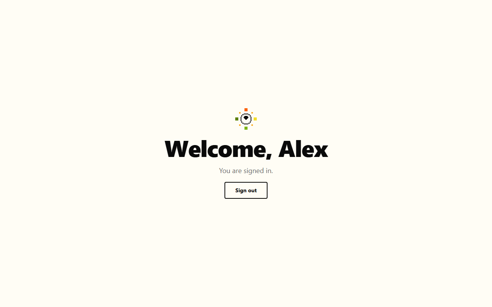
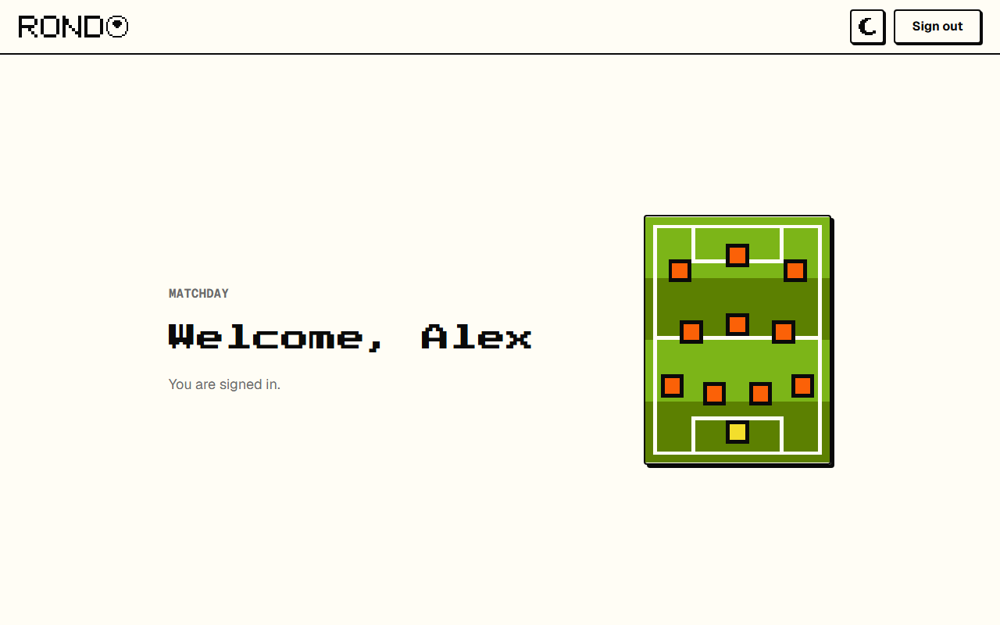
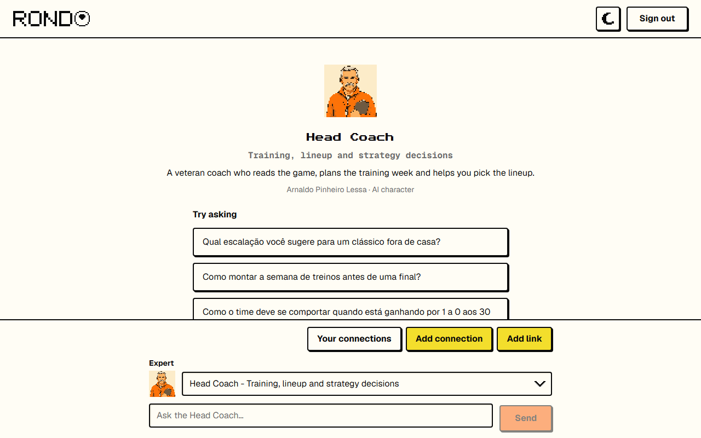
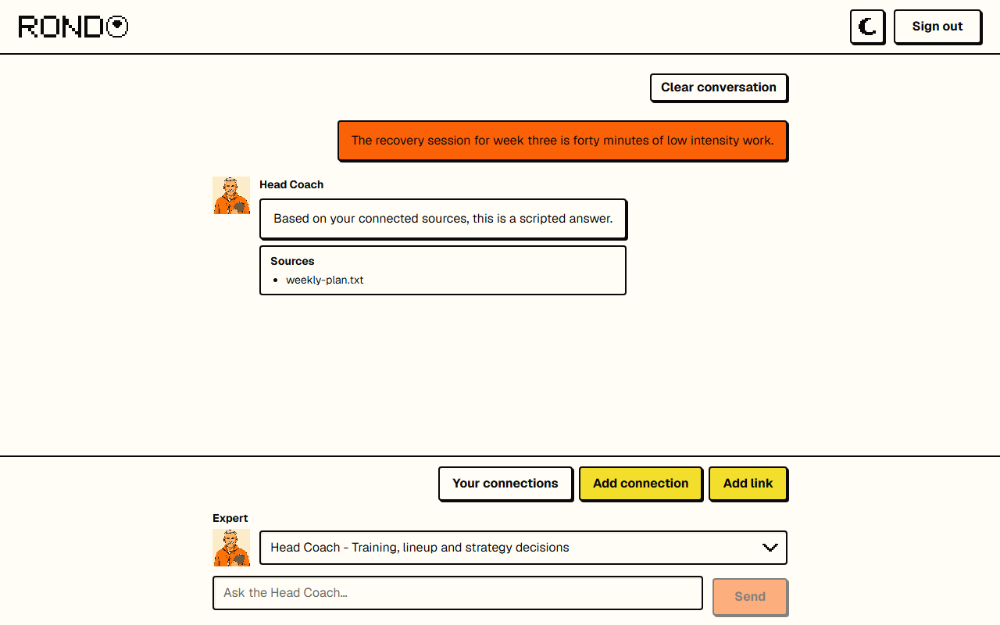
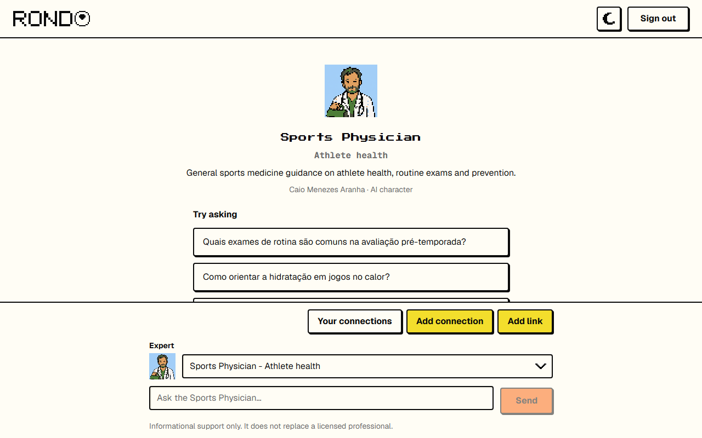
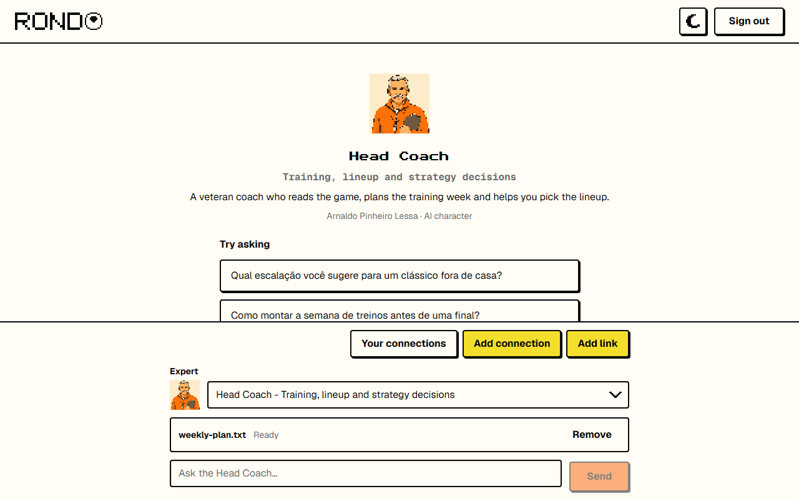
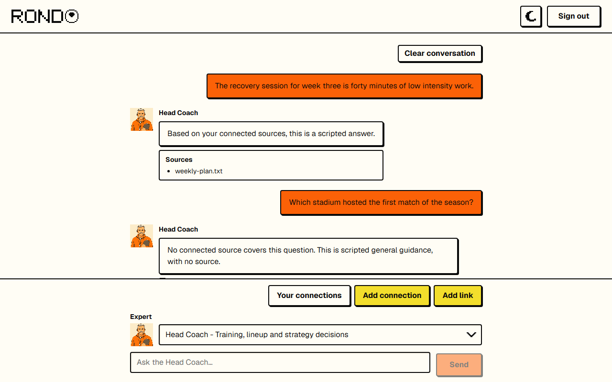
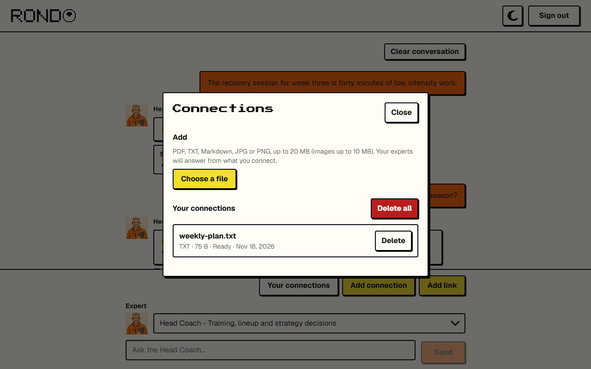
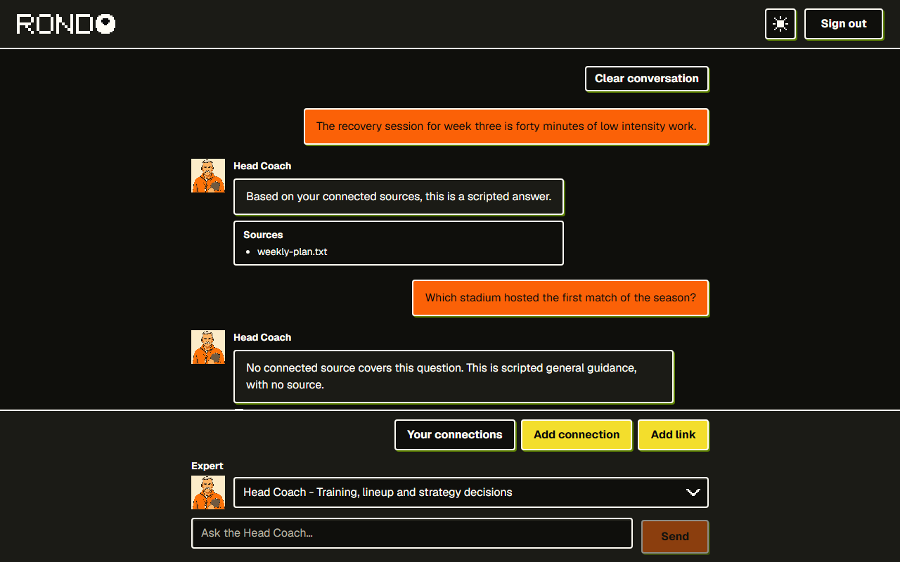
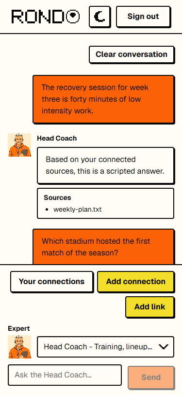

# HOME.md — A home do produto: do redesign retro 8-bit ao chat com os experts

> **Público:** quem avalia o desafio de redesign da home e quem vai evoluir a interface.
> **Verificado contra o código em:** 2026-11-18. As capturas de tela em `.screenshots/home-experts/` foram geradas nessa data pelo produto rodando de verdade (API, Postgres, Weaviate e a SPA), com modelos de IA roteirizados (ver §6).
> **Leitura relacionada:** `DESIGN.md` e `DESIGN_SYSTEM.md` (regras visuais), `EXPERTS.md` (o agente por trás da tela), `QUALITY.md` (testes de acessibilidade e E2E).

## 1. Resumo: a home mudou duas vezes, por razões diferentes

A tela `/app` (a primeira que a pessoa vê depois de entrar) passou por **três estados**. A segunda mudança não desfez a primeira: ela aproveitou a fundação visual que o redesign criou.

| Estado                             | Spec / PR                                  | O que era                                                                                                    | Por que mudou                                                                                        |
| ---------------------------------- | ------------------------------------------ | ------------------------------------------------------------------------------------------------------------ | ---------------------------------------------------------------------------------------------------- |
| **1. Antes do redesign**           | spec `0000` a `0010`                       | "Welcome, Alex" e "You are signed in." sobre fundo liso                                                      | Servia só para provar que a autenticação funciona; parecia protótipo                                 |
| **2. Home "vestiário" (Matchday)** | spec `0018`, PR #12 (2026-11-16)           | Saudação em fonte pixel, formação tática 4-3-3 em pixel art, cabeçalho de app com marca, tema claro e escuro | Dar **identidade própria** ao produto (retro 8-bit, futebol, Brasil) em todas as telas, não só nesta |
| **3. Home de chat com os experts** | specs `0019` a `0029`, PR #13 (2026-11-18) | Chat com sete especialistas, anexos, fontes, histórico e painel de conexões                                  | A home passou a ser **o produto**: é onde a pessoa conversa com o agente e conecta suas fontes       |

| 1. Antes                                       | 2. Redesign (vestiário)                                 | 3. Hoje (chat)                                                        |
| ---------------------------------------------- | ------------------------------------------------------- | --------------------------------------------------------------------- |
|  |  |  |

## 2. O redesign (spec `0018`): o que foi decidido e por quê

**Problema declarado na spec:** as telas funcionavam e tinham acessibilidade razoável, mas cada uma era "um card retangular sobre fundo liso", sem fonte de destaque, sem ícones e sem nenhuma referência a futebol além do logo.

**Direção escolhida:** interface **retro, inspirada em arte 8-bit, futebol e Brasil**, com uma regra de contenção: _uma ousadia por tela_ (o campo de pixel na autenticação, o placar no 404, a formação na home); o resto fica quieto e disciplinado, para não virar enfeite.

| Decisão                                                                                            | Onde está registrada         | Efeito                                                                                    |
| -------------------------------------------------------------------------------------------------- | ---------------------------- | ----------------------------------------------------------------------------------------- |
| Tokens de cor, borda, sombra, raio e movimento em um só arquivo                                    | `packages/ui/src/tokens.css` | Os componentes não espalham hex; `apps/docs` consome o mesmo arquivo                      |
| Fonte display pixel (Press Start 2P) só em títulos curtos; Geist para o corpo                      | ADR `0019`                   | Identidade sem prejudicar a leitura de parágrafos; fontes auto-hospedadas                 |
| Tema claro e escuro por `data-theme` no `<html>`, com script antes da primeira pintura             | ADR `0018`                   | Sem "flash" do tema errado; preferência do sistema por padrão e escolha manual persistida |
| Componentes no estilo 8-bit (`Button`, `Input`, `Card`, `Alert`, `Spinner`, ícones, `ThemeToggle`) | `DESIGN_SYSTEM.md` §5        | Toda tela nova nasce sobre a mesma base                                                   |
| Captura de "antes" e "depois" com script reprodutível                                              | `.screenshots/README.md`     | A mudança é comparável tela a tela (54 imagens, incluindo mobile e escuro)                |

O redesign cobriu as seis telas de autenticação (com todos os estados), a home, o 404, as telas de sessão e a página do `apps/docs`. As regras ficaram em `DESIGN.md`; o estado da implementação está em `DESIGN.md` §10.

## 3. Da home decorativa à home de chat (spec `0019`): o impacto

Quando o produto ganhou os experts, a home deixou de precisar de um elemento decorativo e passou a ser a **área de trabalho**. O que foi mantido, removido e acrescentado:

| Elemento                                        | Situação            | Observação                                                                                        |
| ----------------------------------------------- | ------------------- | ------------------------------------------------------------------------------------------------- |
| Cabeçalho: marca, alternância de tema, sign-out | Mantido             | Vem do redesign (`AppLayout`); nenhuma mudança de comportamento                                   |
| Saudação "Welcome, {nome}" e formação em pixel  | Removidos           | Eram o papel de "ousadia da tela"; o lugar passa a ser da persona do expert (avatar em pixel art) |
| Tokens, fontes, tema escuro, componentes 8-bit  | Reutilizados        | O chat é 100% construído sobre o design system do redesign                                        |
| `Select`, `Textarea`, `PixelAvatar`             | Novos em `@repo/ui` | Primitivos criados pela 0019 no mesmo estilo, não componentes soltos do app                       |
| Avatares dos sete experts                       | Novos (spec `0021`) | Pixel art gerada uma vez, com o mesmo critério visual da marca                                    |

**Efeito prático do redesign no produto:** o spec `0018` declarou "Destrava: qualquer tela de produto futura (experts, conectores)". Isso se confirmou: os 22 testes e specs de interface que vieram depois (chat, anexos, painel) usam os mesmos tokens e primitivos, e o teste de acessibilidade com `axe` roda nos dois temas.

## 4. Anatomia da home atual

| Elemento na tela                                                    | Componente (`apps/app/src`)                                                  | Spec                   | De onde vêm os dados                         | Como é testado                                                      |
| ------------------------------------------------------------------- | ---------------------------------------------------------------------------- | ---------------------- | -------------------------------------------- | ------------------------------------------------------------------- |
| Cabeçalho (marca, tema, sign-out)                                   | `routes/app-layout.tsx`                                                      | `0018`                 | Sessão                                       | `e2e/sign-out.spec.ts`, `e2e/a11y.spec.ts`                          |
| Apresentação do expert (avatar, função, perguntas sugeridas)        | `features/experts/expert-intro.tsx`, `expert-avatar.tsx`                     | `0019`, `0021`         | `GET /api/v1/experts` (catálogo no servidor) | `experts-home.test.tsx`, `expert-avatar.test.tsx`                   |
| Aviso profissional (saúde e jurídico)                               | `expert-intro.tsx`                                                           | `0019`                 | Campo `notice` do catálogo                   | `e2e/experts-chat.spec.ts`                                          |
| Lista de mensagens com streaming (`role="log"`)                     | `message-list.tsx`, `use-expert-chat.ts`, `lib/stream-client.ts`             | `0019`                 | SSE de `POST /experts/:id/messages`          | `chat-state.test.ts`, `e2e/experts-chat.spec.ts`                    |
| Bloco **Sources** e aviso de lacuna                                 | `answer-sources.tsx`                                                         | `0024`                 | Evento `citations` e histórico               | `grounded-answers.test.tsx`, `e2e/experts-grounded-answers.spec.ts` |
| Histórico recarregado e **Clear conversation**                      | `use-conversation.ts`, `clear-conversation.tsx`                              | `0020`                 | `GET/DELETE /experts/:id/conversation`       | `experts-conversation.test.tsx`                                     |
| Seletor de expert e campo de mensagem (`Send`, `Stop`, `Try again`) | `composer.tsx`                                                               | `0019`                 | Estado local + catálogo                      | `experts-home.test.tsx`                                             |
| Chips de anexo e estado (`Processing`, `Ready`, erro)               | `features/connections/attachment-chips.tsx`, `use-attachments.tsx`           | `0023`                 | `POST/GET /connections`                      | `attachments.test.tsx`, `e2e/connections.spec.ts`                   |
| **Add connection**, **Add link**, **Your connections**              | `add-connection-button.tsx`, `add-link-button.tsx`, `connections-button.tsx` | `0023`, `0025`, `0027` | Arquivos, links, lista                       | `connections-panel.test.tsx`, `e2e/connections-manage.spec.ts`      |
| Aviso de privacidade antes do primeiro envio                        | `privacy-notice.tsx`                                                         | `0023`                 | `localStorage` (aceite)                      | `attachments.test.tsx`                                              |

## 5. Capturas do produto (reproduzíveis)

| Captura                                                                  | O que demonstra                                                                                  |
| ------------------------------------------------------------------------ | ------------------------------------------------------------------------------------------------ |
|  | Expert da área de saúde mostra o **aviso** de que não substitui um profissional                  |
|                 | Arquivo conectado, com o chip no estado `Ready`, antes de perguntar                              |
|                    | Pergunta que nenhuma fonte cobre: o produto **declara a lacuna**, sem lista de fontes            |
|                | Painel **Your connections**: tipos aceitos, lista, `Delete` e `Delete all` com confirmação       |
|        | A mesma conversa depois de recarregar a página, no **tema escuro**: o histórico mora no servidor |
|                     | Layout em **375 px** de largura                                                                  |

## 6. Como as capturas foram feitas (e o que elas não provam)

- **Reprodução:** `CAPTURE_DOCS=1 bunx playwright test e2e/docs-screenshots.spec.ts` (use `E2E_APP_PORT` e `E2E_API_PORT` se as portas padrão estiverem ocupadas). O arquivo está fora da suíte normal: só roda com `CAPTURE_DOCS=1`, porque o envio de mensagens divide uma cota de 20 por minuto com os demais E2E.
- **O que é real:** a SPA, a API, o Postgres, o Weaviate local, os avatares, o histórico, as citações e o painel.
- **O que é roteirizado:** o texto das respostas. Como todo E2E, a API roda com `NODE_ENV=test`, em que o modelo de chat e os embeddings são falsos e determinísticos (nenhuma chamada à OpenAI). Por isso as respostas dizem "this is a scripted answer".
- **Capturas do redesign (`0018`):** `.screenshots/README.md` explica o método; nelas a API é interceptada no navegador com dados fictícios.

## 7. Dívida visual: o que a evidência mostrou, o que foi corrigido e o que resta

Produzir estas capturas revelou algo que os testes automatizados não pegavam, e a correção veio na mesma entrega:

1. **Corrigido: botões flutuantes sobrepunham o conteúdo.** Os três botões (**Your connections**, **Add connection**, **Add link**) eram posicionados de forma absoluta sobre a área de mensagens. Em **375 px** eles cobriam trechos da resposta e, no estado vazio a 1280×800, cobriam parte da terceira pergunta sugerida. Agora a fileira de botões faz parte da barra do compositor (`features/experts/composer.tsx`), no fluxo normal da página: o conteúdo nunca fica coberto, e as capturas `01` e `08` deste documento já mostram o resultado. O custo é que, em telas estreitas, a barra fica mais alta porque os botões quebram de linha.
2. **Pendente:** a **revisão visual do Produto** do redesign (`0018`) e a inspeção em 375/768/1280 px das telas de conexões continuam dependendo de uma pessoa olhar.
3. **Pendente:** o comportamento com **leitor de tela** não foi verificado. Há teste de teclado e `axe` (`e2e/a11y.spec.ts` e `e2e/experts-grounded-answers.spec.ts`, nos dois temas), `role="log"` com `aria-busy` e `motion-reduce` no indicador de resposta.
