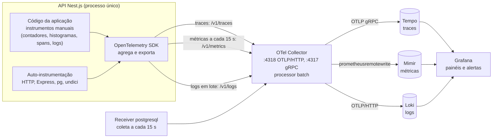

# OBSERVABILITY.md — Como as métricas, traces e logs são coletados

> **Público:** quem avalia como a observabilidade foi implementada e quem vai mantê-la.
> **Verificado contra o código e a infraestrutura em:** 2026-11-18 (`apps/api/src/observability/`, `infra/otel/otel-collector-config.yaml`, `infra/grafana/`).
> **Leitura relacionada:** `ARCHITECTURE.md` §4.4 (catálogo completo de sinais), `QUALITY.md` §5 (o que é medido e evidências reais), `TESTING.md` (como isso é testado).

Este documento explica o **mecanismo**: por qual caminho um número sai do código da API e chega a um painel ou a um alerta no Grafana, o que cada peça faz e por que foi escolhida assim. O catálogo de nomes está em `ARCHITECTURE.md` §4.4; aqui está o "como funciona".

## 1. Os três sinais e o caminho único



| Sinal       | Pergunta que responde                                       | Como sai da API                                                      | Onde fica | Linguagem de consulta |
| ----------- | ----------------------------------------------------------- | -------------------------------------------------------------------- | --------- | --------------------- |
| **Métrica** | "Quanto? Com que frequência? Quão rápido?"                  | Agregada na memória do processo e **enviada por _push_** a cada 15 s | Mimir     | PromQL                |
| **Trace**   | "O que aconteceu **nesta** requisição, e onde o tempo foi?" | Um span por operação, enviado em lote ao terminar                    | Tempo     | TraceQL               |
| **Log**     | "O que aconteceu e por quê, em palavras?"                   | JSON estruturado (pino), enviado em lote                             | Loki      | LogQL                 |

**Por que _push_ OTLP e não o `GET /metrics` do Prometheus?** Porque a API já precisa exportar traces e logs por OTLP; usar o mesmo protocolo e o mesmo coletor para os três sinais evita expor uma porta de raspagem na API e um segundo caminho para configurar e proteger (ADR `0010`). O custo é ter de lidar com as particularidades do push (§7).

## 2. O ciclo de vida de uma métrica, passo a passo

Exemplo real: **o tempo até o primeiro token** de uma resposta de um expert, um dos sinais mais importantes da experiência de chat.

### Passo 1 — O código registra o valor

O instrumento é um **histograma** declarado em `observability/expert-telemetry.ts`:

```ts
firstToken: meter.createHistogram("expert.first_token", {
  description: "Time from the request to the first token sent to the client.",
  unit: "s",
  advice: { explicitBucketBoundaries: ANSWER_DURATION_BUCKETS_SECONDS },
}),
```

Quando o primeiro token é escrito ao cliente (no SSE), o código chama `record(segundos, { expert })`, com o `expert` sendo **um dos 7 ids do catálogo** (qualquer outro valor vira `unknown`). A chamada é protegida por `try/catch`: **telemetria nunca muda a resposta ao usuário**.

### Passo 2 — O SDK agrega na memória

O SDK não envia cada medição. Ele mantém, por combinação de rótulos, um **histograma**: a contagem de observações que caíram em cada faixa (_bucket_), a soma e a contagem total. É barato e não cresce com o tráfego.

As faixas são definidas por nós (`ANSWER_DURATION_BUCKETS_SECONDS`, até 120 s), em **segundos**. Isso importa: o padrão do OpenTelemetry assume **milissegundos** (0, 5, 10, 25… 10000); numa métrica em segundos, todas as requisições cairiam na primeira faixa e o `histogram_quantile` não significaria nada (`observability/duration-buckets.ts`).

### Passo 3 — O SDK exporta a cada 15 s

`PeriodicExportingMetricReader` (`observability/telemetry.ts`) envia o estado agregado por OTLP/HTTP para `…/v1/metrics`, com **timeout de 3 s** (`OTEL_EXPORTER_OTLP_TIMEOUT`). Se o coletor estiver lento ou parado, a exportação falha em segundo plano e a API continua respondendo (§8).

### Passo 4 — O Collector encaminha

O pipeline `metrics` do coletor (`infra/otel/otel-collector-config.yaml`) é: receiver `otlp` → processor `batch` → exporter `prometheusremotewrite` para o Mimir (`http://mimir:9009/api/v1/push`).

### Passo 5 — O nome e os rótulos mudam de forma

Ao entrar no Mimir, o nome segue a convenção do Prometheus:

| No código                                      | No Mimir                                               | Regra                                                                              |
| ---------------------------------------------- | ------------------------------------------------------ | ---------------------------------------------------------------------------------- |
| `expert.first_token` (histograma, `unit: "s"`) | `expert_first_token_seconds_bucket`, `_sum` e `_count` | ponto vira `_`; unidade `s` vira `_seconds`; histograma vira `_bucket/_sum/_count` |
| `expert.llm.tokens` (contador)                 | `expert_llm_tokens_total`                              | contador ganha `_total`                                                            |
| atributo `{ expert: "head-coach" }`            | rótulo `expert="head-coach"`                           | atributo do ponto vira rótulo                                                      |
| `service.name = rondo-api`                     | rótulo `job="rondo-api"`                               | resource do SDK                                                                    |
| `service.instance.id` (UUID por processo)      | rótulo `instance`                                      | evita que dois processos da API sobrescrevam as mesmas séries                      |

### Passo 6 — O painel consulta

O painel "Primeiro token: p50 / p95 por expert" do dashboard "Rondo — Experts" usa:

```promql
histogram_quantile(0.95,
  sum by (le, expert) (
    rate(expert_first_token_seconds_bucket{job="rondo-api"}[$__rate_interval])
  )
)
```

Lendo de dentro para fora: `rate(..._bucket[…])` dá quantas observações por segundo caíram em cada faixa; `sum by (le, expert)` junta as instâncias da API mantendo a faixa (`le`) e o expert; `histogram_quantile(0.95, …)` estima o **percentil 95**: "95 % das respostas receberam o primeiro token em até X segundos". É uma estimativa por interpolação dentro da faixa, por isso a escolha das faixas (passo 2) afeta a precisão.

### Passo 7 — O alerta usa o mesmo sinal

A regra `rondo-experts-primeiro-token-lento` ("Primeiro token lento (p95 > 5 s)") avalia, a cada ciclo, o mesmo histograma em janela de 10 minutos:

```promql
histogram_quantile(0.95, sum by (le) (rate(expert_first_token_seconds_bucket{job="rondo-api"}[10m])))
  and on() (sum(increase(expert_first_token_seconds_count{job="rondo-api"}[10m])) >= 5)
```

A segunda metade (`>= 5`) exige **ao menos 5 respostas** na janela: sem amostra mínima, um único pedido lento dispararia o alerta. A regra só dispara depois de 10 minutos seguidos acima de 5 s (`for: 10m`), e `noDataState: OK` trata "ninguém usou o chat" como normal.

## 3. Os instrumentos e as convenções que valem para todos

| Tipo                         | Para quê                          | Exemplos reais                                                                                                        |
| ---------------------------- | --------------------------------- | --------------------------------------------------------------------------------------------------------------------- |
| **Contador** (`Counter`)     | Eventos que só crescem            | `expert.llm.tokens`, `expert.grounded`, `connection.ingestions`, `auth.operations`                                    |
| **Histograma** (`Histogram`) | Distribuição de tempos e tamanhos | `expert.message.duration`, `expert.first_token`, `knowledge.index.operation.duration`, `db.client.operation.duration` |
| **Gauge**                    | Valor instantâneo                 | `auth.hash.active`, `auth.hash.queued`                                                                                |

Convenções (cada uma tem um teste que a protege, ver `TESTING.md`):

1. **Rótulos de conjunto fechado.** Todo rótulo vem de uma lista finita (`outcome`: `success`/`failure`/`aborted`; `expert`: os 7 ids; `dependency`: `openai`/`weaviate`/`gemini`). Nunca um valor que o cliente controla. Isso evita explosão de cardinalidade (custo) e vazamento de dado pessoal.
2. **Unidade explícita e em segundos** para durações.
3. **Sem conteúdo.** Nenhum rótulo, atributo ou campo de log carrega mensagem, prompt, trecho, nome de arquivo, e-mail, IP, `userId`, `connectionId` ou URL.
4. **Nunca lançar.** Toda função `record*` captura exceções.

## 4. Traces: o caminho de **uma** requisição

A API usa a auto-instrumentação do OpenTelemetry (HTTP, Express, `pg`, `undici`) e **spans manuais** nos pontos de negócio. O contexto viaja por `AsyncLocalStorage`, então cada span sabe quem é o pai.

Resultado para uma pergunta ao expert (um trace real está em `QUALITY.md` §5.3):

```text
POST /api/v1/experts/:expertId/messages          ← span HTTP (auto)
├─ select sessions, select connections, ...      ← spans do Postgres (auto, via DatabaseClient)
└─ expert.message                                 ← span manual: expert.id, outcome, tokens
   ├─ expert.retrieve                             ← nó do grafo: recuperar as fontes
   │  └─ expert.retrieval                         ← a busca em si (só se há conexão pronta)
   │     ├─ gen_ai.embeddings                     ← embeddings da pergunta
   │     └─ knowledge.index.search                ← consulta ao Weaviate
   ├─ expert.generate                             ← nó do grafo: gera a resposta
   │  └─ gen_ai.chat                              ← chamada ao modelo
   └─ rpc expert_append_message                   ← grava a resposta
```

Duas proteções de privacidade são aplicadas **antes** de o span sair do processo (`observability/span-redaction.ts`): a URL de chamadas de saída perde a query string, e o IP do cliente e a query dos spans de entrada são esvaziados. Chamadas de saída para **links que o usuário conecta** nem geram span nem métrica (`ignoreOutgoingRequestHook`), porque host e caminho são dele.

## 5. Logs: texto estruturado que se liga ao trace

Os logs são JSON (pino) com um campo `event` de nome fixo (`expert_message`, `expert_retrieval`, `connection_ingested`, …) e campos de conjunto fechado. Quando há um span ativo, o log leva `trace_id` e `span_id`. No Grafana, isso funciona nos dois sentidos, por configuração provisionada em `infra/grafana/provisioning/datasources/datasources.yaml`:

- no Loki, um **campo derivado** sobre `trace_id` abre o trace no Tempo;
- no Tempo, **trace to logs** abre os logs daquele trace.

**Por que alguns alertas usam logs e não métricas?** Um contador OTLP só passa a existir no primeiro incremento; `rate()` e `increase()` perdem esse primeiro evento. Para **eventos raros** (falha de resposta, de dependência, de ingestão, 5xx) isso significa perder justamente o primeiro erro. Esses alertas contam linhas do Loki (`count_over_time`). As **taxas contínuas** (latência, vazão, primeiro token, tokens) usam métricas.

## 6. Métricas de infraestrutura: o Postgres

Além dos sinais da API, o Collector tem um receiver `postgresql` que consulta as visões de estatística do banco a cada 15 s (conexões, _commits_, _rollbacks_, _deadlocks_, locks, tamanhos). Ele usa o papel `rondo_app`, que tem `pg_monitor` (só estatísticas, nenhum dado de tabela). O receiver não informa um nome de serviço, então o processor `resource/postgres` define `service.name = rondo-postgres` (sem isso as séries não teriam `job`), e o `transform/postgres` copia atributos do resource (banco, schema, tabela) para rótulos, porque o exportador do Prometheus não faz isso sozinho.

## 7. Armadilhas que o projeto já encontrou (e como cada uma foi tratada)

| Armadilha                                                        | Sintoma                                                  | Tratamento                                                                                     |
| ---------------------------------------------------------------- | -------------------------------------------------------- | ---------------------------------------------------------------------------------------------- |
| Faixas de histograma em milissegundos numa métrica em segundos   | Todo percentil igual à primeira faixa                    | `DURATION_BUCKETS_SECONDS` e faixas próprias por tipo de operação                              |
| Dois processos da API escrevendo as mesmas séries                | Contadores se sobrescrevendo; `rate()` distorcida        | `service.instance.id` aleatório por processo vira o rótulo `instance`; consultas agregam `sum` |
| O contador só nasce no primeiro incremento                       | `rate()` perde o primeiro erro                           | Eventos raros contados por log no Loki                                                         |
| O Express 5 não informa a rota ao instrumentador HTTP            | Todas as rotas viram `unmatched` nas métricas            | Middleware grava `req.baseUrl + req.route.path` (o _template_, nunca o caminho real)           |
| Atributos de resource não viram rótulos no exportador Prometheus | Séries do Postgres sem banco, tabela ou índice           | `transform/postgres` copia para o ponto de dados                                               |
| O LangChain liga o tracing para o LangSmith sozinho              | Prompts e trechos de documentos sairiam para um terceiro | `disableLangSmithTracing()` no boot; teste com endpoint falso exige zero requisições           |
| Dashboard consultando série que a API não emite                  | Painel vazio sem aviso                                   | `grafana-assets.spec.ts` compara cada série dos painéis com o que o código declara             |

## 8. Falhas: a observabilidade nunca derruba o produto

- A exportação é **em lote e com timeout** de 3 s; se o Collector cair, as respostas da API continuam `200`.
- Todas as funções de registro capturam exceções.
- Um teste de integração liga o **SDK real** contra uma porta recusada e exige respostas `200` e no máximo 50 ms a mais no p95 (`test/experts-telemetry-resilience.int-spec.ts`).
- Os dashboards usam `noValue: "sem dados"` e os alertas `noDataState: OK`: ausência de dados não é tratada como incidente (a queda da própria API é detectada à parte, por `absent_over_time`).

## 9. Como as métricas são **testadas**

Observabilidade que ninguém testa degrada em silêncio. Há quatro camadas (detalhes em `TESTING.md` §6):

1. **Unitário com gravador em memória.** `test/support/telemetry.ts` registra _providers_ OpenTelemetry em memória como globais (`InMemoryMetricExporter` com temporalidade _delta_ e `InMemorySpanExporter`); o teste chama o código, lê `metric("expert.first_token")` e confere valor, rótulos e faixas. Sem SDK, sem Collector, sem rede.
2. **Integração com a API real.** `experts-observability.int-spec.ts` sobe o app Nest, faz requisições HTTP de verdade e confere spans, métricas e logs emitidos; injeta **valores sentinela** no conteúdo e falha se algum aparecer em qualquer sinal.
3. **Catálogo estático.** `grafana-assets.spec.ts` lê o código-fonte, deduz as séries que a API emite (aplicando as regras do passo 5) e exige que cada série consultada por um painel exista. Não pode haver painel apontando para o vazio.
4. **Resiliência.** O teste do coletor parado (§8).

E há a **evidência ao vivo**: `QUALITY.md` §5.3 mostra consultas feitas direto no Mimir, Loki e Tempo depois do uso real do chat.

## 10. Como consultar (e ver por si)

Com `bun run infra:up` e a API rodando, depois de usar o chat:

```powershell
# Métrica (Mimir): respostas por expert e resultado
curl.exe -s "http://localhost:9009/prometheus/api/v1/query" --data-urlencode 'query=sum by (expert, outcome) (expert_message_duration_seconds_count)'

# Log (Loki): resultado das respostas nas últimas 12 h
curl.exe -s -G "http://localhost:3100/loki/api/v1/query" --data-urlencode 'query=sum by (outcome, reason) (count_over_time({service_name="rondo-api"} | event="expert_message" [12h]))'

# Trace (Tempo): últimas respostas
curl.exe -s -G "http://localhost:3200/api/search" --data-urlencode 'q={ name = "expert.message" }' --data-urlencode 'limit=5'
```

No Grafana (`http://localhost:3000`), abra "Rondo — Experts" (36 painéis em 8 seções) e "Rondo — Observabilidade da API". Depois de editar um dashboard ou uma regra de alerta (provisionados por arquivo), reinicie o contêiner: `docker compose restart grafana`.
