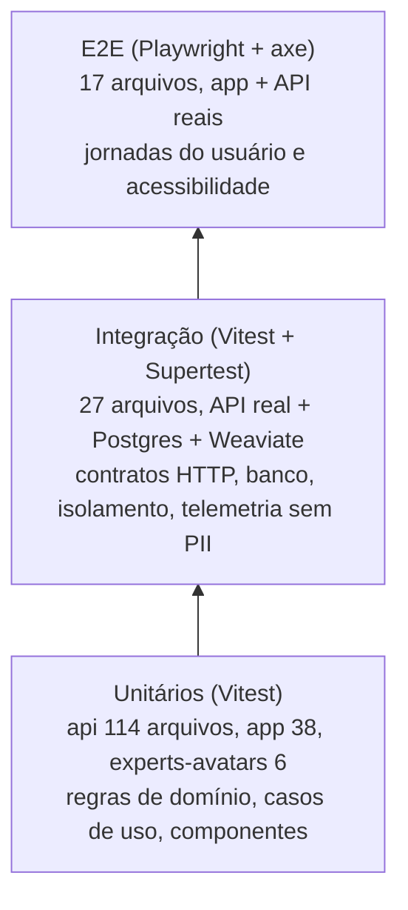
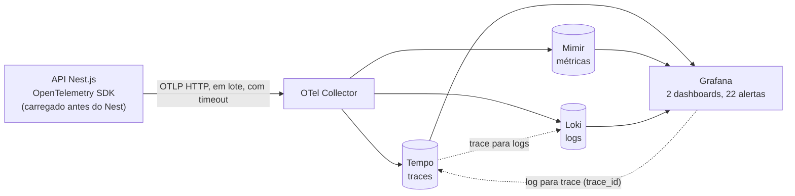

# QUALITY.md — Evidências de testes e observabilidade

> **Público:** quem avalia a qualidade da entrega e quem vai manter o produto.
> **Medido em:** 2026-11-18, na branch desta entrega, no Windows, com Postgres e Weaviate locais (Docker) no ar. Os números abaixo foram obtidos rodando os comandos, não estimados; cada seção diz como reproduzir.
> **Leitura relacionada:** `QA.md` (gates, checklist e o registro por spec de cada verificação), `ARCHITECTURE.md` §4.4 (catálogo completo de sinais), `EXPERTS.md` (o agente que é observado), `AI_PROCESS.md` (como a IA entrou nos testes).

## 1. Resumo em uma tabela

| Gate                        | Comando                    | Resultado em 2026-11-18                                                                                          |
| --------------------------- | -------------------------- | ---------------------------------------------------------------------------------------------------------------- |
| Lint (OXLint)               | `bun run lint`             | passa, 0 avisos                                                                                                  |
| Tipos                       | `bun run check-types`      | passa nos 5 workspaces                                                                                           |
| Build                       | `bun run build`            | passa (`app`, `api`, `docs`)                                                                                     |
| Testes unitários            | `bun run test`             | **api 1.235**, **app 465** (+1 ignorado), **experts-avatars 66** (+1 ignorado); nenhuma falha                    |
| Cobertura com piso          | `bun run test:coverage`    | passa: api 81,2 / 78,1 / 71,2 / 81,4 e app 95,7 / 89,4 / 97,4 / 95,8 (statements / branches / functions / lines) |
| Testes de integração        | `bun run test:integration` | **428** em 27 arquivos (+1 ignorado), contra Postgres e Weaviate reais                                           |
| Testes E2E (Playwright)     | `bun run test:e2e`         | **116** em 17 arquivos, Chromium, app e API reais (+1 ignorado: a captura de documentação)                       |
| Acessibilidade automatizada | dentro do E2E (`axe`)      | sem violação `serious` ou `critical`, nos temas claro e escuro                                                   |

Total: **2.310 testes automatizados** (1.235 + 465 + 66 + 428 + 116). Nenhum chama a OpenAI nem o Gemini (§3).

## 2. A pirâmide de testes do projeto



| Camada     | O que prova                                                                                                                                                        | Onde fica                                                                                   |
| ---------- | ------------------------------------------------------------------------------------------------------------------------------------------------------------------ | ------------------------------------------------------------------------------------------- |
| Unitário   | Regras de domínio, casos de uso com portas falsas, adaptadores com clientes falsos, componentes React                                                              | `apps/api/src/**/*.spec.ts`, `apps/app/src/**/*.test.ts(x)`, `packages/experts-avatars/src` |
| Integração | A API de verdade contra o Postgres e o Weaviate locais: status e envelopes de erro, isolamento entre usuários, SSE, que nada sensível vaza em log, span ou métrica | `apps/api/test/*.int-spec.ts`                                                               |
| E2E        | A pessoa usando a SPA: cadastro, login, chat, anexos, fontes, exclusão, temas, `axe`                                                                               | `e2e/*.spec.ts`                                                                             |

### 2.1 O que cada especificação do épico de experts tem de teste

| Spec   | Capacidade                   | Integração (`apps/api/test`)                                                                                                                                  | E2E (`e2e`)                            |
| ------ | ---------------------------- | ------------------------------------------------------------------------------------------------------------------------------------------------------------- | -------------------------------------- |
| `0019` | Chat com streaming           | `experts.int-spec.ts`, `experts-chat.int-spec.ts`                                                                                                             | `experts-chat.spec.ts`, `home.spec.ts` |
| `0020` | Histórico persistente        | `experts-conversation.int-spec.ts`                                                                                                                            | `experts-chat.spec.ts`                 |
| `0022` | Índice vetorial por usuário  | `knowledge-weaviate.int-spec.ts` (inclui busca em 10 mil trechos abaixo de 300 ms com `KNOWLEDGE_PERF=1`)                                                     | —                                      |
| `0023` | Conexão de arquivos de texto | `connections.int-spec.ts`                                                                                                                                     | `connections.spec.ts`                  |
| `0024` | Respostas ancoradas e lacuna | `experts-grounded-answers.int-spec.ts` (escopo, dedup, citações persistidas, lacuna, documento hostil, índice e embeddings fora do ar, isolamento, sentinela) | `experts-grounded-answers.spec.ts`     |
| `0025` | Listar e excluir conexões    | `connections-manage.int-spec.ts`                                                                                                                              | `connections-manage.spec.ts`           |
| `0026` | Imagens                      | `connections-images.int-spec.ts`                                                                                                                              | `connections-images.spec.ts`           |
| `0027` | Links (SSRF)                 | `connections-url.int-spec.ts`                                                                                                                                 | `connections-url.spec.ts`              |
| `0028` | Áudio e vídeo                | `connections-media.int-spec.ts`                                                                                                                               | `connections-media.spec.ts`            |
| `0029` | Observabilidade dos agentes  | `experts-observability.int-spec.ts`, `experts-telemetry-resilience.int-spec.ts`                                                                               | —                                      |

## 3. Como se testa um sistema com IA sem depender da IA

Testar um agente de LLM tem dois problemas: respostas não determinísticas e custo (além de enviar dados a um terceiro). A estratégia do projeto separa **o que é código nosso** (testável com certeza) de **o que é o modelo** (avaliado por roteiro manual):

| Dependência real    | O que os testes usam no lugar                                                                  | Garantia                                                                                    |
| ------------------- | ---------------------------------------------------------------------------------------------- | ------------------------------------------------------------------------------------------- |
| OpenAI (chat)       | `ScriptedChatModel`, ativado por `NODE_ENV=test`                                               | O **grafo LangGraph real** roda; só o modelo é roteirizado. `production` nunca o usa.       |
| OpenAI (embeddings) | `FakeEmbeddingsGenerator` (sem significado semântico: só texto idêntico fica "perto")          | Busca, limiar, escopo e citações são exercitados de verdade no Weaviate real                |
| OpenAI (visão)      | Descritor de imagem falso por porta                                                            | Validação, dedup, falhas tipadas e telemetria testadas sem rede                             |
| Gemini              | Cliente falso por porta (`MediaUnderstanding`)                                                 | Fila, limites, citação com `mm:ss` e limpeza do arquivo no provedor testados sem rede       |
| Internet (links)    | Resolvedor de DNS e transporte HTTP falsos; **a proteção SSRF é a real**, sem lista de exceção | Cada faixa bloqueada e cada redirecionamento são testados; nenhum teste sai para a internet |

### 3.1 Testes que protegem propriedades, não só comportamentos

| Propriedade protegida                                                                                 | Como o teste a garante                                                                                                                                                                               |
| ----------------------------------------------------------------------------------------------------- | ---------------------------------------------------------------------------------------------------------------------------------------------------------------------------------------------------- |
| **Nenhum conteúdo sensível em telemetria** (mensagem, trecho, nome de arquivo, e-mail, `userId`, URL) | Testes de integração injetam um **valor sentinela** no conteúdo e falham se ele aparecer em log, span ou métrica (`auth-observability`, `experts-chat`, `experts-grounded-answers`, `connections-*`) |
| **Isolamento entre usuários** (dado de saúde)                                                         | O usuário B nunca recupera trecho do usuário A; id de conexão de outro usuário responde `404`                                                                                                        |
| **Documento hostil não vira instrução** (prompt injection)                                            | Um arquivo com "ignore as regras" é tratado como dado; o teste confere o prompt montado                                                                                                              |
| **Fronteiras de arquitetura**                                                                         | `experts-boundaries.spec.ts` e `knowledge-boundaries.spec.ts` falham se o domínio importar SDK ou framework                                                                                          |
| **Dashboard não mente**                                                                               | `grafana-assets.spec.ts` (27 testes) falha se um painel consultar uma série que a API não emite                                                                                                      |
| **Telemetria nunca derruba a API**                                                                    | `experts-telemetry-resilience.int-spec.ts` liga o SDK real contra um coletor parado e exige respostas `200` e no máximo 50 ms a mais no p95                                                          |
| **LangSmith nunca liga sozinho**                                                                      | `langsmith-guard.spec.ts`: o tracing do LangChain é desligado no boot; um endpoint falso recebe zero requisições                                                                                     |
| **Acessibilidade**                                                                                    | `axe` (WCAG 2.x A e AA) nas telas de autenticação, na home e no chat com fontes, nos dois temas                                                                                                      |
| **Relógio único** (JWT)                                                                               | `jose-access-token-signer.spec.ts` julga a expiração pelo relógio recebido, não pelo da máquina                                                                                                      |

### 3.2 O que os testes **não** cobrem (dito com franqueza)

- **A qualidade das respostas do modelo real.** Os testes provam que o agente recupera as fontes certas, monta as citações, declara a lacuna e isola usuários; não provam que `gpt-4o-mini` responde bem. O roteiro de avaliação manual está em `QA.md` §1.17 e §1.21 e **ainda não foi executado**.
- **O limiar de similaridade 0,30**, calibrado só com embeddings falsos.
- **O Gemini e a visão reais** (ver `EXPERTS.md` §7).
- **Leitor de tela** e a **revisão visual do Produto**.
- **Integração e E2E no CI**: exigem Docker e hoje rodam só localmente.

## 4. Cobertura

`bun run test:coverage` (Vitest + v8) gera `coverage/api` e `coverage/app` e **falha se a cobertura cair abaixo do piso**. Os pisos ficam poucos pontos abaixo do medido, para detectar queda real sem gerar falso alarme.

| Workspace | Statements | Branches | Functions | Lines   | Piso (S / B / F / L) |
| --------- | ---------- | -------- | --------- | ------- | -------------------- |
| `api`     | 81,17 %    | 78,15 %  | 71,19 %   | 81,44 % | 78 / 75 / 68 / 78    |
| `app`     | 95,74 %    | 89,36 %  | 97,36 %   | 95,81 % | 92 / 85 / 94 / 92    |

A cobertura do `api` é só de testes unitários (`src/observability/**` e `main.ts` ficam fora de propósito); o que os 428 testes de integração exercitam a mais **não** entra nesse número.

## 5. Observabilidade

### 5.1 Arquitetura



- **Métricas por _push_ OTLP** (não há `GET /metrics`): ADR `0010`.
- **Correlação:** todo log relevante carrega `trace_id` e `span_id`; no Grafana, o campo derivado do Loki abre o trace no Tempo e o Tempo abre os logs.
- **Sem PII por construção:** rótulos, atributos de span e campos de log vêm de **conjuntos fechados** ou são números. Nunca mensagem, prompt, trecho, nome de arquivo, e-mail, IP, `userId`, `connectionId` ou URL (§3.1).
- **Se o coletor cair, a API continua respondendo** (exportação em lote com timeout; testado).

### 5.2 O que é medido

| Camada                | Sinais principais                                                                                                                                                                                                                    | Spec / ADR         |
| --------------------- | ------------------------------------------------------------------------------------------------------------------------------------------------------------------------------------------------------------------------------------ | ------------------ |
| HTTP e autenticação   | Duração por rota (`http_route` como _template_), operações de auth por resultado e motivo, fila de hash de senha, 429                                                                                                                | `0011`, `0015`     |
| Banco                 | Duração por operação e tabela/função (nunca o SQL), métricas do servidor Postgres (conexões, locks, tamanhos)                                                                                                                        | `0013`             |
| **Agentes (experts)** | Duração da resposta, **tempo até o primeiro token**, **tokens de entrada e saída**, resultado por expert, trechos recuperados, taxa de **lacuna** (resposta sem fonte), chamadas e falhas por dependência (OpenAI, Weaviate, Gemini) | `0029`, ADR `0028` |
| Conhecimento          | Duração das operações do índice e dos embeddings                                                                                                                                                                                     | `0022`             |
| Conexões              | Ingestões por tipo e resultado, duração, visão, busca de links (e bloqueios SSRF), minutos de mídia, limpeza no provedor, exclusões                                                                                                  | `0023` a `0028`    |
| **Traces do agente**  | Um span por mensagem (`expert.message`), com filhos `expert.retrieve`, `expert.generate`, `gen_ai.chat`, `gen_ai.embeddings` e `knowledge.index.*`                                                                                   | `0029`             |

**Painéis.** O dashboard "Rondo — Observabilidade da API" tem 93 painéis de dados; o "Rondo — Experts" tem 36, em 8 seções (visão geral, respostas e latência, tokens, falhas, recuperação e ancoragem, dependências, conexões e traces lentos). Nesta entrega foram acrescentados seis painéis que faltavam na seção de conexões (visão, busca de links, bloqueios de SSRF e as três métricas de mídia).

**Alertas (22 regras, sem contact point: o estado aparece na interface).** `rondo-api` (6), `rondo-auth` (5), `rondo-postgres` (6) e `rondo-experts` (5): falha de respostas, primeiro token lento, falhas do Weaviate, falhas da OpenAI e falhas de ingestão. Eventos raros são alertados por contagem em logs do Loki, porque o contador OTLP perde o primeiro incremento de uma série nova.

### 5.3 Evidência real: sinais capturados do ambiente local

Os dados abaixo foram consultados em 2026-11-18 **direto nos backends** (Mimir, Loki e Tempo) do ambiente de desenvolvimento, depois de uso real do chat. São execuções locais, não produção, e os números são pequenos. O que importa é mostrar que os sinais existem, têm os nomes do catálogo e distinguem causas.

**Séries dos agentes presentes no Mimir:** `expert_message_duration_seconds_count`, `expert_first_token_seconds_count`, `expert_llm_tokens_total`, `expert_retrievals_total`, `expert_retrieval_duration_seconds_count`, `expert_retrieval_chunks_count`, `expert_retrieval_hits_count`, `expert_grounded_total`, `expert_dependency_calls_total`, `knowledge_index_operation_duration_seconds_count`, `connection_ingestions_total` e `connection_ingestion_duration_seconds_count`.

**Mensagens por expert e resultado** (`sum by (expert, outcome) (expert_message_duration_seconds_count)`):

| expert             | outcome | mensagens |
| ------------------ | ------- | --------- |
| `head-coach`       | success | 1         |
| `football-manager` | success | 1         |

**Tokens consumidos** (`sum by (direction) (expert_llm_tokens_total)`): 599 de entrada e 792 de saída (somados só quando o provedor informa o uso; nunca estimados).

**Resultado das respostas nas últimas 12 h**, pelos logs `event="expert_message"` no Loki (`sum by (outcome, reason) (count_over_time(... [12h]))`):

| outcome | reason                  | eventos |
| ------- | ----------------------- | ------- |
| success | `none`                  | 14      |
| failure | `knowledge_unavailable` | 6       |
| failure | `provider_error`        | 6       |

As duas causas de falha vêm de situações reais de desenvolvimento (índice fora do ar e erro do provedor) e aparecem **separadas**, que é o ponto: um alerta de "índice fora" não se confunde com "OpenAI instável".

**Um trace real de uma resposta** (Tempo, `{ name = "expert.message" && span.expert.outcome = "success" }`; durações reais, conteúdo ausente por construção):

```text
POST /api/v1/experts/:expertId/messages                      3 877 ms
├─ select sessions                                              1,8 ms   (autenticação)
├─ select connections                                           8,3 ms   (escopo e conexões prontas)
├─ select expert_messages                                       0,9 ms   (últimas mensagens)
├─ rpc expert_append_message                                    3,2 ms   (grava a pergunta)
└─ expert.message  {expert.id=football-manager, outcome=success}  3 862 ms
   ├─ expert.retrieve                                           0,0 ms   (sem conexão pronta: nem busca)
   ├─ expert.generate                                       3 846 ms
   │  └─ gen_ai.chat  {operation=chat}                      3 846 ms   (chamada HTTP ao provedor: DNS, TCP, TLS)
   └─ rpc expert_append_message                                11,7 ms   (grava a resposta)
```

Lê-se a história inteira: a resposta levou 3,9 s, **quase todo o tempo no modelo** (3,8 s) e nenhum no banco ou na busca; como o usuário não tinha conexão pronta, `expert.retrieve` terminou em ~0 ms (sinal `expert_grounded_total{grounded="skipped"}`).

**Para reproduzir** (Docker de pé, depois de usar o chat; as portas são as do `docker-compose.yml`):

```powershell
curl.exe -s -G "http://localhost:3100/loki/api/v1/query" --data-urlencode 'query=sum by (outcome, reason) (count_over_time({service_name="rondo-api"} | event="expert_message" [12h]))'
curl.exe -s "http://localhost:9009/prometheus/api/v1/query" --data-urlencode 'query=sum by (expert, outcome) (expert_message_duration_seconds_count)'
curl.exe -s -G "http://localhost:3200/api/search" --data-urlencode 'q={ name = "expert.message" }' --data-urlencode 'limit=5'
```

No Grafana (`http://localhost:3000`, dashboard "Rondo — Experts"), os mesmos dados aparecem nos painéis; reinicie o contêiner (`docker compose restart grafana`) depois de editar dashboards ou alertas, porque o provisionamento é por arquivo.

### 5.4 Teste de carga

O repositório tem testes de carga com k6 (`load/k6`, runner `scripts/load-test.ts`, ADR `0012`) contra uma API isolada, com cenários de ciclo de vida de conta e de limites. O método está em `QA.md` §4.2. Os relatórios de execução ficam em `load/results/` e não são versionados; **esta entrega não cita resultados de carga**.

## 6. Dívidas de qualidade tratadas nesta entrega

| Dívida                                                                            | O que foi feito                                                                                                                          |
| --------------------------------------------------------------------------------- | ---------------------------------------------------------------------------------------------------------------------------------------- |
| 3 testes de `session.service.spec.ts` falhavam desde 2026-11-16 (data fixa)       | A expiração do JWT agora usa o relógio injetado (`verify(token, now)`), com teste de regressão. `bun run test` passa por inteiro         |
| Cobertura sem piso                                                                | Pisos em `apps/api/vitest.config.mts` e `apps/app/vite.config.ts`; `test:coverage` falha em queda real                                   |
| Sem CI                                                                            | `.github/workflows/ci.yml`: lint, tipos, build e testes unitários com cobertura (a primeira execução no GitHub ainda não foi verificada) |
| Teste do CLI de avatares travava sob carga                                        | Corrida no cliente falso (sinal já abortado nunca emitia de novo) corrigida; timeout do pacote aumentado                                 |
| Dashboard sem painéis de visão, busca de links e mídia                            | Seis painéis acrescentados; o teste de ativos agora também valida as séries `url_fetch_*`                                                |
| Regex do teste de ativos não reconhecia declarações de métrica em várias linhas   | Endurecido: a série `connection_media_cleanups_total` voltou a ser reconhecida                                                           |
| Botões flutuantes cobriam a conversa (achado nas capturas de tela, ver `HOME.md`) | Botões passaram a fazer parte do fluxo do compositor                                                                                     |
| TanStack Table, Charts e `date-fns` instalados sem uso                            | Removidos de `apps/app`                                                                                                                  |
| Documentos desatualizados (README, `AGENTS.md`, `ARCHITECTURE.md`, `QA.md`)       | Estado real, contagem de alertas, URL do repositório e numeração do QA corrigidos                                                        |

**O que resta:** integração e E2E no CI (exigem Docker), pin de versões das imagens do Grafana/LGTM (hoje `:latest`), a avaliação com modelo real, a validação do Gemini, o leitor de tela e a revisão visual do Produto.

## 7. Como reproduzir tudo

```powershell
bun install
bun run infra:up           # Postgres, Weaviate, Grafana, Loki, Tempo, Mimir, Collector
bun run db:migrate
bun run lint
bun run check-types
bun run build
bun run test               # unitários
bun run test:coverage      # unitários com piso de cobertura (o mesmo comando do CI)
bun run test:integration   # exige infra:up e db:migrate
bun run test:e2e           # sobe o app e a API sozinho; bunx playwright install na primeira vez
```

Use `E2E_APP_PORT` e `E2E_API_PORT` se as portas 5173 e 3002 estiverem ocupadas. As capturas de tela da home vêm de `CAPTURE_DOCS=1 bunx playwright test e2e/docs-screenshots.spec.ts` (ver `HOME.md` §6).
