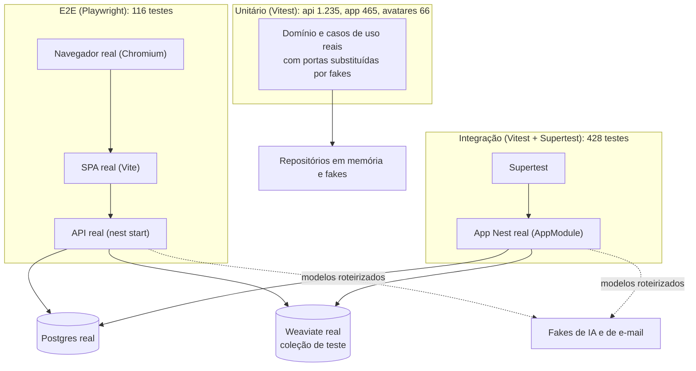

# TESTING.md — Como os testes funcionam e como a arquitetura é exercitada

> **Público:** quem avalia a estratégia de testes e quem vai escrever testes novos.
> **Verificado contra o código em:** 2026-11-18 (`apps/api/test/`, `apps/api/vitest*.mts`, `e2e/`, `playwright.config.ts`).
> **Leitura relacionada:** `QUALITY.md` (números, cobertura e evidências), `OBSERVABILITY.md` (o que é medido e como se testa), `QA.md` (gates e o registro de cada verificação), `EXPERTS.md` (o agente que os testes exercitam).

`QUALITY.md` mostra **quanto** se testa. Este documento mostra **como**: que peças da arquitetura cada camada de teste usa de verdade e quais substitui, como o ambiente é montado, e como as interações entre os componentes (navegador, API, banco, índice vetorial, modelos de IA, telemetria) são verificadas.

## 1. O princípio: quanto mais alto o teste, mais componentes reais

### 1.1 Quem é real e quem é substituído, por camada

| Componente da arquitetura        | Unitário                       | Integração                                                  | E2E                                               | Produção                 |
| -------------------------------- | ------------------------------ | ----------------------------------------------------------- | ------------------------------------------------- | ------------------------ |
| SPA (React)                      | Testing Library, `fetch` falso | —                                                           | **Real** (Vite) em Chromium real                  | Real                     |
| API HTTP (Nest, guards, filtros) | —                              | **Real** (`AppModule` + Supertest, sem porta)               | **Real** (`bun run dev`, porta própria)           | Real                     |
| Domínio e casos de uso           | **Reais**                      | Reais                                                       | Reais                                             | Reais                    |
| Postgres                         | Repositório em memória         | **Real** (banco local, migrations aplicadas)                | **Real**                                          | Real                     |
| Weaviate (índice vetorial)       | `InMemoryKnowledgeIndex`       | **Real**, em coleção própria (`KnowledgeChunkTest`)         | **Real**, mesma coleção de teste                  | Real (`KnowledgeChunk`)  |
| OpenAI: chat                     | Modelo falso do teste          | `ScriptedChatModel` (`NODE_ENV=test`)                       | `ScriptedChatModel`                               | `gpt-4o-mini`            |
| OpenAI: embeddings               | `FakeEmbeddingsGenerator`      | `FakeEmbeddingsGenerator`                                   | `FakeEmbeddingsGenerator`                         | `text-embedding-3-small` |
| OpenAI: visão                    | Descritor falso                | Descritor falso por `NODE_ENV=test`                         | Descritor falso                                   | `gpt-4o-mini`            |
| Gemini (áudio e vídeo)           | Cliente falso                  | Cliente falso por `NODE_ENV=test`                           | Cliente falso                                     | Gemini                   |
| Internet (links)                 | Resolvedor e transporte falsos | Web roteirizada em memória; **proteção SSRF real**          | Web roteirizada em memória; proteção SSRF real    | Internet pública         |
| E-mail                           | —                              | Provedor `capture` (memória)                                | Provedor `capture`, lido por um endpoint de teste | Mailtrap (dev) ou Resend |
| Telemetria (OpenTelemetry)       | Gravador em memória            | Gravador em memória; SDK real só no teste do coletor parado | SDK desligado (`OTEL_SDK_DISABLED=true`)          | SDK + Collector          |
| Relógio                          | Injetado (`now`)               | Real, ou injetado no serviço                                | Real                                              | Real                     |

A regra de ouro: **o que é código nosso roda de verdade em todas as camadas; só o que é de terceiros (modelos de IA, internet, provedor de e-mail) é substituído**, e nunca é substituído onde o teste quer provar justamente a integração (banco, Weaviate e HTTP são reais nas camadas de cima).

## 2. Como o ambiente de teste é montado

### 2.1 Um único interruptor: `NODE_ENV=test`

O código escolhe os adaptadores por configuração, não por `if` espalhado. Em `NODE_ENV=test`, cada módulo troca o adaptador de terceiros por um offline:

| Módulo        | O que muda em `test`                                             | Onde está a escolha                                                    |
| ------------- | ---------------------------------------------------------------- | ---------------------------------------------------------------------- |
| `email`       | provedor `capture` em vez de Mailtrap (dev) ou Resend (produção) | `modules/email/domain/email-config.ts`                                 |
| `experts`     | `ScriptedChatModel` em vez de `ChatOpenAI`                       | `modules/experts/domain/expert-chat-config.ts`                         |
| `knowledge`   | `FakeEmbeddingsGenerator` em vez de embeddings da OpenAI         | `modules/knowledge/knowledge.module.ts`                                |
| `connections` | descritor de imagem, cliente de mídia e web roteirizados         | `modules/connections/connections.module.ts`, `domain/vision-config.ts` |

**`production` nunca usa os fakes** (há teste para isso), e o mesmo padrão já existia desde o e-mail `capture` (ADR `0017`), reaproveitado pela IA (ADR `0021`).

### 2.2 O que o setup de cada camada faz

- **Unitário:** nenhum serviço externo. Cada teste monta o caso de uso com portas em memória (`apps/api/test/support/in-memory-*.ts`, `InMemoryKnowledgeIndex`).
- **Integração** (`vitest.integration.config.mts`): um `globalSetup` verifica antes de qualquer teste que o Postgres local está de pé **e migrado**; se não, falha com a instrução do que rodar (`bun run infra:up` e `bun run db:migrate`) em vez de um erro obscuro. `setup-env.ts` fixa o ambiente (`NODE_ENV=test`, `OTEL_SDK_DISABLED=true`, `LOG_LEVEL=silent`, segredo JWT de teste, URL e chave do Weaviate de desenvolvimento). `fileParallelism: false`: os arquivos rodam em série porque dividem o mesmo banco e o mesmo limite de requisições em memória.
- **E2E** (`playwright.config.ts`): sobe **duas** aplicações de verdade, o Vite do app e uma API **nova** (`reuseExistingServer: false`: uma API de desenvolvimento já rodando não tem `NODE_ENV=test` nem o limite de requisições zerado). As portas vêm de `E2E_APP_PORT` e `E2E_API_PORT`, porque as padrão (5173 e 3002) costumam estar ocupadas. A API de E2E escreve numa coleção do Weaviate própria, nunca na do produto.

### 2.3 Dados de teste: criar, isolar e limpar

| Preocupação                       | Como é resolvida                                                                                                                                                                     |
| --------------------------------- | ------------------------------------------------------------------------------------------------------------------------------------------------------------------------------------ |
| Usuários de teste no banco local  | Criados por helpers que inserem direto no banco (`seedConfirmedUser`, `seedSignedInUser`), com e-mail único e prefixo (`e2e-session-…@example.test`)                                 |
| Limpar o banco                    | `globalTeardown` do Playwright apaga por prefixo, **uma vez no fim** (fazer por worker apagaria linhas de testes que ainda rodam em outro worker); sessões e tokens saem por cascata |
| Limpar o Weaviate                 | Cada spec que grava vetores guarda o tenant do usuário e o apaga em `afterAll` (o banco some, mas os vetores ficariam)                                                               |
| Autenticação sem passar pela tela | O teste gera o token de acesso do usuário semeado e o coloca no `localStorage`; o fluxo de login é testado à parte                                                                   |
| Limite de requisições             | Zerado entre testes na integração; no E2E, a API é nova a cada execução                                                                                                              |

## 3. O mesmo requisito, nas três camadas

Uma boa estratégia de testes **não repete** o mesmo teste em cada camada: cada uma prova o que só ela pode provar. Exemplo, o requisito "a resposta mostra as fontes usadas" (spec `0024`):

| Camada     | O que prova                                                                                                                                                                                                                                                                  | Arquivo                                                               |
| ---------- | ---------------------------------------------------------------------------------------------------------------------------------------------------------------------------------------------------------------------------------------------------------------------------- | --------------------------------------------------------------------- |
| Unitário   | A regra: uma citação por fonte e página, ordenada pela melhor similaridade; o prompt escapa o texto do documento; a busca é pulada sem conexão pronta                                                                                                                        | `grounding.spec.ts`, `send-expert-message-grounding.use-case.spec.ts` |
| Integração | O contrato com o mundo real: o SSE traz `citations`; as citações ficam gravadas no Postgres (sem o texto do trecho); o usuário B não recupera trecho do usuário A; documento hostil não vira instrução; com o índice fora do ar a resposta falha com `KNOWLEDGE_UNAVAILABLE` | `apps/api/test/experts-grounded-answers.int-spec.ts` (20 testes)      |
| E2E        | A experiência: a pessoa anexa um arquivo, pergunta, vê o bloco **Sources**, recarrega a página e as fontes continuam lá; nos dois temas, sem violação do `axe`                                                                                                               | `e2e/experts-grounded-answers.spec.ts`                                |

## 4. Anatomia de um teste de integração (passo a passo)

O teste de integração das respostas ancoradas, em linguagem natural:

1. **Monta o app real:** `Test.createTestingModule({ imports: [AppModule] })`, com `configureApp` (o mesmo prefixo, filtros e validação de produção). Substitui só o que o teste precisa controlar (por exemplo, o recuperador de fontes ou um modelo que falha com um status de provedor).
2. **Cria um usuário** confirmado no Postgres e emite o token de sessão pelo mesmo `SessionService` de produção.
3. **Conecta um arquivo** pela API de verdade (`POST /api/v1/connections` com Supertest) e espera ficar `ready`; os trechos vão para o Weaviate real, na coleção de teste.
4. **Faz a pergunta** (`POST /api/v1/experts/:id/messages`) e lê o **SSE** com um _parser_ próprio (`support/sse.ts`), que devolve a lista de eventos `delta`, `citations` e `done`.
5. **Confere** o que importa: eventos, citações, o que ficou no Postgres e, em outro teste, o que **não** pode aparecer em lugar nenhum (valor sentinela em logs, spans e métricas).

Para provocar falhas e lentidão **de forma determinística**, o modelo roteirizado reage a marcadores na própria pergunta: `[fail]` faz o modelo falhar e `[slow]` o faz demorar (`scripted-chat-model.ts`). Assim o teste exercita os caminhos de erro do produto (repetição antes do primeiro token, abort, evento `error`) sem depender da sorte nem da internet.

## 5. Testes de contrato: o fake e o real obedecem ao mesmo contrato

Quando um componente é substituído por um fake, o risco é o fake mentir. Para o índice vetorial, o projeto resolve com **um só conjunto de testes de contrato** (`test/support/knowledge-index-contract.ts`: gravar, buscar, isolar por tenant, apagar, idempotência) que roda **duas vezes**: contra o `InMemoryKnowledgeIndex` (teste unitário, rápido) e contra o **Weaviate real** (`knowledge-weaviate.int-spec.ts`). Se o fake se afastar do real, um dos dois quebra.

## 6. Testando a observabilidade

Resumo (o mecanismo completo está em `OBSERVABILITY.md` §9):

- um **gravador em memória** (`test/support/telemetry.ts`) substitui o SDK e o Collector, e o teste lê valor, rótulos e faixas de cada métrica e o formato de cada span;
- o **valor sentinela** injetado no conteúdo prova que nada sensível chega a log, span ou métrica;
- o teste de **ativos do Grafana** compara as séries que os painéis consultam com as que o código realmente declara;
- o teste do **coletor parado** liga o SDK real e exige que a API continue respondendo.

## 7. Lições de testes que quebraram (e o que mudou)

Estas falhas aconteceram de verdade durante o desenvolvimento; cada uma virou uma prática:

| O que quebrou                                                                       | Causa                                                                                            | Prática que ficou                                                                                                                  |
| ----------------------------------------------------------------------------------- | ------------------------------------------------------------------------------------------------ | ---------------------------------------------------------------------------------------------------------------------------------- |
| 12 testes de anexos falharam após juntar duas specs                                 | O compositor fica desabilitado (e é refeito) até a conversa carregar; o teste interagia antes    | Todo teste da home **aguarda o compositor habilitar** antes de interagir (`openHome`)                                              |
| O teste de interrupção do CLI de avatares travava sob carga                         | O _abort_ disparava antes de o fake registrar o ouvinte; um sinal já abortado não emite de novo  | O fake trata `signal.aborted` antes de escutar; specs que sobem processo filho têm timeout de 30 s                                 |
| 3 testes de sessão falhavam por data (por dois dias foram tratados como "baseline") | O teste fixava `2026-11-09`, mas o JWT era verificado pelo relógio da máquina                    | A expiração é julgada pelo relógio injetado, com teste de regressão; **baseline não é desculpa**                                   |
| A API não subia com `WEAVIATE_URL` no `.env`, e nenhum teste percebeu               | Os testes colocam as variáveis direto em `process.env`; o caminho real passa pelo `ConfigModule` | `loadEnvironment` mantém as variáveis cruas, com teste. **Lição:** testar o caminho de configuração real, não só o atalho de teste |
| O E2E de mídia derrubava outros testes com `429`                                    | As cotas por IP (20 envios/10 min, 20 mensagens/min) são compartilhadas pela suíte inteira       | O teste **semeia dados no banco** em vez de enviar arquivo e mensagem; nada de envio extra                                         |
| Um teste de fronteira da 0022 proibia LangChain fora do módulo `knowledge`          | Cada spec passava sozinha; o conflito só apareceu na integração das duas                         | Gate de testes **na integração**, não só por spec; o teste agora distingue Weaviate de LangChain                                   |

## 8. Como escrever um teste novo (checklist)

1. **Escolha a camada pelo que quer provar:** regra de negócio → unitário; contrato HTTP, banco ou índice → integração; jornada do usuário e acessibilidade → E2E.
2. **Não chame provedor real.** Use o interruptor `NODE_ENV=test` ou uma porta com fake.
3. **Se criar um fake, escreva (ou reuse) um teste de contrato** que o ligue ao adaptador real.
4. **Se o dado é sensível, acrescente o sentinela:** injete um valor reconhecível e afirme que ele não aparece em log, span nem métrica.
5. **Crie e limpe o seu dado:** e-mail único com o prefixo da suíte; apague o tenant do Weaviate em `afterAll`.
6. **Na home, aguarde o compositor habilitar** e não envie mensagens ou arquivos além do necessário (as cotas são compartilhadas).
7. **Acessibilidade:** telas novas entram no `axe` nos dois temas (`e2e/a11y.spec.ts`).
8. Rode a camada, depois `bun run test:coverage`: os pisos de cobertura falham em queda real.

## 9. Gates e CI

| Onde roda                                     | O que roda                                                                                                                                                        |
| --------------------------------------------- | ----------------------------------------------------------------------------------------------------------------------------------------------------------------- |
| Local (hook de commit)                        | OXLint e OXFmt nos arquivos alterados                                                                                                                             |
| Local (antes de integrar)                     | `lint`, `check-types`, `build`, `test`, `test:integration`, `test:e2e` (a ordem está em `QA.md` §3)                                                               |
| **CI no GitHub** (`.github/workflows/ci.yml`) | `lint`, `check-types`, `build` e `test:coverage` (unitários com piso de cobertura). **Executado com sucesso no PR #14** (job "Lint, types, build and unit tests") |
| Ainda só local                                | Integração e E2E: exigem Docker (Postgres e Weaviate)                                                                                                             |
