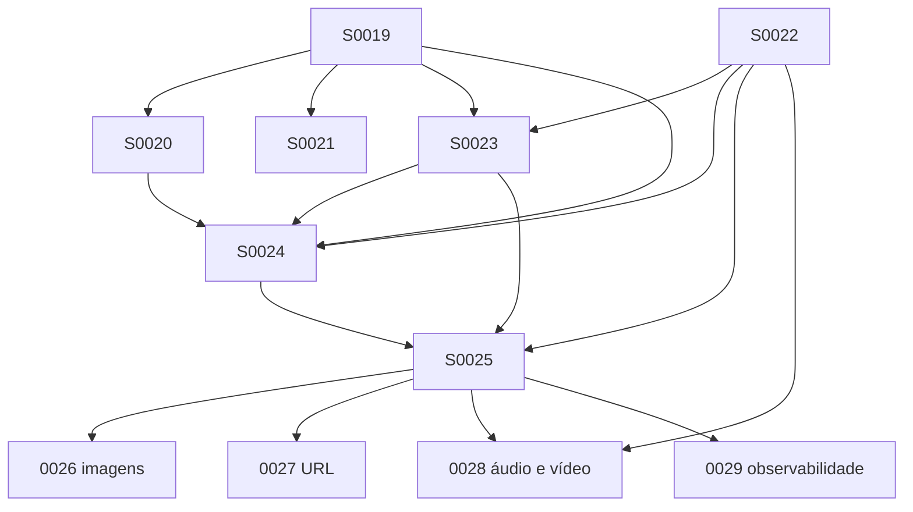

# Breakdown — Experts de futebol com chat, conexões e RAG local

- **Épico:** experts
- **Data:** 2026-11-17
- **Status:** specs criadas (fase 1: 0019 a 0025; fase 2: 0026 a 0029; todas refinadas em 2026-11-17 e prontas)
- **Prompt original:** "Precisamos agora trabalhar na criação dos agentes especialistas. Vamos começar com um Head Coach (ele poderia ter os trejeitos do Vanderlei Luxemburgo), Analista de Desempenho, Jurídico Esportivo, Fisiologista, Médico Esportista, Fisioterapeuta, Gerente de Futebol." A home é "bem simples": uma barra no rodapé com dropdown de expert, textarea de prompt e um botão flutuante para adicionar conexões. Conexões "via arquivos: PDF, TXT, Markdown, Imagem (jpg, jpeg, png), vídeos (mp4), áudio (mp3), link de URL externa". Manter o user profile para logout. "Sempre que utilizarmos um conector, precisamos verificar se é uma conexão existente"; se existe, segue ao modelo; senão extrai chunks, cria embeddings e insere no banco de vetor e no banco relacional para deduplicação. Cada expert com perguntas sugeridas que enviam o prompt ao clicar e uma imagem de perfil 8-bit de um personagem fictício. Respostas em formato de chat. Stack LangChain (LangChain.js, LangGraph, LangSmith Deployment/Evaluation/Observability/Studio), Weaviate, Document Loaders + DirectoryLoaders, `gpt-4o-mini`, `gpt-image-2`, Gemini + `gemini-omni-flash`. "É de extrema importância que tudo rode local via Docker", exceto as chamadas à OpenAI e ao Gemini.

## 1. Objetivo

Entregar os 7 experts como um chat simples em `/app`, com histórico, avatares 8-bit e respostas ancoradas em arquivos que o usuário conecta (PDF, TXT, Markdown na fase 1), com deduplicação por conteúdo, índice vetorial Weaviate local e exclusão completa dos dados. A fase 2 acrescenta imagem, URL, áudio, vídeo e observabilidade do agente. Cada spec entrega uma capacidade verificável sozinha e é implementada com `implement-me`, uma por vez.

## 2. Decisões compartilhadas

| Decisão                         | Valor                                                                                                                                                                                                                  | Origem (usuário / premissa)                                 |
| ------------------------------- | ---------------------------------------------------------------------------------------------------------------------------------------------------------------------------------------------------------------------- | ----------------------------------------------------------- |
| Experts                         | 7 fixos, definidos em código (`head-coach`, `performance-analyst`, `sports-lawyer`, `physiologist`, `sports-physician`, `physiotherapist`, `football-manager`); sem edição pelo usuário                                  | usuário (lista); premissa (ids e catálogo em código)        |
| Isolamento                      | Por usuário; clube e workspace fora do escopo                                                                                                                                                                          | premissa (herdada do épico de auth)                         |
| Escopo de uma conexão           | Base do **usuário**, válida para **todos** os experts; um anexo na mensagem restringe a busca àquele arquivo                                                                                                           | usuário (quiz)                                              |
| Dedup                           | Por usuário e por conteúdo (SHA-256 dos bytes); nome não entra na identidade; a exclusão remove também a identidade                                                                                                    | usuário (fluxo pedido); premissa (por usuário, por bytes)   |
| Arquivo original                | Não é guardado; só chunks e metadados                                                                                                                                                                                  | premissa                                                    |
| Dados de saúde e LGPD           | Exclusão completa (individual e total), nenhum conteúdo, nome de arquivo ou hash em logs, spans ou métricas, aviso de privacidade antes do primeiro envio                                                               | usuário (quiz)                                              |
| Agentes                         | LangChain.js + LangGraph.js como **biblioteca dentro de `apps/api`** (módulo `experts`); sem LangGraph Platform/Deployment                                                                                              | usuário (quiz: LangGraph local); premissa (forma de rodar)  |
| LangSmith                       | **Não** obrigatório e não self-hosted (exige licença Enterprise). Traces por OpenTelemetry no Grafana existente (fase 2); LangSmith SaaS, Evaluation e Studio só como opt-in por variável de ambiente, desligados (backlog) | usuário (quiz)                                              |
| Modelo de chat                  | `gpt-4o-mini` via `@langchain/openai`                                                                                                                                                                                  | usuário                                                     |
| Embeddings                      | `text-embedding-3-small` (1.536 dimensões), calculados pela aplicação                                                                                                                                                  | premissa                                                    |
| Banco vetorial                  | Weaviate no Docker Compose, versão fixada, portas só em `127.0.0.1`, chave de API, um tenant por usuário, sem módulos vetorizadores                                                                                    | usuário (Weaviate); premissa (tenant, segurança)            |
| Carregamento de arquivos        | Document Loaders e `DirectoryLoader` do LangChain.js sobre diretório temporário apagado ao fim                                                                                                                         | usuário                                                     |
| Áudio e vídeo (fase 2)          | Modelo Gemini de **entendimento** multimodal lê MP4 e MP3. O `gemini-omni-flash` **gera e edita** vídeo (3 a 10 s) e não serve para ler arquivos                                                                       | usuário (quiz); fato conferido na documentação do Google    |
| `gpt-image-2`                   | Só para os 7 avatares, gerados **uma vez** por script manual e commitados como assets; sem geração de imagem ou vídeo no chat                                                                                          | usuário (quiz)                                              |
| Persona do Head Coach           | Personagem fictício inspirado no estilo de um técnico veterano brasileiro; sem nome, imagem ou citação de pessoa real                                                                                                  | usuário (pediu os trejeitos); premissa (guardrails)         |
| Idioma                          | Interface em en-US (`DEVELOPMENT.md` §13.3); perguntas sugeridas e respostas dos experts em pt-BR, no idioma da mensagem do usuário                                                                                    | premissa                                                    |
| Respostas                       | Streaming por SSE, formato de chat; citações montadas pelo servidor; declaração de lacuna quando não há fonte (`BUSINESS.md` §10)                                                                                       | usuário (chat); premissa (regras de §10)                    |
| Aviso de saúde e jurídico       | Texto fixo sob o textarea nos 4 experts afetados; as respostas não substituem profissional                                                                                                                             | premissa                                                    |
| Docker                          | Tudo que o épico acrescenta roda local; o único tráfego externo é OpenAI e (fase 2) Gemini. A API e o app seguem rodando no host (`bun run dev`), como hoje; só os serviços de apoio ficam no Compose                  | usuário; premissa (leitura de "local via Docker")           |
| Testes                          | Nenhum teste automatizado chama OpenAI ou Gemini (portas com fakes); a validação com modelo real é manual e registrada em `QA.md`                                                                                      | premissa                                                    |
| Acesso a dados                  | `pg` com `rondo_app` (só DML); tabelas novas por migration com `rondo_migrator`; nada de DDL em runtime                                                                                                                | premissa (herdada do ADR `0015`)                            |
| Limite de requisições | **Por IP**, pelo mecanismo existente (ADR `0005`), com políticas novas `expert-message`, `connection-upload` e `connection-url`; o limitador roda antes da autenticação e não enxerga o usuário. Limite por usuário fica no backlog | usuário (refinamento da 0019, 2026-11-17) |
| Testes e adaptadores falsos | Unit e integração com fakes por porta; o E2E sobe a API real e usa adaptadores falsos (modelo de chat, embeddings, visão, Gemini, busca de URL) selecionados por `NODE_ENV=test`, como o e-mail `capture` (ADR `0017`); `production` nunca os usa | premissa |
| Avatar dos experts | Resolvido no **app** pelo `id` do expert (PNGs importados pelo Vite); `GET /api/v1/experts` não devolve avatar | usuário (refinamento da 0019 e da 0021, 2026-11-17) |
| ADR | Cada spec que adiciona tecnologia, modelo de dados ou contrato registra o ADR como requisito `Must` (`RULES.md` §5) | usuário (refinamento da 0019, 2026-11-17) |

## 3. Specs (ordem de implementação)

### Fase 1 (specs criadas)

| Ordem | Spec                                                                                    | Capacidade                                                                                                                                | Depende de             | Paralelo com | Tamanho | Status   |
| ----- | --------------------------------------------------------------------------------------- | ----------------------------------------------------------------------------------------------------------------------------------------- | ---------------------- | ------------ | ------- | -------- |
| 0019  | [`0019-experts-chat-home`](../.specs/0019-experts-chat-home.md)                         | **Esqueleto ambulante.** Catálogo dos 7 experts, home de chat com barra no rodapé, sugestões, streaming com LangGraph e `gpt-4o-mini`, logout mantido | —                      | —            | G       | concluída |
| 0020  | [`0020-experts-chat-history`](../.specs/0020-experts-chat-history.md)                   | Conversa persistida por usuário e expert, recarga, limpar conversa; o servidor passa a guardar o histórico                                | 0019                   | 0021, 0022   | M       | concluída |
| 0021  | [`0021-experts-avatars-pixel-art`](../.specs/0021-experts-avatars-pixel-art.md)         | 7 avatares 8-bit gerados com `gpt-image-2` por script manual, commitados como assets e usados na interface                                | 0019                   | 0020, 0022   | M       | concluída |
| 0022  | [`0022-rag-weaviate-foundation`](../.specs/0022-rag-weaviate-foundation.md)             | **Habilitadora.** Weaviate local no Compose, índice com tenant por usuário, embeddings, erros e telemetria sem conteúdo                    | —                      | 0020, 0021   | M       | concluída |
| 0023  | [`0023-connections-text-files`](../.specs/0023-connections-text-files.md)               | Botão flutuante, upload de PDF, TXT e MD, dedup por conteúdo, pipeline com Document Loaders, chunks, embeddings e índice                    | 0019, 0022             | —            | G       | concluída |
| 0024  | [`0024-experts-grounded-answers`](../.specs/0024-experts-grounded-answers.md)           | Recuperação no grafo, respostas ancoradas, citações do servidor, regra de lacuna, defesa contra instruções em documentos                  | 0019, 0020, 0022, 0023 | —            | G       | concluída |
| 0025  | [`0025-connections-manage`](../.specs/0025-connections-manage.md)                       | Listar conexões, excluir uma ou todas (vetores, linha e dedup), citações "Source removed"                                                 | 0022, 0023, 0024       | —            | M       | concluída |

**Sobre paralelismo:** pelas dependências, 0020, 0021 e 0022 poderiam andar juntas depois da 0019 (a 0022 nem depende dela). Elas tocam arquivos em comum (`modules/experts`, home do app, `docker-compose.yml`, `.env.example`, docs), então **implemente uma por vez, na ordem acima**. **0023 e 0024 devem ser implementadas em sequência:** entre as duas o arquivo fica indexado, mas o expert ainda não o usa.

**Por que a 0022 é habilitadora:** o índice, o tenant por usuário e os embeddings servem a 0023, 0024, 0025 e a todas as specs de conexão da fase 2. Dentro da 0023 esconderiam a decisão de isolamento e prenderiam as demais a um fluxo de upload.

**Tamanho G em 0019, 0023 e 0024:** cada uma tem uma só capacidade, mas atravessa UI, API e uma integração (LLM, índice). Se o `implement-me` mostrar que estouram uma execução, o corte natural é: 0019 → catálogo e home / envio com streaming; 0023 → upload e dedup / processamento; 0024 → recuperação / citações e lacuna. Isso volta a este mapa antes de implementar.

### Fase 2 (specs criadas)

Reaproveitam o pipeline da 0023 (uma porta de extrator por tipo), a busca da 0024 e a listagem e exclusão da 0025.

| Ordem | Spec | Capacidade | Depende de | Paralelo com | Tamanho | Status |
| ----- | ---- | ---------- | ---------- | ------------ | ------- | ------ |
| 0026 | [`0026-connections-images`](../.specs/0026-connections-images.md) | JPG, JPEG e PNG: visão do `gpt-4o-mini` transcreve e descreve, o texto entra no pipeline, mesmo dedup, citação e exclusão | 0023, 0024, 0025 | 0027, 0028, 0029 | P | concluída |
| 0027 | [`0027-connections-url`](../.specs/0027-connections-url.md) | Link de URL externa: busca protegida contra **SSRF**, extração de HTML, PDF e texto, dedup pela URL canônica e pelo conteúdo, segredos de URL nunca guardados | 0023, 0024, 0025 | 0026, 0028, 0029 | G | concluída |
| 0028 | [`0028-connections-audio-video`](../.specs/0028-connections-audio-video.md) | MP3 e MP4 por modelo Gemini de entendimento, processamento assíncrono, citação com `mm:ss`, arquivo apagado no provedor | 0022, 0023, 0024, 0025 | 0026, 0027, 0029 | G | concluída |
| 0029 | [`0029-experts-agent-observability`](../.specs/0029-experts-agent-observability.md) | Spans por nó do LangGraph, métricas de latência, primeiro token e tokens, dashboard e alertas no Grafana, trava do tracing do LangSmith | 0019, 0022, 0023, 0024, 0025 | 0026, 0027, 0028 | M | concluída |

**Sobre paralelismo:** as quatro dependem só da fase 1 e poderiam andar juntas, mas tocam os mesmos arquivos (`modules/connections`, seletor e chip da interface, esquema do índice, `.env.example`, docs). **Implemente uma por vez.** Ordem sugerida: **0026 → 0027 → 0028 → 0029**; a 0029 por último completa os sinais com as ingestões de todos os tipos e a chamada ao Gemini.

**Pontos de contato com a fase 1:** a 0028 acrescenta `startSeconds` (propriedade opcional) ao esquema do índice da 0022 e à citação da 0024; a 0027 acrescenta o hash da URL e o nome de exibição à tabela `connections` da 0023 e o endpoint `POST /api/v1/connections/url`; a 0029 consome os sinais definidos nas 0019, 0022 a 0025.

## 4. Dependências

Ordem de implementação: 0019 → 0020 → 0021 → 0022 → 0023 → 0024 → 0025 → 0026 → 0027 → 0028 → 0029. Sem ciclos: toda dependência aponta para número menor.

## 5. Rastreabilidade do prompt

| Item do prompt                                                                         | Spec                                                                                         |
| -------------------------------------------------------------------------------------- | -------------------------------------------------------------------------------------------- |
| 7 experts (Head Coach com trejeitos, Analista, Jurídico, Fisiologista, Médico, Fisioterapeuta, Gerente de Futebol) | 0019 (catálogo e persona)                                                    |
| Home simples: barra no rodapé com dropdown de expert e textarea de prompt              | 0019                                                                                         |
| Botão flutuante para adicionar conexões                                                | 0023 (botão e upload), 0025 (painel de gestão)                                               |
| Conexões PDF, TXT e Markdown                                                           | 0023                                                                                         |
| Conexões de imagem (jpg, jpeg, png)                                                    | 0026                                                                         |
| Conexões de URL externa                                                                | 0027                                                                         |
| Conexões de vídeo (mp4) e áudio (mp3)                                                  | 0028                                                                         |
| Manter o user profile para logout                                                      | 0019 (cabeçalho com tema e `Sign out` preservados; não existe componente de perfil à parte hoje) |
| Verificar conexão existente; se sim segue ao modelo; senão chunks, embeddings, banco vetorial e banco relacional para dedup | 0023 (dedup e ingestão), 0024 (seguir ao modelo com a conexão existente)     |
| Perguntas sugeridas que enviam o prompt ao clicar                                      | 0019                                                                                         |
| Imagem de perfil 8-bit com personagem fictício                                         | 0019 (personagem e fallback), 0021 (imagens)                                                 |
| Experts respondem em formato de chat                                                   | 0019 (chat e streaming), 0020 (histórico)                                                    |
| LangChain.js                                                                           | 0019, 0022, 0023, 0024                                                                       |
| LangGraph                                                                              | 0019 (grafo do expert), 0024 (nó de recuperação)                                             |
| LangSmith Observability                                                                | Substituída por OpenTelemetry no Grafana: 0029 (que também trava o tracing automático do LangSmith); LangSmith SaaS opt-in no backlog     |
| LangSmith Deployment, Evaluation e Studio                                              | Backlog (exigem licença Enterprise ou serviço em nuvem; ver §6)                              |
| Banco de dados vetorial Weaviate                                                       | 0022                                                                                         |
| Document Loaders e DirectoryLoaders do LangChain.js                                    | 0023                                                                                         |
| Modelo base `gpt-4o-mini`                                                              | 0019 (chat), 0026 (visão)                                                            |
| Modelo de imagens `gpt-image-2`                                                        | 0021 (só avatares)                                                                           |
| Modelo de vídeo Gemini + `gemini-omni-flash`                                           | Gemini de entendimento: 0028; `gemini-omni-flash` (geração) fica no backlog          |
| Tudo local via Docker, exceto OpenAI e Gemini                                          | 0022 (Weaviate no Compose) e a decisão compartilhada de Docker; todas as specs              |
| "Tudo via LangChain instalado e configurado localmente com Docker"                     | 0019 (biblioteca na API) e 0022; plataformas LangSmith/Deployment ficam fora (ver §6)        |
| Embeddings (não citado; necessário ao RAG, escolha do assistente)                      | 0022 (`text-embedding-3-small`)                                                              |

## 6. Backlog (candidatas não criadas)

| Candidata                                                       | Por que ficou de fora                                                                                                                                                                                                | Quem decide        |
| --------------------------------------------------------------- | -------------------------------------------------------------------------------------------------------------------------------------------------------------------------------------------------------------------- | ------------------ |
| LangSmith self-hosted (Deployment, Evaluation, Observability, Studio) | Exige plano Enterprise e `LANGSMITH_LICENSE_KEY`, obtida com vendas; contradiz "tudo local via Docker" sem a licença.                                                                                         | Produto/Eng.       |
| LangSmith SaaS opt-in (traces, Evaluation, Studio)              | Terceira exceção ao "só OpenAI e Gemini fora" e envia prompts a um terceiro; seria uma variável de ambiente desligada por padrão.                                                                                    | Produto            |
| LangGraph Studio local (`langgraphjs dev`)                      | O CLI pede chave do LangSmith e o Studio é uma interface hospedada; sem decisão sobre o LangSmith fica fora.                                                                                                         | Eng.               |
| Avaliação offline dos experts (dataset, LLM-as-judge)           | Sem LangSmith Evaluation, vira spec própria com Vitest e dataset local; depende de 0024 e de critérios do Produto.                                                                                                   | Produto/Eng.       |
| Geração de imagem e vídeo nas respostas (`gpt-image-2`, `gemini-omni-flash`) | O usuário escolheu usar `gpt-image-2` só para os avatares; geração no chat exige custo, limites, armazenamento e exibição de mídia.                                                                      | Produto            |
| Conectores com OAuth (Google Drive, Notion, Jira, Confluence)   | Não pedidos; `BUSINESS.md` §5 os prevê para depois.                                                                                                                                                                  | Produto            |
| Exclusão de conta do usuário (cascata de conversas, sessões e conexões) | Não existe hoje; necessária para atender titulares de dados de saúde sem o fluxo manual da 0025 e da 0020.                                                                                               | Produto/Jurídico   |
| Expiração automática de conversas e conexões                    | Retenção indefinida é a premissa; a LGPD pode exigir prazo (pergunta aberta nas 0020 e 0025).                                                                                                                        | Jurídico           |
| Várias conversas por expert, busca no histórico, exportação     | Não pedidas; a 0020 usa uma conversa por par (usuário, expert).                                                                                                                                                      | Produto            |
| OCR de PDF escaneado, planilhas e documentos Office             | Não pedidos; PDF sem texto vira `failed` na 0023.                                                                                                                                                                    | Produto            |
| Busca híbrida, reranking e agentes com ferramentas              | Otimização posterior à primeira medição de qualidade da 0024.                                                                                                                                                        | Eng.               |
| Rodar a API e o app também dentro do Docker                     | Hoje só os serviços de apoio estão no Compose; mudar o modo de execução do app é decisão de infra, não deste épico.                                                                                                  | Eng.               |
| Escala horizontal (trava de conversa e limite de requisições compartilhados) | Aceito instância única, como nas specs `0003` e `0020`; Redis é backlog.                                                                                                                                 | Eng.               |

## 7. Perguntas abertas

| Pergunta                                                                                                                                                           | Impacto                                                         | Bloqueante? | Quem decide        |
| ------------------------------------------------------------------------------------------------------------------------------------------------------------------ | --------------------------------------------------------------- | ----------- | ------------------ |
| Os textos aprovados dos avisos de saúde e jurídico e do aviso de privacidade precisam passar pelo Jurídico antes de produção? (0019, 0023)                          | Texto da interface.                                             | Não         | Jurídico           |
| A LGPD exige registrar o aceite do aviso de privacidade no servidor e uma expiração automática para dados de saúde? (0020, 0023)                                    | Nova tabela, job de limpeza e texto de privacidade.             | Não         | Jurídico           |
| Excluir uma conexão deve apagar também as respostas do histórico que a citaram? (0025)                                                                              | Regra de cascata entre conexões e mensagens.                    | Não         | Jurídico           |
| Qual modelo Gemini de entendimento será usado para MP3 e MP4, e quais os limites de duração e tamanho? (0028)                                               | Custo, tempo de processamento e chave do Gemini.                | Não         | Produto/Eng.      |
| Produto aprova ou ajusta os nomes dos personagens fictícios, as perguntas sugeridas e as fichas dos avatares? (0019, 0021)                                          | Identidade dos experts.                                         | Não         | Produto/Design     |
| Sem fonte relevante, o expert pode dar orientação geral marcada como "sem fonte" ou deve recusar? (0024)                                                            | Utilidade versus rigor de `BUSINESS.md` §10.                    | Não         | Produto            |
| O Produto quer pedir a licença Enterprise do LangSmith no futuro (para voltar a Evaluation e Studio self-hosted)?                                                   | Reabre as decisões de observabilidade e avaliação.              | Não         | Produto            |
