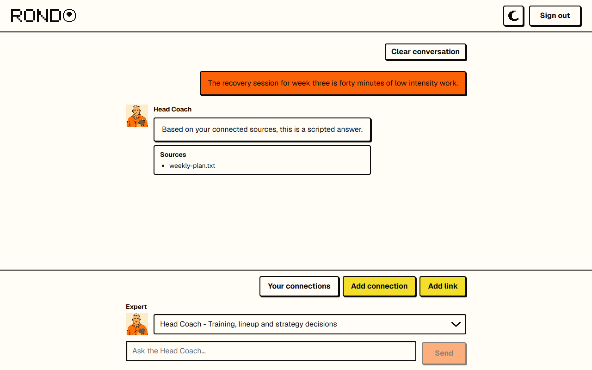
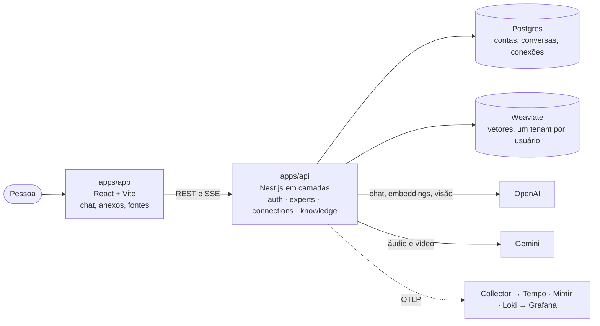

# Rondo

Plataforma para conversar com _experts_: agentes de IA especializados em funções de um clube de futebol (Head Coach, Performance Analyst, Sports Lawyer, Physiologist, Sports Physician, Physiotherapist e Football Manager). Eles respondem **a partir das fontes que a própria pessoa conecta** (PDF, TXT, Markdown, imagens, links, áudio e vídeo), com **respostas rastreáveis às fontes** e declarando a lacuna quando nenhuma fonte cobre a pergunta.



> **Estado (2026-11-18):** o produto funciona de ponta a ponta: autenticação completa, chat com sete experts, histórico, conexões de cinco tipos de fonte, observabilidade dos agentes e identidade visual retro 8-bit. O que ainda não existe está em [`.docs/ARCHITECTURE.md`](.docs/ARCHITECTURE.md) §6.

## Guia para quem avalia

Cada critério de avaliação tem um documento com evidência verificável:

| Critério                                                                                                                                         | Onde está a evidência                                                                                                                                                                                                     |
| ------------------------------------------------------------------------------------------------------------------------------------------------ | ------------------------------------------------------------------------------------------------------------------------------------------------------------------------------------------------------------------------- |
| **Aplicação funcional**                                                                                                                          | Rode o [Começando](#começando) e abra `http://localhost:5173`; capturas em [`.docs/HOME.md`](.docs/HOME.md) §5                                                                                                            |
| **IA no produto** (agentes)                                                                                                                      | [`.docs/EXPERTS.md`](.docs/EXPERTS.md): o que é cada expert, o grafo, a busca nas fontes, citações e como cada funcionalidade se liga ao agente                                                                           |
| **Arquitetura e componentes**                                                                                                                    | Diagrama abaixo e [`.docs/EXPERTS.md`](.docs/EXPERTS.md) §2 e §3; contratos em [`.docs/ARCHITECTURE.md`](.docs/ARCHITECTURE.md)                                                                                           |
| **Qualidade: testes**                                                                                                                            | [`.docs/QUALITY.md`](.docs/QUALITY.md) (2.310 testes, cobertura com piso) e [`.docs/TESTING.md`](.docs/TESTING.md) (como os testes funcionam, o que é real ou substituído em cada camada e como os componentes interagem) |
| **Qualidade: observabilidade**                                                                                                                   | [`.docs/OBSERVABILITY.md`](.docs/OBSERVABILITY.md) (como as métricas, traces e logs são coletados, passo a passo) e [`.docs/QUALITY.md`](.docs/QUALITY.md) §5 (dados e um trace reais do ambiente)                        |
| **Processo e uso da IA**                                                                                                                         | [`.docs/TESTING.md`](.docs/TESTING.md)                                                                                                                                                                                    | Como os testes funcionam e como os componentes da arquitetura interagem |
| [`.docs/OBSERVABILITY.md`](.docs/OBSERVABILITY.md)                                                                                               | Como as métricas, os traces e os logs são coletados                                                                                                                                                                       |
| [`.docs/AI_PROCESS.md`](.docs/AI_PROCESS.md): fluxo de specs e skills, orquestração de agentes, decisões, erros da IA e como o processo os pegou |
| **Desafio: redesign da home**                                                                                                                    | [`.docs/HOME.md`](.docs/HOME.md): três estados da home, decisões do redesign, impacto no produto e capturas antes/depois                                                                                                  |

## Arquitetura em uma imagem



Um _expert_ é uma **persona** (tom, escopo e limites) + um **grafo LangGraph.js** (`retrieve` → `respond`) + o **conhecimento** do usuário (índice vetorial isolado por usuário) + a **memória** da conversa. Detalhes e diagramas de sequência em [`.docs/EXPERTS.md`](.docs/EXPERTS.md).

## Estrutura

| Caminho                        | O que é                                                                | Porta      |
| ------------------------------ | ---------------------------------------------------------------------- | ---------- |
| `apps/app`                     | Cliente de produto (React + Vite)                                      | 5173       |
| `apps/api`                     | API (Nest.js): auth, experts, conexões, conhecimento                   | 3002       |
| `apps/docs`                    | Site de documentação (Next.js)                                         | 3001       |
| `packages/ui`                  | Design system (`@repo/ui`: Tailwind + shadcn, tema retro 8-bit)        | —          |
| `packages/experts-avatars`     | Ferramenta manual dos avatares pixel art dos experts                   | —          |
| `packages/typescript-config`   | tsconfigs compartilhados                                               | —          |
| `db/`                          | Migrations SQL e roles do Postgres local                               | 5432       |
| `docker-compose.yml`, `infra/` | Postgres, Weaviate, Grafana LGTM (Loki, Tempo, Mimir) e OTel Collector | 3000, 8080 |
| `.specs/`, `.plans/`, `.adrs/` | Specs executáveis, planos e decisões de arquitetura                    | —          |

## Começando

Requer Bun 1.4.4, Node.js >= 24 e Docker em execução (para a infra local).

```bash
bun install
cp .env.example .env     # preencha OPENAI_API_KEY para respostas reais; sem ela a API sobe e o envio responde 503
bun run infra:up         # Postgres, Weaviate e Grafana LGTM
bun run db:migrate       # aplica db/migrations (idempotente)
bun run dev
```

As variáveis de IA (`OPENAI_API_KEY`, `GEMINI_API_KEY`) são opcionais para subir o projeto e **não são necessárias para os testes**, que usam modelos falsos. O que só funciona com chave real está listado em [`.docs/EXPERTS.md`](.docs/EXPERTS.md) §7.

## Comandos

| Comando                                          | O que faz                                              |
| ------------------------------------------------ | ------------------------------------------------------ |
| `bun run dev [--filter=app\|api\|docs]`          | Sobe os apps em modo de desenvolvimento                |
| `bun run lint` / `format` / `code:fix`           | OXLint, OXFmt e correção automática                    |
| `bun run check-types`                            | `tsc --noEmit` em todos os workspaces                  |
| `bun run build`                                  | Build de produção                                      |
| `bun run test` / `test:integration` / `test:e2e` | Vitest, Supertest e Playwright                         |
| `bun run test:coverage`                          | Testes unitários com piso de cobertura (o mesmo do CI) |
| `bun run infra:up` / `infra:down`                | Postgres, Weaviate e Grafana LGTM                      |
| `bun run infra:reset`                            | Apaga os volumes e sobe de novo                        |
| `bun run db:migrate`                             | Aplica as migrations de `db/migrations`                |
| `bun run experts:avatars -- --expert <id>`       | Gera um avatar com a Image API (manual, exige chave)   |

Na primeira execução do E2E, rode `bunx playwright install`. Se as portas 5173 e 3002 estiverem ocupadas, use `E2E_APP_PORT` e `E2E_API_PORT`. O CI (`.github/workflows/ci.yml`) roda lint, tipos, build e os testes unitários com cobertura; integração e E2E exigem Docker e rodam localmente. Gates, checklist e o registro de cada verificação estão em [`.docs/QA.md`](.docs/QA.md).

## Documentação

Leia [`.docs/AGENTS.md`](.docs/AGENTS.md) primeiro: é o guia operacional do repositório e indica qual documento ler para cada tarefa.

| Documento                                                 | Assunto                                                           |
| --------------------------------------------------------- | ----------------------------------------------------------------- |
| [`.docs/EXPERTS.md`](.docs/EXPERTS.md)                    | Os agentes especialistas, a arquitetura e a ligação com o produto |
| [`.docs/HOME.md`](.docs/HOME.md)                          | A home: redesign retro 8-bit e o chat, com capturas               |
| [`.docs/QUALITY.md`](.docs/QUALITY.md)                    | Testes, cobertura, observabilidade e evidências reais             |
| [`.docs/AI_PROCESS.md`](.docs/AI_PROCESS.md)              | Como a IA foi usada para construir o projeto                      |
| [`.docs/ARCHITECTURE.md`](.docs/ARCHITECTURE.md)          | Stack, módulos, contratos, decisões e dívidas                     |
| [`.docs/BUSINESS.md`](.docs/BUSINESS.md)                  | Produto, vocabulário e regras de negócio                          |
| [`.docs/DESIGN.md`](.docs/DESIGN.md) e `DESIGN_SYSTEM.md` | Identidade visual e design system                                 |
| [`.docs/DEVELOPMENT.md`](.docs/DEVELOPMENT.md)            | Padrões de código, API, dados e testes                            |
| [`.docs/QA.md`](.docs/QA.md)                              | Gates, checklist e o registro de verificação por spec             |
| `.specs/`, `.plans/`, `.adrs/`                            | 30 specs, 31 planos e 30 decisões de arquitetura                  |
